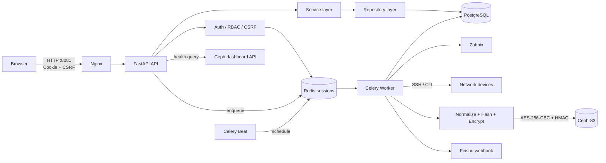

# Laporan Audit Teknis dan Keamanan — Network Backup

**Tanggal audit:** 11 Oktober 2026  
**Mode audit:** read-only; tidak ada deploy, migrasi, perubahan data, atau akses ke isi kredensial  
**Ruang lingkup:** seluruh repository `/opt/network-backup`, dengan fokus pada payload konfigurasi di S3, vault kredensial database, dan manifest repository S3

## 1. Ringkasan Eksekutif

Network Backup memiliki fondasi yang cukup baik: pemisahan API/service/repository/driver jelas, autentikasi memakai sesi server-side dan CSRF, payload S3 memakai AES-256-CBC dengan HMAC terpisah dalam pola encrypt-then-MAC, serta 46 unit test yang tersedia berhasil dijalankan. Implementasi kriptografi juga memverifikasi autentikasi sebelum dekripsi dan menolak fallback plaintext kecuali objek legacy dapat diidentifikasi secara positif.

Namun, sistem **belum layak disebut production-ready**. Dua temuan kritis dapat berdampak langsung pada kemampuan pemulihan:

1. Jalur migrasi dan image deployment tidak dapat membangun skema yang sesuai dengan model aplikasi. Migration `010` tidak membuat dua kolom yang dibutuhkan model, image tidak membawa migration, dan Compose tidak menjalankannya. Database yang sedang aktif hanya bekerja karena sudah mengalami drift di luar migration repository.
2. Inisialisasi repository menulis ulang `repo_manifest.enc` tanpa pemeriksaan keberadaan atau conditional write. Kesalahan operasi admin atau race dapat mengganti master password repository dan membuat seluruh payload lama tidak dapat didekripsi.

Risiko tinggi lain adalah identitas TLS Ceph yang tidak diverifikasi, host key SSH yang tidak diverifikasi, lifecycle retention/retry yang belum benar-benar diterapkan, deduplikasi yang dapat mencatat sukses untuk objek yang hilang/rusak, model multi-repository yang bertabrakan pada unique index global, stored XSS, dan query histori/report yang tidak berbatas.

### Penilaian area

| Area | Skor | Ringkasan |
|---|---:|---|
| Arsitektur | 6/10 | Modular monolith cukup jelas, tetapi kontrak multi-repository dan batas transaksi S3–DB belum kokoh. |
| Kualitas kode | 5/10 | Unit test lulus, tetapi static analysis menemukan debt dan beberapa error path nyata. |
| Keamanan | 4/10 | Kriptografi payload baik; transport trust, secret hardening, rate limit, dan output encoding lemah. |
| Performa | 5/10 | Cukup untuk skala kecil, tetapi histori dan report tumbuh tanpa batas serta network call sinkron. |
| Reliability/operasional | 3/10 | Migration/deploy drift, retry/retention belum aktif, dan task belum idempotent. |

**Kesimpulan risiko keseluruhan: Tinggi.** Deployment baru dan prosedur recovery harus dianggap belum tervalidasi sampai temuan Critical dan High pada roadmap 0–30 hari diselesaikan.

## 2. Cakupan dan Metodologi

### Cakupan yang diperiksa

- Backend FastAPI: API, dependencies, core security, model, repository, service, task Celery, integrasi, dan driver jaringan.
- Frontend: HTML, CSS, dan seluruh JavaScript aplikasi.
- Database: model SQLAlchemy, migration Alembic, dan metadata skema instance lokal yang sedang berjalan.
- Operasional: Dockerfile, Docker Compose, Nginx, contoh environment, dependency declarations, serta dokumentasi operasional.
- Test dan artefak: unit test, checksum dokumen otoritatif, cache/generated files, dan status worktree.

Inventaris source yang dihitung mencakup **123 file** Python/JavaScript/CSS/HTML dengan **18.614 baris fisik**. Repository berisi 109 file `.py`, 30 file `.md`, 12 file `.js`, 3 file `.html`, dan artefak konfigurasi lain. Sebelas file `.pyc`/`__pycache__` dikecualikan dari review isi karena generated; salah satunya tidak memiliki source pasangan dan dicatat sebagai hygiene issue. Tidak ditemukan `node_modules`, `vendor`, `dist`, atau `build`.

### Metode

1. Discovery struktur, entry point, dependency, container topology, dan dokumentasi.
2. Penelusuran data dari browser/API hingga Postgres, Redis/Celery, perangkat SSH, Zabbix, Ceph S3, dan Feishu.
3. Review manual terhadap kriptografi, pengelolaan secret, RBAC/CSRF, input/output boundaries, kegagalan parsial, concurrency, dan data lifecycle.
4. Validasi aman: AST parse, unit test, `pip check`, audit dependency Python, Ruff, Mypy, Alembic current/check, metadata schema read-only, dan checksum dokumen.
5. Setiap temuan diberi severity berdasar dampak, kemungkinan eksploitasi/kegagalan, dan luas blast radius.

### Validasi yang dilakukan

| Pemeriksaan | Hasil |
|---|---|
| `pytest -q /app/tests/unit` | **46 passed** dalam 8,55 detik. |
| Parse AST backend | 87 file aplikasi berhasil diparse; 0 syntax error. |
| `pip check` | Tidak ada dependency rusak pada runtime aktif. |
| `pip-audit` pada dependency runtime aktif | Tidak menemukan advisory Python yang dikenal saat audit. |
| Ruff | 234 diagnostic; mayoritas style, tetapi termasuk 3 undefined name dan 35 broad exception. |
| Mypy (`--ignore-missing-imports --check-untyped-defs`) | 34 error pada 14 file; termasuk pemanggilan `AppError` yang salah. |
| `alembic current` | `010_storage_and_custom_drivers (head)`. |
| `alembic check` | Gagal; mendeteksi operasi upgrade baru terhadap skema aktif. |
| `sha256sum -c AUTHORITATIVE-DOCS.sha256` | 55 checksum tidak cocok; manifest integritas dokumentasi sudah stale. |

### Batasan

- Audit tidak melakukan upload/download nyata ke S3, login ke perangkat, call Zabbix/Feishu production, load test, chaos test, restore drill, atau perubahan skema.
- Nilai dalam `.env` tidak dibaca atau dilaporkan; hanya metadata permission file yang diperiksa.
- Repository belum memiliki commit Git (`No commits yet`), sehingga historical secret scan dan analisis regresi antar-commit tidak mungkin dilakukan.
- Test dijalankan pada container lokal yang telah aktif. Container memuat test yang tidak disalin oleh Dockerfile saat ini, sehingga hasil test bukan bukti bahwa image dapat dibangun ulang secara identik.
- Audit dependency mencakup paket Python runtime aktif, bukan CVE base image, image Nginx/Postgres/Redis, atau script CDN browser.
- Dokumentasi referensi direview untuk konsistensi terhadap implementasi; file cache/generated tidak direview sebagai source.

## 3. Arsitektur dan Aliran Data

Sistem adalah modular monolith FastAPI dengan worker Celery. Postgres menyimpan metadata operasional dan ciphertext kredensial; Redis menjadi session store, broker, backend task, dan distributed lock. Ceph menyediakan API S3 untuk payload backup dan manifest repository.



### Aliran backup

1. Scheduler/manual API membuat `BackupJob`, lalu mengirim task ke Redis.
2. Worker memeriksa status perangkat dari Zabbix, membuka koneksi driver, dan mengambil konfigurasi.
3. Konfigurasi dinormalisasi dan di-hash untuk deteksi perubahan.
4. Master key repository didekripsi dari database menggunakan `APP_SECRET`.
5. Payload dikompresi, dienkripsi, dan diberi HMAC; ciphertext di-upload ke S3.
6. `ConfigObject` dan `Snapshot` disimpan di Postgres, kemudian job ditandai berhasil.

### Trust boundary utama

- Browser ↔ Nginx/FastAPI: session cookie, CSRF token, dan output HTML.
- FastAPI/worker ↔ Postgres/Redis: metadata, session, queue, dan vault ciphertext.
- Worker ↔ perangkat: identitas SSH dan konfigurasi yang dapat mengandung secret.
- Worker/API ↔ Ceph: kredensial, token, ciphertext backup, dan manifest master password.
- Zabbix ↔ aplikasi: hostname/IP/vendor dari sistem eksternal masuk ke database dan UI/report.
- Aplikasi ↔ Feishu: metadata kegagalan dan topologi keluar ke layanan eksternal.

## 4. Kekuatan yang Terverifikasi

- Password user memakai Argon2id dengan memory cost 64 MiB, time cost 3, dan parallelism 4 (`backend/app/core/security.py:13-20`).
- Payload, credential vault, dan manifest memakai kunci AES/HMAC terpisah. HMAC diverifikasi secara constant-time sebelum decrypt/unpad/decompress (`backend/app/core/security.py:102-163`, `353-453`, `515-608`).
- Salt dan IV dibuat acak untuk setiap ciphertext; fallback legacy dibatasi oleh signature/lookup hash positif, bukan fallback plaintext umum.
- Session berada di Redis, cookie `HttpOnly` dan `SameSite=Lax`, serta mutating endpoint yang direview memakai validasi CSRF.
- Query aplikasi memakai SQLAlchemy/Pydantic, sehingga tidak ditemukan SQL injection langsung pada jalur utama.
- Client S3 menggunakan Signature V4 dan timeout; backend container berjalan sebagai user non-root.
- Distributed lock per perangkat dan state machine job menyediakan dasar concurrency control yang baik.
- Security logging berbentuk JSON dan melakukan sanitasi token-like text sebelum menulis log.
- Unit test mencakup tamper detection kriptografi dan seluruh 46 unit test yang tersedia lulus.
- Audit dependency Python runtime tidak menemukan advisory yang dikenal pada saat pemeriksaan.

## 5. Temuan Terperinci

### 5.1 Arsitektur dan integritas data

#### ARCH-01 — Unique constraint tidak kompatibel dengan multi-repository

- **Severity:** High
- **Lokasi:** `backend/app/models/config_object.py:30-41`, `64-68`; `backend/app/models/storage_repository.py:11-35`
- **Bukti:**

  ```python
  Index("uq_config_object_content", "device_id", "content_sha256", unique=True)
  Index("uq_config_object_s3_key", "s3_bucket", "s3_key", unique=True)
  repository_id = mapped_column(ForeignKey("storage_repositories.id"), ...)
  ```

- **Fakta:** Service deduplikasi mencari objek dengan scope repository, tetapi unique index database tidak memasukkan `repository_id`. Unique key objek juga tidak menyertakan endpoint/repository. Tabel repository tidak mempunyai partial unique constraint untuk menjamin hanya satu repository aktif.
- **Inferensi:** Backup konfigurasi yang sama ke repository baru dapat lolos query service lalu gagal saat insert. Dua endpoint berbeda dengan bucket/key sama dapat saling berbenturan. Aktivasi concurrent dapat menghasilkan lebih dari satu row aktif.
- **Dampak:** Kegagalan backup saat migrasi repository, ambiguity repository aktif, dan ketidakselarasan antara kontrak service dengan database.
- **Rekomendasi:** Buat migration yang mengubah uniqueness menjadi `(repository_id, device_id, content_sha256)` dan `(repository_id, s3_bucket, s3_key)` atau identitas endpoint yang setara. Tambahkan partial unique index `WHERE is_active = true`; lakukan preflight duplicate scan sebelum migration.
- **Effort:** M
- **Confidence:** Tinggi

#### ARCH-02 — Operasi lintas S3 dan database tidak mempunyai kompensasi

- **Severity:** Medium
- **Lokasi:** `backend/app/services/storage_repository_service.py:90-163`; `backend/app/services/backup_execution_service.py:411-500`
- **Bukti:**

  ```python
  s3.put_repo_manifest(manifest_payload)
  ...
  db.add(repository)
  db.commit()
  ```

- **Fakta:** Penulisan S3 dilakukan sebelum commit metadata DB. Upload payload dan pembuatan snapshot juga terdiri dari beberapa commit tanpa outbox/saga/cleanup marker.
- **Inferensi:** Timeout atau crash di tengah aliran dapat meninggalkan manifest/payload orphan atau metadata tanpa objek yang benar.
- **Dampak:** Drift S3–DB, biaya storage, dan proses recovery/manual reconciliation yang sulit.
- **Rekomendasi:** Definisikan state `PENDING_UPLOAD/PENDING_COMMIT`, idempotency key, dan reconciliation job. Untuk manifest gunakan two-phase activation dengan object version yang dicatat di DB.
- **Effort:** L
- **Confidence:** Tinggi

### 5.2 Kualitas kode dan maintainability

#### CODE-01 — Pemanggilan `AppError` positional mengubah error terkontrol menjadi HTTP 500

- **Severity:** Medium
- **Lokasi:** `backend/app/core/errors.py:6-14`; `backend/app/services/storage_repository_service.py:279-288`; `backend/app/services/driver_management_service.py:83-164`
- **Bukti:**

  ```python
  def __init__(self, *, status_code: int, code: str, message: str, ...):
  ...
  raise AppError(404, "repository_not_found", "Repository not found")
  ```

- **Fakta:** Constructor hanya menerima keyword argument, sedangkan beberapa jalur service memanggil positional. Mypy juga menandai kasus-kasus tersebut.
- **Inferensi:** Jalur not-found/validation tertentu menghasilkan `TypeError` dan 500, bukan error domain yang dimaksud.
- **Dampak:** API contract tidak stabil, observability menyesatkan, dan frontend mendapat error generik.
- **Rekomendasi:** Ubah seluruh call menjadi keyword, tambah test setiap error path, dan jadikan Mypy/Ruff blocking di CI.
- **Effort:** S
- **Confidence:** Tinggi

#### CODE-02 — Quality gate dan dependency reproducibility belum tersedia

- **Severity:** Medium
- **Lokasi:** `backend/requirements.txt:1-24`; `backend/requirements-dev.txt:1-4`; `backend/app/services/report_service.py:1-1133`; `AUTHORITATIVE-DOCS.sha256`
- **Bukti:**

  ```text
  fastapi>=0.115,<1.0
  sqlalchemy>=2.0,<3.0
  pytest>=8.0,<9.0
  ```

- **Fakta:** Dependency memakai range tanpa lock/hash; `cryptography` di-import langsung tetapi hanya hadir transitif. Runtime memiliki pytest 9.1.1 di luar constraint dev. Ruff menghasilkan 234 diagnostic dan Mypy 34 error. `report_service.py` berukuran 1.133 baris. Semua 55 checksum authoritative gagal. Tidak ditemukan workflow CI.
- **Inferensi:** Rebuild dapat memilih dependency berbeda, regresi error path tidak diblok, dan dokumen bertanda authoritative tidak lagi bisa dipercaya sebagai baseline.
- **Dampak:** Reproducibility rendah, upgrade surprise, serta maintenance dan review lebih mahal.
- **Rekomendasi:** Tambahkan lockfile dengan hash, dependency langsung eksplisit, CI untuk unit test/Ruff/Mypy/Alembic check/checksum, dan pecah report builder per format/query layer.
- **Effort:** M
- **Confidence:** Tinggi

#### CODE-03 — Kontrak dokumentasi dan UI driver sudah drift

- **Severity:** Low
- **Lokasi:** `README.md:3-7`, `README.md:340-350`; `frontend/README.md:12-14`; `frontend/js/workers.js:150-160`; `backend/app/api/drivers.py`
- **Bukti:**

  ```javascript
  const isCustom = d.is_custom === true;
  ```

- **Fakta:** API mengembalikan `is_builtin`, sementara UI membaca `is_custom`; custom driver dapat tampil sebagai built-in/protected. README menyebut 39 test walau suite berisi 46, mengklaim production-ready/retention, serta mereferensikan `js/app.js` dan endpoint CSRF yang tidak ada.
- **Inferensi:** Operator dapat mengambil keputusan dari dokumentasi salah dan fungsi edit/delete custom driver tidak bekerja sesuai maksud.
- **Dampak:** Friksi operasional dan false confidence.
- **Rekomendasi:** Satukan schema API TypeScript/JSON/OpenAPI-generated, tambah contract test UI, dan perbarui dokumentasi dari hasil CI.
- **Effort:** S
- **Confidence:** Tinggi

### 5.3 Keamanan

#### SEC-01 — Inisialisasi dapat menimpa manifest dan memutus akses ke seluruh backup lama

- **Severity:** Critical
- **Lokasi:** `backend/app/services/storage_repository_service.py:90-163`; `backend/app/services/s3_service.py:289-301`
- **Bukti:**

  ```python
  manifest_payload = create_repository_manifest(master_password)
  s3.put_repo_manifest(manifest_payload)
  ...
  self.client.put_object(Bucket=self.bucket_name, Key=self.repo_manifest_key, Body=payload)
  ```

- **Fakta:** `initialize_repository` tidak memeriksa manifest existing dan `put_object` ke key tetap tidak memakai precondition, version ID, atau object lock. Penulisan terjadi sebelum commit DB.
- **Inferensi:** Re-initialize tidak sengaja, request concurrent, atau kegagalan DB setelah put dapat mengganti verifier/master password repository. Payload lama masih ada tetapi tidak dapat didekripsi dengan password baru.
- **Dampak:** Kehilangan kemampuan restore seluruh repository; potensi kehilangan data permanen secara operasional.
- **Rekomendasi:** Tolak init jika manifest ada; gunakan conditional create (`If-None-Match: *`) dan bucket versioning/Object Lock bila tersedia. Pisahkan operasi rotate melalui prosedur re-encrypt terverifikasi dan simpan version ID manifest di DB. Tambah restore drill sebelum aktivasi.
- **Effort:** M
- **Confidence:** Tinggi

#### SEC-02 — Validasi sertifikat Ceph dimatikan untuk komunikasi berkredensial

- **Severity:** High
- **Lokasi:** `backend/app/integrations/ceph_health_client.py:45-117`
- **Bukti:**

  ```python
  self.client = httpx.Client(timeout=self.timeout_seconds, verify=False)
  response = self.client.post("/api/auth", json={"username": ..., "password": ...})
  ```

- **Fakta:** Client menonaktifkan verifikasi TLS sambil mengirim username/password dan bearer token.
- **Inferensi:** Penyerang pada jalur jaringan dapat melakukan MITM, mengambil credential/token, atau memalsukan health state.
- **Dampak:** Kompromi dashboard Ceph dan informasi storage; keputusan operasional berdasarkan data palsu.
- **Rekomendasi:** Aktifkan verification dengan CA internal yang dipasang eksplisit; fail closed. Jangan gunakan `verify=False` sebagai fallback. Rotasi credential setelah perbaikan bila pernah digunakan di jaringan tidak tepercaya.
- **Effort:** S
- **Confidence:** Tinggi
- **Rujukan:** [OWASP Transport Layer Security Cheat Sheet](https://cheatsheetseries.owasp.org/cheatsheets/Transport_Layer_Security_Cheat_Sheet.html)

#### SEC-03 — Identitas host SSH tidak diverifikasi dan algoritma legacy diubah global

- **Severity:** High
- **Lokasi:** `backend/app/drivers/netmiko_base.py:44-53`; `backend/app/drivers/sangfor_nsf.py:45-55`; `backend/app/drivers/ruijie_switch.py:38-65`; `backend/app/core/config.py:49-52`
- **Bukti:**

  ```python
  client.set_missing_host_key_policy(paramiko.AutoAddPolicy())
  ```

- **Fakta:** Netmiko connection tidak menerima policy/known-host enforcement. Sangfor menerima host key baru otomatis. Setting `SSH_STRICT_HOST_KEY_CHECKING` dan known-hosts path tidak dipakai driver. Driver Ruijie memodifikasi preference Paramiko process-wide untuk `ssh-rsa` dan Diffie-Hellman SHA-1.
- **Inferensi:** MITM dapat menyamar sebagai perangkat dan memperoleh credential/config. Perubahan algoritma global dapat menurunkan posture koneksi perangkat lain di worker yang sama.
- **Dampak:** Kompromi credential perangkat dan kerahasiaan/keaslian backup.
- **Rekomendasi:** Terapkan known_hosts/pinned fingerprint dan strict checking default. Isolasi exception algoritma legacy per subprocess/worker queue dan per-device allowlist; log setiap exception dan rencanakan deprecation.
- **Effort:** M
- **Confidence:** Tinggi

#### SEC-04 — Secret root dan vault belum di-hardening untuk kompromi host/offline guessing

- **Severity:** High
- **Lokasi:** `.env` (metadata file); `.env.example:7-28`; `backend/app/core/config.py:16-21`, `79-83`; `backend/app/core/security.py:83-99`; `backend/app/api/storage.py:25-39`
- **Bukti:**

  ```python
  app_secret: str
  ...
  iterations=100_000
  ...
  master_password: str = Field(min_length=8)
  ```

- **Fakta:** `.env` aktif berpermission `0644`; `APP_SECRET` tidak memiliki validasi panjang/entropy atau key version. Seluruh credential/master key DB bergantung pada satu secret. KDF manifest/vault memakai PBKDF2-HMAC-SHA256 100.000 iterasi dan password repository minimum 8 karakter. Template menetapkan `COOKIE_SECURE=false` secara eksplisit, sehingga auto-secure production tidak mengambil alih.
- **Inferensi:** User lokal lain dapat membaca secret; password manifest lemah lebih murah ditebak offline; rotasi `APP_SECRET` tanpa key ring membuat vault lama tidak terbaca.
- **Dampak:** Dekripsi credential S3/master key dan potensi pengambilalihan repository.
- **Rekomendasi:** Permission `0600`, secret manager/Docker secrets, validasi startup minimal 32 random bytes, envelope version + key ID/key ring, prosedur rotasi, dan password repository panjang/passphrase. Naikkan PBKDF2 secara terukur ke baseline modern atau gunakan Argon2id; benchmark worker sebelum rollout.
- **Effort:** M
- **Confidence:** Tinggi
- **Rujukan:** [OWASP Password Storage Cheat Sheet](https://cheatsheetseries.owasp.org/cheatsheets/Password_Storage_Cheat_Sheet.html) merekomendasikan baseline PBKDF2-HMAC-SHA256 yang lebih tinggi dari implementasi saat ini.

#### SEC-05 — Stored XSS dari data Zabbix/driver dan tidak ada CSP

- **Severity:** High
- **Lokasi:** `frontend/js/reports.js:20-30`; `frontend/js/schedules.js:20-30`; `frontend/js/users.js:82-104`; `frontend/js/api.js:12-20`; `nginx/nginx.conf:1-46`; `backend/app/schemas/user.py:21-29`
- **Bukti:**

  ```javascript
  option.innerHTML = `${device.hostname} (${device.ip_address})`;
  row.innerHTML = `<td>${user.username}</td> ...`;
  localStorage.setItem('csrf_token', token);
  ```

- **Fakta:** Beberapa nilai dari Zabbix/database/custom driver dimasukkan ke `innerHTML` tanpa encoding. Username hanya dibatasi panjang. Nginx tidak mengirim Content-Security-Policy; CSRF token disimpan di localStorage.
- **Inferensi:** Hostname Zabbix atau username berisi HTML/script dapat dieksekusi saat user/admin membuka halaman terkait. Script same-origin dapat membaca CSRF token dan menjalankan aksi dengan sesi korban.
- **Dampak:** Pengambilalihan sesi efektif dan aksi administratif atas nama korban.
- **Rekomendasi:** Gunakan `textContent`/DOM API, jangan interpolasi inline `onclick`, validasi identifier, dan tambahkan CSP ketat tanpa `unsafe-inline`. Tambah browser test dengan payload XSS untuk seluruh trust boundary eksternal.
- **Effort:** M
- **Confidence:** Tinggi
- **Mapping:** OWASP A03:2021 Injection; CWE-79.

#### SEC-06 — Proteksi brute force dan invalidasi sesi setelah perubahan password tidak ada

- **Severity:** Medium
- **Lokasi:** `backend/app/services/auth_service.py:20-69`; `backend/app/api/auth.py`; `backend/app/dependencies.py:35-61`
- **Bukti:**

  ```python
  user = self.db.scalar(select(User).where(User.username == username))
  if not user or not verify_password(password, user.password_hash):
      raise InvalidCredentialsError()
  ```

- **Fakta:** Login tidak mempunyai rate limit/lockout/backoff. Perubahan password tidak mencabut session lain. Session menggunakan sliding TTL, termasuk remember-me.
- **Inferensi:** Credential stuffing dapat berjalan tanpa kontrol aplikasi; session yang telah dicuri tetap valid setelah password diganti dan dapat terus diperpanjang.
- **Dampak:** Peningkatan risiko account takeover dan persistensi akses penyerang.
- **Rekomendasi:** Rate limit kombinasi account/IP dengan progressive delay, alert, dan perlindungan distributed. Tambah `session_version`/revocation set dan cabut semua session saat password/role/status berubah.
- **Effort:** M
- **Confidence:** Tinggi
- **Mapping:** OWASP A07:2021 Identification and Authentication Failures; CWE-307.

#### SEC-07 — UI production dilayani lewat HTTP tanpa security headers

- **Severity:** High
- **Lokasi:** `nginx/nginx.conf:1-46`; `docker-compose.yml:92-104`; `README.md:40-60`; `frontend/index.html:9-15`
- **Bukti:**

  ```nginx
  listen 80;
  location /api/ { proxy_pass http://api:8000; }
  ```

- **Fakta:** Compose mempublikasikan Nginx ke semua interface pada port 8081, hanya HTTP. Tidak ada HSTS, CSP, `X-Content-Type-Options`, frame protection, atau referrer policy. Halaman memuat Google Fonts dan Tailwind melalui CDN tanpa SRI/self-hosting.
- **Inferensi:** Session/CSRF traffic dapat disadap atau dimodifikasi di jaringan. CDN compromise/outage memengaruhi UI dan memperbesar supply-chain boundary.
- **Dampak:** Session hijacking, content injection, clickjacking, dan availability UI.
- **Rekomendasi:** Terminasi TLS dengan redirect HTTP→HTTPS, cookie Secure wajib pada production, security headers, dan self-host/pin asset frontend. Batasi bind address bila hanya internal.
- **Effort:** M
- **Confidence:** Tinggi
- **Mapping:** OWASP A02:2021 Cryptographic Failures; CWE-319.

#### SEC-08 — Export report terlalu luas dan rentan spreadsheet formula injection

- **Severity:** Medium
- **Lokasi:** `backend/app/api/reports.py:60-75`; `backend/app/services/report_service.py:106-142`, `287-327`; `README.md:340-350`
- **Bukti:**

  ```python
  context: CurrentContext = Depends(get_current_context)
  jobs = query.all()
  ws.append([device.hostname, device.vendor, ..., job.failure_message])
  ```

- **Fakta:** Export hanya memerlukan user terautentikasi, sementara dokumentasi menyatakan Admin. Nilai eksternal ditulis ke XLSX tanpa neutralisasi prefix formula (`=`, `+`, `-`, `@`).
- **Inferensi:** Viewer dapat mengekspor inventaris/failure detail penuh. Metadata Zabbix yang berbahaya dapat dieksekusi sebagai formula saat file dibuka di spreadsheet client.
- **Dampak:** Kebocoran informasi jaringan dan client-side formula injection.
- **Rekomendasi:** Tegakkan role yang disepakati, scope data eksplisit, audit download, dan prefix nilai berbahaya dengan apostrophe/tipe string aman. Tambah test CSV/XLSX injection.
- **Effort:** S
- **Confidence:** Tinggi
- **Mapping:** CWE-1236.

### 5.4 Performa dan skalabilitas

#### PERF-01 — Daftar perangkat memuat histori tak berbatas dan memicu N+1

- **Severity:** High
- **Lokasi:** `backend/app/repositories/device_repository.py:42-78`; `backend/app/api/devices.py:23-47`
- **Bukti:**

  ```python
  selectinload(Device.snapshots),
  selectinload(Device.backup_jobs),
  ...
  latest_snapshot = max(device.snapshots, key=lambda s: s.created_at, default=None)
  ```

- **Fakta:** Hingga 200 device memuat seluruh snapshot dan backup job sepanjang masa. Serializer mencari latest di Python dan mengakses relationship snapshot pada job. `count_devices` juga mengambil list ID, bukan `COUNT(*)`.
- **Inferensi:** Memori, latency, dan query count meningkat linear terhadap seluruh histori, bukan ukuran halaman.
- **Dampak:** Endpoint inventory melambat/OOM ketika backup harian menumpuk.
- **Rekomendasi:** Query latest snapshot/job dengan window function/lateral join atau denormalized pointer, gunakan aggregate COUNT, dan jangan eager-load histori penuh pada list endpoint.
- **Effort:** M
- **Confidence:** Tinggi

#### PERF-02 — Report sinkron tanpa batas waktu/rentang dapat menghabiskan resource API

- **Severity:** High
- **Lokasi:** `backend/app/api/reports.py:60-105`; `backend/app/services/report_service.py:106-142`, `1-1133`
- **Bukti:**

  ```python
  jobs = query.order_by(BackupJob.created_at.asc()).all()
  return StreamingResponse(BytesIO(report_bytes), ...)
  ```

- **Fakta:** Rentang tanggal tidak dibatasi, seluruh row dimaterialisasi, dan XLSX/PDF dibuat sinkron dalam process API.
- **Inferensi:** User terautentikasi dapat meminta histori sangat panjang dan menghabiskan CPU/RAM hingga mengganggu request lain.
- **Dampak:** Denial of service dan latency tinggi.
- **Rekomendasi:** Batas maksimum rentang/row/ukuran, job async dengan queue khusus dan time limit, streaming/chunk query, pagination, serta concurrency quota per user.
- **Effort:** M
- **Confidence:** Tinggi
- **Mapping:** CWE-400.

#### PERF-03 — Dashboard melakukan network call Ceph sinkron pada setiap request

- **Severity:** Medium
- **Lokasi:** `backend/app/api/dashboard.py:45-75`; `backend/app/integrations/ceph_health_client.py:95-126`; `backend/app/tasks/health_tasks.py`
- **Bukti:**

  ```python
  ceph_health = CephHealthClient().get_health()
  ```

- **Fakta:** Endpoint dashboard menunggu call Ceph dan re-auth bila perlu. Task health terjadwal tidak menyediakan cache/persisted value yang dipakai endpoint.
- **Inferensi:** Latency/down Ceph menjalar langsung ke latency dashboard dan memperbanyak autentikasi.
- **Dampak:** UI tidak responsif dan beban tambahan pada Ceph manager.
- **Rekomendasi:** Poll di background, cache hasil beserta timestamp/staleness, gunakan circuit breaker, dan biarkan dashboard membaca last-known state.
- **Effort:** S
- **Confidence:** Tinggi

### 5.5 Reliability, deployment, dan observability

#### REL-01 — Migration dan image tidak dapat mereproduksi skema yang dibutuhkan aplikasi

- **Severity:** Critical
- **Lokasi:** `migrations/versions/010_storage_and_custom_drivers.py:23-127`; `backend/app/models/storage_repository.py:24-32`; `backend/app/models/backup_job.py:71-75`; `backend/Dockerfile:1-20`; `docker-compose.yml:1-104`
- **Bukti:**

  ```dockerfile
  COPY requirements.txt .
  RUN pip install --no-cache-dir -r requirements.txt
  COPY app ./app
  ```

  ```python
  master_key_encrypted = mapped_column(Text, nullable=True)
  repository_id = mapped_column(ForeignKey("storage_repositories.id"), ...)
  ```

- **Fakta:** Migration `010` tidak membuat `storage_repositories.master_key_encrypted` atau `backup_jobs.repository_id`, walau model memerlukannya. Kolom tersebut ada pada DB aktif, membuktikan drift di luar migration. `alembic check` gagal terhadap beberapa index/constraint. Dockerfile tidak menyalin `alembic.ini`/`migrations`, dan Compose tidak menjalankan `alembic upgrade`. Migration juga mengimpor setting/runtime code dan menanam default repository aktif tanpa manifest/master key; identifier akses bawaan telah dimask sebagai `PDV4****CNAE` dalam laporan ini.
- **Inferensi:** Fresh deployment tidak membuat tabel/kolom yang diperlukan atau langsung gagal saat query model. Rebuild/recovery tidak reproducible; rollback dan audit schema tidak dapat dipercaya.
- **Dampak:** Deployment baru, disaster recovery, dan upgrade production dapat gagal total.
- **Rekomendasi:** Segera buat migration korektif dari baseline yang teruji; jangan mengedit migration yang sudah pernah diterapkan tanpa strategi checksum. Salin migration ke image atau gunakan migration image terpisah, jalankan one-shot migrator sebelum API/worker, dan blok startup bila revision/schema contract tidak cocok. Hilangkan import app settings dari migration dan secret-like seed.
- **Effort:** L
- **Confidence:** Tinggi

#### REL-02 — Retention dan retry yang diklaim belum diimplementasikan

- **Severity:** High
- **Lokasi:** `backend/app/tasks/retention_tasks.py:1-7`; `backend/app/celery_app.py:25-45`; `backend/app/services/backup_execution_service.py:250-520`; `backend/app/core/config.py:60-70`
- **Bukti:**

  ```python
  def run_retention_policy():
      return {"status": "not_implemented"}
  ```

- **Fakta:** Retention task adalah stub dan tidak ada di beat schedule. Setting delay retry tersedia tetapi tidak digunakan; state `RETRYING` tidak pernah dituju dan kegagalan transient langsung `FAILED`.
- **Inferensi:** Objek tumbuh tanpa batas dan kebijakan 31-day/smart/GFS/latest-good di dokumentasi tidak berjalan. Gangguan jaringan singkat menurunkan success rate tanpa retry.
- **Dampak:** Biaya/capacity tidak terkendali, risiko compliance, dan backup gap karena failure transient.
- **Rekomendasi:** Implement retention dengan dry-run, legal hold/latest-good guard, batch delete idempotent, audit log, dan reconciliation. Klasifikasikan error transient/permanent dan gunakan Celery retry dengan jitter/backoff/time limit.
- **Effort:** L
- **Confidence:** Tinggi

#### REL-03 — Deduplikasi dan verifikasi dapat mencatat sukses untuk objek hilang/rusak

- **Severity:** High
- **Lokasi:** `backend/app/services/backup_execution_service.py:337-403`, `411-500`; `backend/app/services/s3_service.py:171-196`
- **Bukti:**

  ```python
  if no_change:
      config_object = last_snapshot.config_object
      ... transition(SUCCEEDED)
  ...
  self.s3_service.object_exists(s3_key)  # HEAD only
  config_object.verified_at = utcnow()
  ```

- **Fakta:** Jalur no-change memakai ulang objek lama tanpa memeriksa `storage_status`, keberadaan, decryptability, atau hash. Verifikasi upload hanya HEAD/existence, tetapi mengisi `verified_at`. `object_sha256` dihitung dari raw plaintext yang dikoleksi, bukan ciphertext di S3.
- **Inferensi:** Objek yang terhapus/corrupt dapat terus menghasilkan snapshot/job `SUCCEEDED`; `verified_at` memberi false assurance. Corruption ciphertext tidak ditemukan sampai restore.
- **Dampak:** Backup terlihat sehat tetapi tidak dapat direstore.
- **Rekomendasi:** Sebelum reuse, validasi state dan existence; lakukan periodik/full verification dengan GET→HMAC/decrypt→hash, simpan jenis verifikasi (`head`, `cryptographic`, `restore`) dan checksum ciphertext terpisah. Jalankan restore sampling otomatis.
- **Effort:** M
- **Confidence:** Tinggi

#### REL-04 — Enqueue dan redelivery task tidak idempotent

- **Severity:** High
- **Lokasi:** `backend/app/tasks/scheduler_tasks.py:30-60`; `backend/app/celery_app.py:15-24`; `backend/app/services/backup_execution_service.py:45-90`; `backend/app/api/backups.py:85-110`
- **Bukti:**

  ```python
  db.commit()  # job dibuat dan next_run dimajukan
  execute_backup.delay(str(job.id))
  ```

- **Fakta:** Scheduler commit job dan memajukan `next_run_at` sebelum enqueue. Jika enqueue gagal, job `QUEUED` tetap aktif dan dapat memblokir jadwal berikutnya. Celery memakai `acks_late`/reject-on-worker-lost, tetapi eksekusi ulang mencoba transisi dari state intermediate kembali ke `PRECHECK`. Tidak ada stale-job recovery. Manual backup juga mengubah jadwal berikut menjadi sekitar satu menit.
- **Inferensi:** Broker outage atau worker crash dapat meninggalkan job macet, duplikasi side effect, atau melewatkan backup berikutnya.
- **Dampak:** Backup gap dan status permanen yang memerlukan intervensi DB.
- **Rekomendasi:** Gunakan transactional outbox/enqueuer, task idempotency berdasarkan job/state, lease/heartbeat, watchdog stale jobs, dan resume/reconcile state. Pisahkan manual run dari perubahan schedule.
- **Effort:** L
- **Confidence:** Tinggi

#### REL-05 — Health check tidak mengukur dependency readiness

- **Severity:** Medium
- **Lokasi:** `backend/app/main.py:88-108`; `docker-compose.yml:1-104`; `backend/app/core/security_logging.py`
- **Bukti:**

  ```python
  @app.get("/healthz")
  def healthz():
      return {"status": "ok", "environment": settings.app_env}
  ```

- **Fakta:** Health endpoint statis dan tidak menguji Postgres, Redis, broker, atau S3. Worker/beat tidak mempunyai healthcheck. Tidak ditemukan metric/trace/SLO atau alert untuk queued/stale job, restore verification, retention lag, dan crypto failure.
- **Inferensi:** Orchestrator dapat menilai API sehat saat backup pipeline gagal; incident terdeteksi terlambat dari keluhan pengguna/log manual.
- **Dampak:** MTTR tinggi dan status operasional menyesatkan.
- **Rekomendasi:** Pisahkan liveness/readiness, cek dependency kritis dengan timeout pendek, tambah worker heartbeat dan queue age. Ekspor metric keberhasilan backup, stale job, last successful restore, object verification, retention backlog, serta alert berbasis SLO.
- **Effort:** M
- **Confidence:** Tinggi

## 6. Prioritas Top 10

| Prioritas | ID | Severity | Alasan |
|---:|---|---|---|
| 1 | REL-01 | Critical | Fresh deploy/DR tidak dapat mereproduksi skema yang dibutuhkan aplikasi. |
| 2 | SEC-01 | Critical | Dapat memutus akses ke seluruh backup lama dengan menimpa manifest. |
| 3 | REL-03 | High | Sistem dapat menyatakan backup sehat padahal objek tidak dapat direstore. |
| 4 | SEC-02 | High | Credential/token Ceph dikirim tanpa autentikasi sertifikat server. |
| 5 | SEC-03 | High | Credential dan konfigurasi perangkat rentan MITM SSH. |
| 6 | REL-04 | High | Broker/worker failure dapat membuat job macet atau melewatkan jadwal. |
| 7 | REL-02 | High | Retention dan retry tidak berjalan walau didokumentasikan. |
| 8 | ARCH-01 | High | Migrasi repository dapat gagal karena constraint global yang salah. |
| 9 | SEC-05 | High | Data eksternal dapat menjadi stored XSS dan mengambil alih aksi sesi. |
| 10 | PERF-01 / PERF-02 | High | Pertumbuhan histori/report dapat menghabiskan memory/CPU aplikasi. |

## 7. Roadmap Remediasi

### 0–7 hari: hentikan risiko kehilangan akses dan kompromi transport

1. Nonaktifkan/restrict endpoint initialize pada repository yang sudah mempunyai manifest; tambahkan existence check dan conditional create.
2. Dokumentasikan bahwa fresh deploy/DR belum aman. Bangun migration korektif di staging clone dan uji `upgrade` dari database kosong serta revision sebelumnya.
3. Aktifkan CA verification Ceph; terapkan host-key pinning untuk perangkat prioritas tinggi.
4. Ubah `.env` ke `0600`, rotasi credential yang mungkin terekspos, dan wajibkan TLS/cookie Secure pada akses non-local.
5. Perbaiki semua pemanggilan positional `AppError` dan XSS sink yang sudah teridentifikasi.
6. Tambah alarm sederhana untuk job `QUEUED/RUNNING` stale dan backup gagal beruntun.

### 8–30 hari: pulihkan correctness dan operability

1. Masukkan Alembic + config ke release artifact dan jalankan migrator one-shot sebagai deployment gate.
2. Koreksi unique index repository dan enforce single active repository di database.
3. Implement verification bertingkat dan automated restore sampling; jangan set `verified_at` dari HEAD saja.
4. Implement retry terklasifikasi, idempotent execution, transactional outbox, dan stale-job watchdog.
5. Implement retention dengan dry-run, guard latest-good, batch/retry, serta audit trail.
6. Tambah rate limit login, session revocation/versioning, CSP/security headers, dan output encoding menyeluruh.
7. Batasi rentang/row report dan query latest device; pindahkan report berat ke worker.

### 31–90 hari: hardening dan assurance berkelanjutan

1. Versioned crypto envelope dengan KDF parameters/key ID; key ring dan prosedur rotasi `APP_SECRET` serta master repository.
2. Secret manager, dependency lock/hash, image digest pinning, SBOM dan scanning seluruh image.
3. Isolasi driver legacy ke queue/process khusus dan hapus algoritma SHA-1 sesuai program deprecation perangkat.
4. Reconciliation berkala DB↔S3, orphan cleanup, object versioning/Object Lock sesuai kebutuhan recovery.
5. SLO/metric/dashboard untuk success rate, queue age, restore success, storage growth, retention lag, dan crypto failure.
6. CI wajib: unit/integration test, Ruff, Mypy, Alembic empty-db upgrade, schema diff, dependency audit, secret scan, dan checksum docs.

## 8. Checklist Validasi Setelah Perbaikan

### Deployment dan schema

- [ ] Build image bersih berisi migration dan tidak bergantung bind mount source.
- [ ] `alembic upgrade head` berhasil dari Postgres kosong.
- [ ] Upgrade dari revision production menghasilkan skema identik; `alembic check` bersih.
- [ ] API/worker menolak startup pada revision tidak kompatibel.
- [ ] Backup dan restore Postgres diuji, bukan hanya dikonfigurasi.

### Enkripsi dan repository

- [ ] Init kedua terhadap repository existing ditolak tanpa mengubah ETag/version manifest.
- [ ] Dua request init concurrent hanya menghasilkan satu pemenang.
- [ ] Tamper satu bit pada manifest/payload/credential selalu gagal sebelum plaintext dipakai.
- [ ] Rotasi key diuji dengan ciphertext versi lama dan baru.
- [ ] Restore sampling melakukan GET, autentikasi HMAC, decrypt, decompress, dan hash compare.
- [ ] Kehilangan/corruption objek mencegah snapshot no-change ditandai sehat.

### Transport dan identity

- [ ] Sertifikat Ceph invalid/expired/wrong-host ditolak.
- [ ] SSH host key berubah/unknown ditolak dan menghasilkan alert yang aman.
- [ ] Hanya perangkat allowlisted yang dapat memakai algoritma legacy.
- [ ] HTTP redirect ke HTTPS; cookie Secure dan security headers diverifikasi dengan integration test.

### Task, retry, dan retention

- [ ] Simulasi broker down antara commit dan enqueue tidak meninggalkan job permanen.
- [ ] Worker kill pada setiap state dapat dilanjutkan/reconcile tanpa upload atau snapshot ganda.
- [ ] Error transient retry dengan backoff/jitter; error credential tidak retry tanpa batas.
- [ ] Retention dry-run dan delete menghasilkan hasil yang sama; latest-good/legal hold tidak terhapus.
- [ ] Stale job, queue age, dan missed schedule memicu alert.

### Aplikasi dan performa

- [ ] Payload XSS pada hostname, username, driver label, dan filename tampil sebagai teks.
- [ ] Formula prefix pada XLSX tidak dieksekusi sebagai formula.
- [ ] Login rate limit dan session revocation diuji lintas instance.
- [ ] Device list mempunyai query count konstan dan tidak memuat seluruh histori.
- [ ] Report maksimum tidak melewati budget CPU/RAM/time dan tidak memblok API worker.
- [ ] Dashboard tetap cepat saat Ceph manager down dan menampilkan staleness.

## 9. Kesimpulan

Desain inti enkripsi dan struktur modular memberi dasar yang layak untuk diperbaiki; audit tidak menemukan bukti plaintext fallback umum, SQL injection langsung, atau dependency Python runtime dengan advisory dikenal. Meski demikian, assurance backup tidak hanya bergantung pada cipher. Saat ini sistem mempunyai jalur yang dapat mengganti manifest, schema yang tidak reproducible, dan verifikasi yang dapat memberi status sukses tanpa membuktikan restoreability.

Kriteria kelulusan minimum sebelum production adalah: migration dari database kosong dan upgrade existing terbukti repeatable; manifest tidak dapat tertimpa; TLS/SSH identity diverifikasi; restore sampling lulus; retry/retention/idempotency aktif; dan observability mampu mendeteksi stale atau unrecoverable backup. Sampai itu tercapai, status yang tepat adalah **fitur berfungsi untuk lingkungan terbatas, tetapi belum memiliki jaminan operasional production**.
