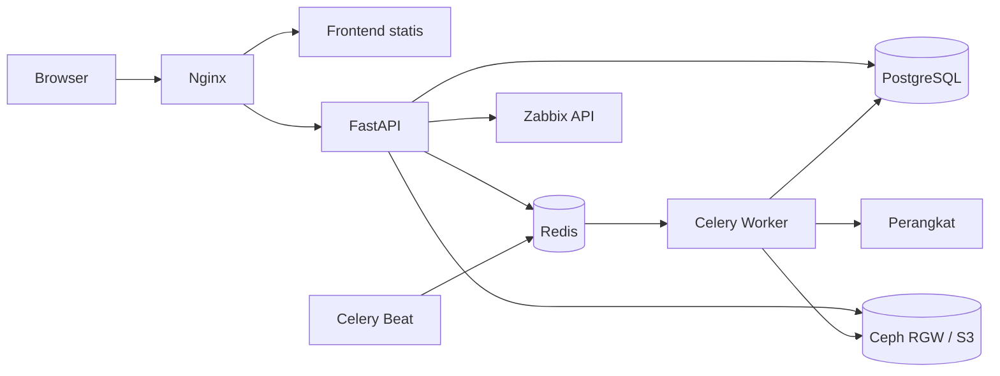

# NetBackup

NetBackup adalah aplikasi web internal untuk mencadangkan konfigurasi perangkat jaringan. Aplikasi menyinkronkan inventaris dari Zabbix, menjalankan backup melalui Celery worker, menyimpan metadata di PostgreSQL, memakai Redis untuk antrean dan koordinasi, serta menyimpan payload backup pada Ceph RGW atau S3-compatible storage.

Dokumentasi teknis dan produk dimulai dari [indeks dokumentasi](docs/README.md).

## Fitur utama

- Sinkronisasi perangkat dan availability dari Zabbix.
- Backup manual dan jadwal harian berbasis driver.
- Driver bawaan serta driver CLI parametrik.
- Riwayat job, snapshot, change detection, deduplikasi, dan retention.
- Pengelolaan beberapa repository dengan satu repository aktif.
- Enkripsi payload sebelum upload dan verifikasi saat restore.
- Download snapshot retained oleh admin.
- Dashboard, Ceph health, export XLSX/PDF, dan notifikasi webhook.
- Peran `admin` dan `viewer`.

## Arsitektur singkat



Docker Compose menjalankan `postgres`, `redis`, `migrator`, `api`, `worker`, `beat`, dan `nginx`. Migrator harus selesai sebelum service aplikasi dimulai.

## Prasyarat

- Docker Engine dan Docker Compose v2.
- Akses ke PostgreSQL/Redis hanya diperlukan melalui stack Compose bawaan.
- Endpoint Zabbix, S3-compatible storage, dan perangkat uji sesuai kebutuhan.
- File `known_hosts` yang sudah disiapkan bila pemeriksaan host key diaktifkan.
- Sertifikat CA S3 pada `backend/ceph-s3.crt` bila endpoint memakai CA privat.

## Konfigurasi

Salin template, lalu isi dengan nilai environment sendiri:

```bash
cp .env.example .env
```

Minimal isi nilai berikut sebelum startup:

- `APP_SECRET`
- `POSTGRES_DB`, `POSTGRES_USER`, `POSTGRES_PASSWORD`, dan `DATABASE_URL`
- `ZABBIX_URL`, `ZABBIX_API_TOKEN`, dan `ZABBIX_NETWORK_GROUP_ID`
- credential koneksi perangkat pada kelompok variable `NETWORK_*`
- `S3_ENDPOINT`, `S3_BUCKET`, `S3_ACCESS_KEY`, dan `S3_SECRET_KEY` bila memakai fallback environment
- `SMTP_*` dan `APP_BASE_URL` bila reset password diaktifkan

Jangan commit `.env`. Arti seluruh variable dan default non-secret dapat dilihat pada [.env.example](.env.example).

## Menjalankan aplikasi

```bash
docker compose up -d --build
docker compose ps
docker compose logs migrator
```

Migration `alembic upgrade head` dijalankan otomatis oleh service `migrator`. Jangan menjalankan API dengan schema yang belum mencapai head.

Port Nginx lokal default adalah `8080`:

```text
http://localhost:8080
```

URL deployment yang didokumentasikan:

```text
https://netbackup.makuku.co.id
```

Periksa liveness:

```bash
curl --fail https://netbackup.makuku.co.id/healthz
```

## Bootstrap user

Bootstrap hanya berjalan bila `BOOTSTRAP_USERS_ENABLED=true` dan password terkait sudah diisi pada `.env`.

```bash
docker compose run --rm api python -m app.cli.bootstrap_users
```

Sesudah akun awal tersedia, nonaktifkan bootstrap dan kosongkan nilai password bootstrap dari konfigurasi yang tidak lagi memerlukannya.

## Pengujian

Image API memasang dependency runtime, bukan dependency test. Jika environment pengembangan sudah memiliki `pytest`, jalankan:

```bash
pytest -q
```

Atau jalankan suite melalui image/tooling test yang memang memasang `pytest`. Daftar skenario dan traceability berada di [Test Script](docs/04-testing/test-script.md). Jangan menyatakan test lulus tanpa mencatat commit dan environment eksekusinya.

## Struktur repository

```text
backend/             FastAPI, service, model, driver, task, dan crypto
frontend/            Dashboard statis dan visualisasi teknis
migrations/          Revision Alembic
nginx/               Reverse proxy
tests/               Automated test
docs/                Dokumen planning sampai operasi
docker-compose.yml   Topologi runtime lokal/deployment
.env.example         Template konfigurasi tanpa secret nyata
```

## Dokumentasi penting

- [Project Charter](docs/01-planning/project-charter.md)
- [BRD](docs/02-requirements/brd.md) dan [PRD](docs/02-requirements/prd.md)
- [Technical Design Document](docs/03-design/tdd.md)
- [Arsitektur Database](docs/03-design/database-schema.md)
- [Kontrak API](docs/03-design/api-contract.md)
- [Spesifikasi Enkripsi Backup S3](docs/03-design/enkripsi-backup-s3.md)
- [Runbook](docs/05-operations/runbook.md)
- [Manual dan FAQ](docs/05-operations/manual-faq.md)

## Operasi dan perubahan

Gunakan [Runbook](docs/05-operations/runbook.md) untuk deployment, rollback, backup/restore, health check, dan troubleshooting. Setiap perubahan model membutuhkan migration baru; setiap perubahan route atau requirement harus memperbarui dokumen dan test terkait.
