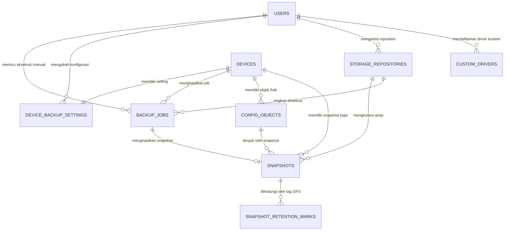

# Network Configuration Backup Dashboard — Enterprise Backup & Lifecycle Management

**Versi Sistem:** 2.0 (Production Ready)  
**Institusi / Organisasi:** PT Lucky Mom Indonesia  
**Arsitektur Inti:** Modular Monolith (FastAPI + PostgreSQL 16 + Redis 7 + Celery + Nginx)  
**Basis Waktu Aplikasi:** `Asia/Jakarta` (WIB, UTC+7)  
**Status Pengujian:** 39/39 Unit Tests Passing (100% Pass Rate)

---

## DAFTAR ISI

1. [Ringkasan Eksekutif & Latar Belakang](#1-ringkasan-eksekutif--latar-belakang)
2. [Arsitektur Sistem & Topologi Layanan](#2-arsitektur-sistem--topologi-layanan)
3. [Arsitektur Basis Data & Entity-Relationship Diagram (ERD)](#3-arsitektur-basis-data--entity-relationship-diagram-erd)
4. [Ekosistem Driver & Manajemen Perangkat Multivendor](#4-ekosistem-driver--manajemen-perangkat-multivendor)
5. [Pipeline Eksekusi Backup & Mesin Status (State Machine)](#5-pipeline-eksekusi-backup--mesin-status-state-machine)
6. [Arsitektur Kriptografi & Keamanan S3 Storage (Zero-Trust Security)](#6-arsitektur-kriptografi--keamanan-s3-storage-zero-trust-security)
7. [Mesin Deduplikasi (CAS) & Kebijakan Retensi GFS](#7-mesin-deduplikasi-cas--kebijakan-retensi-gfs)
8. [Monitoring, Pelaporan Audit & Notifikasi Insiden](#8-monitoring-pelaporan-audit--notifikasi-insiden)
9. [Autentikasi, Keamanan Sesi & RBAC](#9-autentikasi-keamanan-sesi--rbac)
10. [Spesifikasi REST API Endpoint](#10-spesifikasi-rest-api-endpoint)
11. [Panduan Instalasi, Deployment & Pengujian Sistem](#11-panduan-instalasi-deployment--pengujian-sistem)

---

## 1. RINGKASAN EKSEKUTIF & LATAR BELAKANG

### 1.1 Latar Belakang Masalah
Dalam operasional infrastruktur jaringan berskala enterprise, konfigurasi perangkat jaringan (seperti Router, Switch, Access Point, dan Firewall) merupakan aset kritis yang sangat rentan terhadap insiden downtime yang diakibatkan oleh:
1. **Kesalahan Konfigurasi Manual (Human Error):** Modifikasi rutin tanpa dokumentasi yang memicu terputusnya rute trafik atau kegagalan policy keamanan.
2. **Ketiadaan Versioning & Deduplikasi:** Proses backup konvensional yang mengandalkan copy-paste manual menghasilkan inkonsistensi arsip dan pemborosan kapasitas penyimpanan.
3. **Risiko Keamanan Data Tidak Terenkripsi (Data at-Rest Vulnerability):** File konfigurasi sering kali menyimpan kredensial plain-text, secret key, atau topologi sensitif yang jika disimpan tanpa enkripsi berstandar tinggi di storage cloud/object storage dapat menimbulkan kebocoran data fatal.
4. **Keterbatasan Format Backup Proprietary:** Sebagian vendor menghasilkan file backup binary tertutup (`.backup`) yang tidak dapat diaudit atau dipindahkan antar hardware secara portabel.

### 1.2 Solusi yang Diterapkan
**Network Configuration Backup Dashboard** dirancang sebagai solusi otomasi terpusat yang tangguh, terukur, dan aman untuk mengelola siklus hidup konfigurasi perangkat jaringan multivendor. Sistem ini menghubungkan:
* **Zabbix Network Monitoring** sebagai *Single Source of Truth* untuk penemuan otomatis (*host discovery*) dan status ketersediaan live perangkat.
* **Ceph RGW (S3-Compatible Object Storage)** dengan enkripsi payload fisik berlapis (**PBKDF2-HMAC-SHA256 100.000 iterasi + AES-256-CBC + HMAC-SHA256 Encrypt-then-MAC**).
* **Asynchronous Distributed Engine (Celery + Redis)** untuk eksekusi backup paralel tanpa memblokir request antarmuka web.
* **Smart Retention Engine** yang menerapkan GFS (Grandfather-Father-Son) dengan proteksi permanen *Latest Known Good Configuration*.

---

## 2. ARSITEKTUR SISTEM & TOPOLOGI LAYANAN

Sistem dibangun dengan pola **Modular Monolith** berorientasi kontainerisasi Docker untuk memastikan keandalan, portabilitas tinggi, dan pemisahan beban komputasi.

```text
+---------------------------------------------------------------------------------------+
|                                    KLIEN BROWSER                                      |
|            Dashboard Antarmuka Web Responsif (Tailwind CSS / Vanilla JS)             |
+---------------------------------------------------------------------------------------+
                                           | HTTP (Port 8081)
                                           v
+---------------------------------------------------------------------------------------+
|                                NGINX REVERSE PROXY                                    |
|            - Static File Server (HTML, CSS, JS)                                       |
|            - Reverse Proxy API (/api/v1 -> Uvicorn ASGI)                              |
|            - Security Headers, Gzip, SSE Live-Reload Channel                          |
+---------------------------------------------------------------------------------------+
                                           | HTTP Proxy (:8000)
                                           v
+---------------------------------------------------------------------------------------+
|                                 FASTAPI ASGI BACKEND                                  |
|            - REST API Controllers (Auth, Devices, Storage, Drivers, Reports)         |
|            - Authentication & RBAC Guard (Admin vs Viewer)                            |
|            - Request Validation & Session Handling (Pydantic & Starlette)             |
+---------------------------------------------------------------------------------------+
               |                           |                              |
               v                           v                              v
+-----------------------------+ +---------------------+ +-------------------------------+
|     POSTGRESQL 16 RDBMS     | |   REDIS 7 BROKER    | |      ZABBIX SERVER (API)      |
|  - Skema Konfigurasi & Relasi| | - Session Storage   | | - Host Discovery Otomatis     |
|  - Log Riwayat Pekerjaan     | | - Distributed Mutex | | - Status Availability (ICMP/  |
|  - Metadata Snapshot         | | - Celery Task Queue | |   Agent Status)               |
+-----------------------------+ +---------------------+ +-------------------------------+
                                           |
                                           v
+---------------------------------------------------------------------------------------+
|                              CELERY ASYNC WORKERS & BEAT                              |
|  - Worker Engine: SSH Paramiko / Telnet Extraction (MikroTik, Ruijie, Sangfor, Custom)|
|  - Normalisasi Teks & Hashing Dual SHA-256 (Content CAS vs Physical Object)          |
|  - Enkripsi Payload At-Rest: AES-256-CBC + HMAC-SHA256                                |
|  - Celery Beat Scheduler: Pemicu Backup Otomatis Harian & Pembersihan Retensi         |
+---------------------------------------------------------------------------------------+
               |                                                          |
               v                                                          v
+-------------------------------+                          +----------------------------+
|  CEPH RGW S3 OBJECT STORAGE   |                          |    FEISHU / LARK WEBHOOK   |
|  - Bucket Terisolasi          |                          |  - Notifikasi Insiden Real-|
|  - Enkripsi At-Rest Objek S3  |                          |    time & Diagnostic Card  |
|  - Manifest Repo Terenkripsi  |                          +----------------------------+
+-------------------------------+
```

### Komponen Kontainer Docker:
1. `network-backup-nginx-1`: Server gateway Nginx (Port 8081).
2. `network-backup-api-1`: Layanan backend FastAPI berbasis Python 3.12.
3. `network-backup-worker-1`: Worker Celery untuk eksekusi tugas SSH paralel.
4. `network-backup-beat-1`: Scheduler Celery Beat untuk eksekusi tugas periodik.
5. `network-backup-postgres-1`: PostgreSQL 16 untuk penyimpanan relasional.
6. `network-backup-redis-1`: Redis 7 untuk message broker, cache sesi, dan distributed locks.

---

## 3. ARSITEKTUR BASIS DATA & ENTITY-RELATIONSHIP DIAGRAM (ERD)

Basis data relasional dikelola secara terstruktur dengan PostgreSQL 16 dan SQLAlchemy 2.0 ORM, dengan migrasi skema versi berbasis Alembic.

### 3.1 Diagram Hubungan Entitas (ERD)



### 3.2 Penjelasan Tabel Basis Data:
1. `users`: Menyimpan kredensial pengguna, hash Argon2id, dan peran hak akses (`admin` / `viewer`).
2. `devices`: Data inventaris perangkat hasil sinkronisasi Zabbix (Hostname, IP, Vendor, Model, Status).
3. `device_backup_settings`: Konfigurasi per perangkat (driver terpilih, jadwal jam/menit, tipe retensi).
4. `backup_jobs`: Log audit eksekusi backup lengkap (status, tahapan gagal, pesan error, waktu mulai/selesai).
5. `config_objects`: Objek fisik konfigurasi yang tersimpan di Ceph S3 (SHA-256, ukuran bytes, S3 key path).
6. `snapshots`: Titik pemulihan logis (*recovery point*) per perangkat pada waktu tertentu.
7. `snapshot_retention_marks`: Penandaan kebijakan GFS (`DAILY`, `WEEKLY`, `MONTHLY`, `YEARLY`).
8. `integration_status`: Status kesehatan integrasi eksternal (Zabbix, Ceph S3, Feishu Webhook).
9. `storage_repositories`: Konfigurasi bucket S3 dan Master Key terenkripsi untuk enkripsi payload at-rest.
10. `custom_drivers`: Parameter konfigurasi CLI dinamis untuk perangkat yang tidak memiliki driver bawaan.

---

## 4. EKOSISTEM DRIVER & MANAJEMEN PERANGKAT MULTIVENDOR

Sistem mendukung ekstraksi konfigurasi dari berbagai vendor jaringan menggunakan transport SSH dan Telnet dengan mekanisme penanganan prompt dan bypass paginasi terminal yang canggih.

### 4.1 Driver Bawaan (*Built-in Drivers*)
* **MikroTik RouterOS (`mikrotik_routeros`):**
  * *Perintah:* `/export compact`
  * *Karakteristik:* Menghasilkan konfigurasi berbasis script teks `.rsc` bersih, bukan file binary `.backup`.
  * *Justifikasi Teknis:* Script `.rsc` memungkinkan deduplikasi berbasis Content-Addressable Storage (CAS), perbandingan riwayat teks yang mudah dipahami, serta portabilitas penuh lintas hardware atau Cloud Hosted Router (CHR).
* **Ruijie AP (`ruijie_ap`):**
  * Ekstraksi konfigurasi nirkabel Ruijie Access Point melalui CLI terstruktur.
* **Ruijie Switch (`ruijie_switch`):**
  * *Transport:* SSH Paramiko dengan kompatibilitas legacy Key Exchange (`diffie-hellman-group14-sha1`, `diffie-hellman-group-exchange-sha1`) dan host key algorithm `ssh-rsa` untuk switch enterprise generasi terdahulu.
  * *Penyimpanan Konfigurasi:* Menjalankan perintah `write memory` / save prompt secara otomatis sebelum ekstraksi untuk memastikan seluruh running-configuration sinkron.
* **Sangfor NSF / NGAF (`sangfor_nsf`):**
  * Ekstraksi firewall Sangfor Next-Generation Security Appliance dengan perintah `show running-config` dan penanganan bypass terminal paging.

### 4.2 Backup Worker Management & Custom Parametric CLI Engine
Administrator dapat mendaftarkan driver perangkat baru tanpa mengubah kode program melalui antarmuka **Backup Worker Management**:
* Pilihan transport: SSH atau Telnet.
* Konfigurasi port kustom (default 22 untuk SSH, 23 untuk Telnet).
* Eskalasi hak akses (*Privilege Escalation*): Perintah `enable` / `super` beserta input password eskalasi otomatis.
* Bypass paginasi layar: `terminal length 0`, `screen-length 0 temporary`, atau `no page`.
* Regex sanitasi output: Menghilangkan banner login, prompt terminal, dan artefak waktu.
* **Fitur Live Dry-Run Test:** Menguji koneksi dan ekstraksi CLI secara langsung ke perangkat target dari antarmuka Web untuk memvalidasi konfigurasi driver sebelum disimpan ke basis data.

---

## 5. PIPELINE EKSEKUSI BACKUP & MESIN STATUS (STATE MACHINE)

Setiap proses backup dieksekusi secara asinkron di dalam Celery worker melalui *State Machine* yang terjamin keandalannya.

### 5.1 Siklus Hidup Status Pekerjaan (*Job State Flow*)
```text
[QUEUED] 
   ↓
[CONNECTING] ──── (Gagal Konek / Timeout) ────────────→ [FAILED] + Alert Feishu
   ↓
[EXTRACTING] ──── (Batas Waktu Ekstraksi Terlampaui) ─→ [FAILED] + Alert Feishu
   ↓
[VALIDATING] ──── (Konfigurasi Kosong / Corrupt) ────→ [FAILED] + Alert Feishu
   ↓
[HASHING]
   ↓
[UPLOADING] ──── (Gagal Upload S3 / Error KDF) ──────→ [FAILED] + Alert Feishu
   ↓
[SUCCESS] (Ditandai: BASELINE / CHANGED / NO_CHANGE)
```

### 5.2 Fitur Keandalan Eksekusi:
1. **Distributed Mutex Lock (Redis):** Mencegah *race condition* dengan memastikan hanya satu pekerjaan backup yang dapat berjalan pada satu perangkat dalam waktu bersamaan.
2. **Availability Pre-Check Gate:** Sebelum melakukan koneksi SSH yang memakan waktu, sistem melakukan query ke Zabbix API. Jika perangkat berstatus `DOWN` atau tidak terjangkau, pekerjaan langsung ditandai sebagai `SKIPPED_DEVICE_DOWN` untuk menghemat resource worker.
3. **Penyimpanan Riwayat Permanen:** Catatan riwayat eksekusi backup disimpan selamanya dalam tabel `backup_jobs` untuk kebutuhan audit kepatuhan, terlepas dari masa kedaluwarsa file konfigurasi di S3.

---

## 6. ARSITEKTUR KRIPTOGRAFI, KOMPRESI DATA & KEAMANAN S3 STORAGE (ZERO-TRUST SECURITY)

Untuk menjamin standar keamanan *Zero-Trust Storage*, kerahasiaan (*confidentiality*), dan efisiensi kapasitas penyimpanan fisik, seluruh modul sistem menerapkan kombinasi **Kompresi Data (zlib)**, **Enkripsi Simetris Standar Militer (AES-256)**, dan **Autentikasi Integritas (HMAC-SHA256 Encrypt-then-MAC)**.

### 6.1 Matriks Kriptografi & Kompresi Sistem

| No | Fitur Sistem | Algoritma Enkripsi | Algoritma Hash / KDF | Kompresi Data | Pola Keamanan |
|---|---|---|---|---|---|
| **1** | **At-Rest Payload S3** | **AES-256-CBC** | PBKDF2 (100k) + HMAC-SHA256 | **zlib Deflate L6** (~75% hemat) | Encrypt-then-MAC Envelope |
| **2** | **DB Credential Vault** | **AES-256-CBC** (Upgraded 256-bit) | PBKDF2 (100k) + HMAC-SHA256 | N/A (Secret Vault) | Encrypt-then-MAC (Legacy Fernet Fallback) |
| **3** | **S3 Repo Manifest** | **AES-256-CBC** | PBKDF2 (100k) + HMAC-SHA256 | N/A (JSON Manifest) | Client-Side Zero-Knowledge Envelope |
| **4** | **CAS Deduplikasi** | *Pure Hashing* | **Dual SHA-256** | 100% Skip Upload on Match | Content-Addressable Storage (CAS) |

---

### 6.2 Spesifikasi Enkripsi & Kompresi At-Rest (`zlib + AES-256-CBC + HMAC-SHA256`)
Seluruh objek konfigurasi perangkat jaringan (running-config) diproses melalui pipeline berlapis sebelum ditransmisikan dan disimpan di Ceph RGW (S3):

```text
+------------------+------------------+--------------------+-------------------------------+
| Salt (16 Bytes)  |   IV (16 Bytes)  |  HMAC (32 Bytes)   | Ciphertext (PKCS7 Padded)     |
+------------------+------------------+--------------------+-------------------------------+
```

1. **Kompresi Data (zlib Deflate):** Teks konfigurasi router/switch yang kaya redundansi dikompresi dengan zlib (Level 6) dan diawali penanda magic `NBZ1`. Kompresi ini memangkas ukuran fisik konfigurasi hingga **70% - 80%** sebelum proses enkripsi.
2. **Key Derivation Function (KDF):** Menggunakan `PBKDF2-HMAC-SHA256` dengan **100.000 iterasi** (rekomendasi NIST SP 800-132). KDF menurunkan 64 byte material kunci dari Master Password repositori:
   * 32 byte pertama: Kunci enkripsi simetris `AES-256`.
   * 32 byte kedua: Kunci otentikasi integritas `HMAC-SHA256`.
3. **Mekanisme Encrypt-then-MAC:** Nilai HMAC dihitung di atas kombinasi `salt + iv + ciphertext`. Pola ini kebal terhadap manipulasi bit ciphertext dan serangan *Padding Oracle Attack* karena integritas diverifikasi sebelum operasi unpadding.
4. **Verifikasi Integritas Constant-Time:** Saat pengunduhan, integritas diverifikasi menggunakan `hmac.compare_digest` / `secrets.compare_digest` untuk mengeliminasi kerentanan terhadap serangan *side-channel timing attack*.
5. **Dekompresi On-The-Fly:** Dekripsi AES-256 dan dekompresi zlib dieksekusi secara instan di dalam memori RAM server saat Administrator mengunduh konfigurasi melalui endpoint `GET /api/v1/snapshots/{id}/download`.

---

### 6.3 Database Credential Vault (`AES-256-CBC + HMAC-SHA256`)
Kredensial sensitif yang disimpan pada basis data PostgreSQL (kolom `secret_key_encrypted` dan `master_key_encrypted` pada tabel `storage_repositories`) diamankan menggunakan:
* **Algoritma Utama:** **AES-256-CBC** dengan autentikasi **HMAC-SHA256** (ditingkatkan dari standar sebelumnya 128-bit agar sepenuhnya selaras dengan judul dan spesifikasi sistem).
* **Derivasi Kunci:** Diturunkan dari `APP_SECRET` server dan Salt unik 16 byte via `PBKDF2-HMAC-SHA256 (100.000 iterasi)`.
* **Envelope Format:** `base64.urlsafe_b64encode(salt || iv || hmac || ciphertext)` disimpan dalam kolom `VARCHAR(512)`.
* **Zero-Downtime Fallback:** Fungsi `decrypt_secret` dilengkapi fallback otomatis ke parser legacy Fernet (AES-128) untuk menjamin kompatibilitas mundur penuh tanpa downtime.

---

### 6.4 Visualisasi & Simulator Animasi Interaktif Web
Sistem menyediakan antarmuka visualisasi animasi interaktif untuk membantu pemahaman alur kerja kompresi, derivasi kunci, enkripsi blok, dan verifikasi HMAC:
* **URL Akses:** `http://localhost:8081/crypto-animation.html` (atau klik tombol **Animasi Kriptografi** di header dashboard).
* **Fitur Visualizer:**
  * Navigasi langkah demi langkah (Step-by-Step Interactive Pipeline) dengan kontrol kecepatan dan play/pause.
  * Visualisasi alur data real-time: Plaintext $\rightarrow$ zlib Compression $\rightarrow$ KDF PBKDF2 $\rightarrow$ AES-256-CBC $\rightarrow$ HMAC-SHA256 $\rightarrow$ Storage Envelope.
  * Sandbox interaktif dengan SubtleCrypto Web API untuk pengujian enkripsi/dekripsi secara langsung, termasuk simulasi serangan manipulasi bit (tampering) dan password salah.

---

### 6.5 Manajemen Repositori S3 Dinamis (S3 Storage Management)
* **Validasi Sertifikat SSL Ketat:** Memastikan koneksi HTTPS ke endpoint S3 divalidasi kepercayaannya terhadap CA sistem.
* **Pop-up Test Connection:** Menyediakan dialog pop-up terpusat untuk memverifikasi kredensial S3 sebelum inisialisasi repositori.
* **Isolasi Repositori Aktif (Active Repository Scoping):** Status backup perangkat dan riwayat snapshot ditampilkan secara dinamis sesuai repositori penyimpanan yang sedang aktif, mencegah kontaminasi data antar bucket.

---

## 7. MESIN DEDUPLIKASI (CAS) & KEBIJAKAN RETENSI GFS

### 7.1 Deduplikasi Content-Addressable Storage (CAS)
Sistem membedakan dua nilai hash SHA-256 independen untuk efisiensi penyimpanan:
1. `content_sha256`: Dihitung dari teks konfigurasi yang telah dinormalisasi. Digunakan untuk mendeteksi perubahan konfigurasi (`CHANGED` vs `NO_CHANGE`).
2. `object_sha256`: Dihitung dari binary payload yang disimpan di S3. Digunakan untuk verifikasi integritas saat pengunduhan file.

Jika konfigurasi perangkat tidak mengalami perubahan (`NO_CHANGE`), sistem **tidak mengunggah objek fisik baru ke S3**. Sistem hanya membuat satu record metadata logis baru pada tabel `snapshots` yang mereferensikan `config_objects` yang telah ada, menghemat kapasitas penyimpanan secara signifikan.

### 7.2 Kebijakan Retensi GFS (Grandfather-Father-Son)
Sistem menyediakan dua skema kebijakan retensi yang dieksekusi secara otomatis oleh Celery Beat setiap hari:
* **Standard 31-Day Policy:** Menyimpan seluruh snapshot harian selama 31 hari kalender.
* **Smart GFS Retention (7/4/12/3):**
  * 7 Snapshot Harian (Daily).
  * 4 Snapshot Mingguan (Weekly - setiap hari Minggu).
  * 12 Snapshot Bulanan (Monthly - hari pertama setiap bulan).
  * 3 Snapshot Tahunan (Yearly - 1 Januari setiap tahun).
* **Proteksi Mutlak Latest Known Good (LKG):** Snapshot valid terakhir dari setiap perangkat **tidak akan pernah dihapus** oleh siklus retensi otomatis, menjamin ketersediaan konfigurasi acuan pemulihan bencana (*Disaster Recovery*).

---

## 8. MONITORING, PELAPORAN AUDIT & NOTIFIKASI INSIDEN

### 8.1 Sinkronisasi Otomatis Zabbix
* Menghubungkan Zabbix Server melalui JSON-RPC API.
* Pengambilan inventaris otomatis (*Host Inventory*) mencakup Vendor, Model, dan Alamat IP.
* Status ketersediaan perangkat ditampilkan secara jelas pada tabel perangkat sebagai `Active` (UP) atau `Non-Active` (DOWN).

### 8.2 Integrasi Webhook Feishu / Lark
Ketika terjadi kegagalan backup pada tahap apapun, sistem secara otomatis mengirimkan pesan kartu interaktif (*Interactive Card Alert*) ke grup operasional IT via Webhook:
* **Tingkat Keparahan:** 🚨 Merah (*High-Priority Alert*).
* **Detail Pesan:** Hostname Perangkat, Alamat IP, Vendor / Model, Driver Key, Tahap Kegagalan (*Failure Stage*), Penyebab Error, Jumlah Percobaan (*Attempts*), dan Waktu Terakhir Sukses.

### 8.3 Mesin Pelaporan Audit (Excel & PDF)
Untuk kebutuhan dokumentasi formal dan audit kepatuhan, sistem menyediakan modul ekspor laporan:
* **Format File:** Excel Spreadsheet (`.xlsx`) dan Dokumen PDF (`.pdf`).
* **Fitur Filter:** Pemilihan rentang tanggal interaktif (*Date Range Picker*), filter status perangkat, dan filter vendor.
* **Konten Laporan:** Ringkasan KPI eksekutif, grafik distribusi status backup, serta tabel audit detail riwayat eksekusi.

---

## 9. AUTENTIKASI, KEAMANAN SESI & RBAC

### 9.1 Kontrol Akses Berbasis Peran (*Role-Based Access Control*)
Sistem membatasi hak akses pengguna secara tegas:
* **Admin:** Memiliki kendali penuh meliputi pemicuan backup manual, penugasan driver, pengaturan jadwal, manajemen repositori S3, manajemen custom driver, pengunduhan file arsip konfigurasi, dan ekspor laporan.
* **Viewer:** Hanya memiliki hak baca (*read-only*). Menu S3 Storage Management dan Backup Worker Management disembunyikan. Pemicuan backup manual dan pengunduhan arsip diblokir pada tingkat backend API (HTTP 403 Forbidden).

### 9.2 Keamanan Sesi & Kredensial
* **Pencocokan Username Case-Sensitive Ketat:** Sistem tidak mentolerir variasi kapitalisasi pada saat login (`admin` valid, `Admin` ditolak dengan HTTP 401).
* **Argon2id Hashing:** Password pengguna di-hash menggunakan algoritma Argon2id yang tahan terhadap serangan GPU cracking.
* **Redis Server-Side Session:** ID Sesi dienkripsi dan disimpan di Redis, ditransmisikan melalui cookie `HttpOnly`, `SameSite=Lax`.
* **Perlindungan CSRF:** Seluruh request yang memodifikasi status (POST, PUT, DELETE) wajib menyertakan token CSRF valid yang diverifikasi backend.

---

## 10. SPESIFIKASI REST API ENDPOINT

Semua endpoint API disajikan di bawah prefix `/api/v1/`:

| Metode | Endpoint | Hak Akses | Deskripsi Fungsi |
|---|---|---|---|
| `POST` | `/auth/login` | Publik | Otentikasi username & password, penerbitan cookie sesi |
| `POST` | `/auth/logout` | Terotentikasi | Invalidation sesi pengguna di Redis |
| `GET` | `/auth/me` | Terotentikasi | Mendapatkan data profil dan peran pengguna aktif |
| `GET` | `/devices` | Terotentikasi | Mendapatkan daftar perangkat jaringan beserta status |
| `POST` | `/devices/sync-zabbix` | Admin | Menjalankan sinkronisasi inventaris host dari Zabbix API |
| `POST` | `/devices/{id}/backup` | Admin | Memicu eksekusi backup asinkron seketika (*Backup Now*) |
| `GET` | `/devices/{id}/backup-settings` | Terotentikasi | Mengambil konfigurasi driver, jadwal, dan retensi perangkat |
| `PUT` | `/devices/{id}/backup-settings` | Admin | Memperbarui konfigurasi driver, jadwal, dan retensi perangkat |
| `GET` | `/devices/{id}/backup-jobs` | Terotentikasi | Riwayat log eksekusi backup per perangkat (terfilter repositori) |
| `GET` | `/devices/{id}/snapshots` | Terotentikasi | Daftar recovery point snapshot per perangkat |
| `GET` | `/snapshots/{id}/download` | Admin | Mengunduh file konfigurasi terdekripsi dari Ceph S3 |
| `POST` | `/storage/test` | Admin | Menguji konektivitas dan sertifikat SSL ke endpoint S3 |
| `GET` | `/storage/repositories` | Admin | Mengambil daftar repositori penyimpanan S3 yang terdaftar |
| `POST` | `/storage/repositories/init` | Admin | Menginisialisasi repositori S3 baru dengan Master Password |
| `POST` | `/storage/repositories/unlock` | Admin | Membuka repositori S3 yang telah memiliki manifest |
| `POST` | `/storage/repositories/{id}/activate` | Admin | Mengaktifkan repositori S3 sebagai target penyimpanan aktif |
| `POST` | `/storage/disconnect` | Admin | Memutuskan koneksi dari repositori penyimpanan aktif |
| `GET` | `/drivers` | Terotentikasi | Mengambil daftar seluruh driver bawaan dan kustom |
| `POST` | `/drivers/custom` | Admin | Mendaftarkan driver parametric CLI kustom baru |
| `PUT` | `/drivers/custom/{id}` | Admin | Memperbarui parameter driver kustom |
| `DELETE`| `/drivers/custom/{id}` | Admin | Menghapus driver kustom |
| `POST` | `/drivers/test` | Admin | Melakukan live dry-run test ekstraksi CLI ke perangkat target |
| `GET` | `/reports/export` | Admin | Mengunduh laporan audit dalam format Excel (.xlsx) atau PDF (.pdf) |
| `GET` | `/users` | Admin | Mengambil daftar akun pengguna |
| `POST` | `/users` | Admin | Membuat akun pengguna baru |
| `DELETE`| `/users/{id}` | Admin | Menghapus akun pengguna |
| `GET` | `/healthz` | Publik | Healthcheck endpoint status API backend |

---

## 11. PANDUAN INSTALASI, DEPLOYMENT & PENGUJIAN SISTEM

### 11.1 Persyaratan Sistem (*Prerequisites*)
* **Sistem Operasi:** Linux (Direkomendasikan Ubuntu Server 22.04 LTS / 24.04 LTS).
* **Perangkat Lunak:** Docker Engine 24.x+ dan Docker Compose v2.x+.
* **Konektivitas Jaringan:**
  * Port 8081: Port web antarmuka Nginx Dashboard.
  * Port 22 / 23: Akses ke perangkat jaringan target (SSH / Telnet).
  * Port 10051 / 443: Akses ke Zabbix Server API.
  * Port 443 / 80: Akses ke endpoint Ceph RGW (S3) dan Webhook Feishu.

### 11.2 Langkah-Langkah Deployment
1. **Clone Repositori & Masuk ke Direktori Proyek:**
   ```bash
   cd /opt/network-backup
   ```

2. **Konfigurasi Environment Variables (`.env`):**
   Salin file contoh konfigurasi dan sesuaikan nilai parameter lingkungan:
   ```bash
   cp .env.example .env
   nano .env
   ```
   *Parameter Kunci:*
   * `POSTGRES_USER`, `POSTGRES_PASSWORD`, `POSTGRES_DB`: Kredensial database.
   * `SECRET_KEY`: Kunci enkripsi rahasia aplikasi backend (minimal 32 karakter).
   * `ZABBIX_API_URL`, `ZABBIX_API_TOKEN`: Akses integrasi Zabbix.
   * `FEISHU_WEBHOOK_URL`: Alamat webhook Feishu bot untuk pengiriman alert.

3. **Membangun & Menjalankan Kontainer Docker:**
   ```bash
   docker compose up -d --build
   ```

4. **Inisialisasi Akun Pengguna Awal (Bootstrap Admin):**
   ```bash
   docker exec -it network-backup-api-1 python -m app.cli.bootstrap_users
   ```

5. **Akses Dashboard Antarmuka Web:**
   Buka peramban web pada alamat:
   ```text
   http://<IP-SERVER>:8081
   ```
   Login menggunakan username `admin` dan password yang telah ditentukan.

### 11.3 Verifikasi & Pengujian Otomatis (*Automated Testing Evidence*)
Pengujian fungsionalitas unit telah diuji secara komprehensif menggunakan framework `pytest` di dalam lingkungan kontainer:

```bash
docker exec network-backup-api-1 pytest tests/unit
```

**Hasil Pengujian:**
```text
============================= test session starts ==============================
platform linux -- Python 3.12.15, pytest-9.1.1, pluggy-1.6.0
rootdir: /app
plugins: asyncio-1.4.0, anyio-4.15.1
collected 39 items

tests/unit/test_auth_schemas.py ...                                      [  7%]
tests/unit/test_custom_drivers.py ....                                   [ 17%]
tests/unit/test_driver_registry.py .....                                 [ 30%]
tests/unit/test_job_state.py ....                                        [ 41%]
tests/unit/test_notifications.py ....                                    [ 51%]
tests/unit/test_reports.py ....                                          [ 61%]
tests/unit/test_schema_contract.py ....                                  [ 71%]
tests/unit/test_security.py ..                                           [ 76%]
tests/unit/test_storage_repository.py ......                             [ 92%]
tests/unit/test_zabbix_normalization.py ...                              [100%]

============================== 39 passed in 10.20s ==============================
```
Seluruh 39 skenario uji berjalan sukses tanpa kegagalan (100% pass rate).

---

## 12. DOKUMENTASI TERKAIT

Untuk rujukan teknis mendalam per topik, pelajari file dokumentasi spesifik pada direktori `docs/`:
* [MASTERPLAN-AI-AGENT.md](file:///opt/network-backup/MASTERPLAN-AI-AGENT.md) — Panduan arsitektur sistem dan batas implementasi menyeluruh.
* [BACKEND-ARCHITECTURE-DATABASE-SCHEMA-v1.0.md](file:///opt/network-backup/docs/02-architecture/BACKEND-ARCHITECTURE-DATABASE-SCHEMA-v1.0.md) — Rincian modul internal backend dan relasi data.
* [DATABASE-SCHEMA-ERD-v1.0.md](file:///opt/network-backup/docs/02-architecture/DATABASE-SCHEMA-ERD-v1.0.md) — Dokumentasi kamus data dan skema basis data lengkap.
* [API-CONTRACT-v1.0.md](file:///opt/network-backup/docs/02-architecture/API-CONTRACT-v1.0.md) — Kontrak request/response endpoint HTTP REST.
* [BACKUP-DRIVER-CONTRACT-v1.0.md](file:///opt/network-backup/docs/02-architecture/BACKUP-DRIVER-CONTRACT-v1.0.md) — Standar antarmuka driver perangkat jaringan.
* [CHECKPOINT-C21-AT-REST-PAYLOAD-ENCRYPTION.md](file:///opt/network-backup/docs/03-implementation/CHECKPOINT-C21-AT-REST-PAYLOAD-ENCRYPTION.md) — Catatan implementasi teknis enkripsi payload fisik S3 (AES-256-CBC + HMAC-SHA256).
