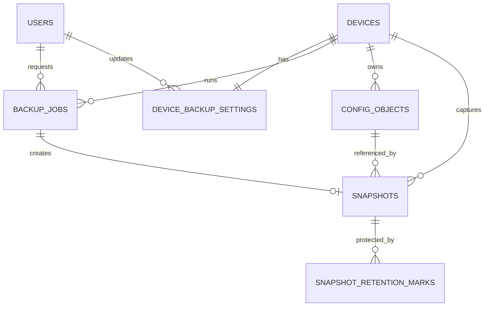

# Network Backup Dashboard — Backend Architecture & Database Schema

**Version:** 1.0  
**Status:** Architecture Baseline / Ready for Implementation  
**Project:** TA Opsi 3 — Centralized Network Configuration Backup  
**Architecture Style:** Modular Monolith + Background Worker  
**Frontend Baseline:** Existing `mockup.html`  
**Application Timezone:** `Asia/Jakarta`  
**Primary Device Transport:** SSH using Netmiko  
**Primary Repository:** Ceph S3 / RGW  
**Single Source of Truth for Device Identity:** Zabbix  
**Database:** PostgreSQL  
**Task Queue:** Redis + Celery  
**Scheduler:** Celery Beat + PostgreSQL schedule state

---

# 1. Frozen Decisions

The following decisions are considered **frozen for v1** and must not be changed by the implementation agent without explicit approval.

1. Backend uses **Python 3.12 + FastAPI**.
2. Architecture is a **Modular Monolith**, not microservices.
3. Frontend reuses the current HTML/Tailwind/Vanilla JS mockup and is adapted to real APIs.
4. PostgreSQL stores persistent application state and history.
5. Redis is used only for ephemeral queue/session/lock functions.
6. Celery runs background work; Celery Beat dispatches periodic tasks.
7. All network-device backup drivers use **SSH/Netmiko first**.
8. If a specific device cannot be handled reliably by Netmiko, a vendor-specific Python SSH implementation may be created **inside that driver's module only**. Core backup logic must not change.
9. Driver assignment is performed manually from the web UI.
10. Zabbix is the Single Source of Truth for network-device identity and operational status.
11. Vendor and model are read primarily from **Zabbix Host Inventory**.
12. Zabbix availability is evaluated using a live Zabbix availability source; the default implementation should use a configured ICMP/availability item such as `icmpping`.
13. Zabbix availability uses two layers:
    - background synchronization every approximately 30 seconds;
    - a fresh Zabbix pre-check immediately before every backup job.
14. `UP` in Zabbix is a prerequisite, but does not mean SSH/config backup will succeed.
15. If Zabbix says the device is down, do not attempt SSH retries. Result: `SKIPPED_DEVICE_DOWN`.
16. If fresh Zabbix status cannot be obtained, do not execute SSH. Result: `SKIPPED_STATUS_UNKNOWN`.
17. Scheduled backup recurrence is **Daily only**.
18. Active device schedules use **5-minute time slots**. Two enabled devices may not use the same slot; the UI uses 5-minute increments.
19. Standard retention is **31 days**.
20. Smart retention is **7 Daily / 4 Weekly / 12 Monthly / 3 Yearly**.
21. The **Latest Known Good Configuration** must always remain protected, even if normal retention would otherwise expire it.
22. SHA-256 is used for Changed / No Change detection.
23. Line-level configuration diff is not part of v1.
24. If a configuration does not change, the daily backup job still executes and creates history/snapshot metadata, but the same physical Ceph S3 object may be reused.
25. Ceph header status represents actual:
    - `HEALTH_OK`
    - `HEALTH_WARN`
    - `HEALTH_ERR`
    - application fallback `UNKNOWN`
26. Ceph health details must explain why WARN/ERR/UNKNOWN occurred.
27. Failed backup notifications are sent through **Feishu webhook**.
28. Authentication uses **server-side session + Secure HttpOnly cookie**, not JWT in localStorage.
29. Passwords are hashed using **Argon2id**. Authentication enforces **strict case-sensitive matching** with zero tolerance for case discrepancy (`admin` != `Admin`).
30. Admin and Viewer are the only roles.
31. Viewer cannot download configuration backup files and cannot access S3 Storage / Worker Management.
32. Automated restore to network devices is excluded from v1 (scheduled for v2).
33. Excel (.xlsx) and PDF (.pdf) audit reporting with date picker range, metrics, and charts delivered in v1 (Checkpoint C15).
34. S3 Storage Management with PBKDF2-HMAC-SHA256 (100,000 iterations) + AES-256-CBC + HMAC-SHA256 authenticated envelope for repository manifest delivered in v1 (Checkpoint C19/C20).
35. Active repository scoping isolates device snapshots, backup status, and history per connected S3 bucket.
36. Operational backup metadata is retained even when backup objects expire.
37. The Last Backup column shows the latest attempt/result; on error, hover shows error detail and the most recent successful backup time.

---

# 2. Recommended Tech Stack

| Layer | Technology |
|---|---|
| OS | Ubuntu Server 24.04 LTS |
| Deployment | Docker Compose |
| Reverse Proxy | Nginx |
| Frontend | HTML5 + Tailwind CSS + Vanilla JavaScript ES Modules |
| Backend API | Python 3.12 + FastAPI |
| Validation/Settings | Pydantic + pydantic-settings |
| ORM | SQLAlchemy 2.x |
| Migration | Alembic |
| Database | PostgreSQL 16+ |
| Queue / Session / Lock | Redis |
| Background Worker | Celery |
| Scheduler | Celery Beat |
| Network Automation | Netmiko |
| HTTP Client | HTTPX |
| Ceph S3 Client | boto3 |
| Password Hash | Argon2id |
| Change Detection | `hashlib.sha256` |
| Test | pytest |
| Version Control | Git |

Do not introduce React/Vue, Node backend, Kubernetes, Kafka, Elasticsearch, or microservices in v1.

---

# 3. High-Level Architecture

```text
                          Browser
                             |
                           HTTPS
                             |
                             v
                       +-----------+
                       |   Nginx   |
                       +-----+-----+
                             |
                +------------+------------+
                |                         |
                v                         v
        Static Frontend               FastAPI API
        HTML/Tailwind/JS                  |
                                          |
                 +------------------------+----------------------+
                 |                        |                      |
                 v                        v                      v
            PostgreSQL                  Redis              Integrations
        Persistent state          Queue/Session/Lock       /          \
                 |                        |               Zabbix      Ceph
                 |                        v                 API       Health
                 |                  Celery Worker
                 |                        |
                 |                Backup Orchestrator
                 |                        |
                 |                  Driver Registry
                 |                 /      |       \
                 |                /       |        \
                 |        Sangfor     Mikrotik     Ruijie
                 |         Driver       Driver      Driver
                 |             \          |          /
                 |              \---------+---------/
                 |                        |
                 |                    SSH/Netmiko
                 |                        |
                 |                  Network Devices
                 |
                 +--------------------------+
                                            |
                                            v
                                      Ceph S3 / RGW

                                Failed job -> Feishu Webhook
```

---

# 4. Component Boundaries

Each component has one clear responsibility.

| Component | Owns | Must NOT Own |
|---|---|---|
| Frontend | UI, user input, status display | SSH, S3 secret, Zabbix secret |
| FastAPI | HTTP API, auth, request validation, orchestration entry | Long-running SSH work |
| Auth Service | Login/session/RBAC/password change | Device backup logic |
| Zabbix Service | Device sync + live availability | Collecting configuration |
| Scheduler Service | Determine which device is due | SSH execution |
| Redis | Queue, session, distributed lock | Permanent history |
| Celery Worker | Execute background tasks | UI decisions |
| Backup Service | Orchestrate backup pipeline | Vendor CLI syntax |
| Driver | Connect/collect/normalize/validate vendor config | S3, retention, user auth |
| Change Detection Service | SHA-256 content fingerprint comparison | Scheduling |
| S3 Service | Upload/download/verify/delete Ceph S3 objects | Retention decisions |
| Retention Service | Decide which snapshots remain protected | Device communication |
| PostgreSQL | Persistent state/history | Task queue |
| Ceph Health Service | Read and normalize cluster health | Config backup |
| Notification Service | Send Feishu messages | Decide whether job succeeded |

This boundary is mandatory. Do not allow a vendor driver to query Zabbix, write database records, upload S3 objects, or send Feishu alerts.

---

# 5. Recommended Repository Layout

```text
network-backup/
|
+-- frontend/
|   +-- index.html
|   +-- css/
|   |   +-- app.css
|   +-- js/
|       +-- api.js
|       +-- auth.js
|       +-- devices.js
|       +-- backups.js
|       +-- schedules.js
|       +-- archives.js
|       +-- users.js
|       +-- theme.js
|
+-- backend/
|   +-- app/
|       +-- main.py
|       +-- config.py
|       +-- database.py
|       +-- dependencies.py
|       |
|       +-- api/
|       |   +-- auth.py
|       |   +-- users.py
|       |   +-- dashboard.py
|       |   +-- devices.py
|       |   +-- drivers.py
|       |   +-- backups.py
|       |   +-- snapshots.py
|       |   +-- health.py
|       |
|       +-- models/
|       |   +-- user.py
|       |   +-- device.py
|       |   +-- backup_setting.py
|       |   +-- backup_job.py
|       |   +-- config_object.py
|       |   +-- snapshot.py
|       |   +-- retention_mark.py
|       |   +-- integration_status.py
|       |
|       +-- schemas/
|       +-- repositories/
|       +-- services/
|       |   +-- auth_service.py
|       |   +-- zabbix_service.py
|       |   +-- backup_service.py
|       |   +-- change_detection.py
|       |   +-- s3_service.py
|       |   +-- retention_service.py
|       |   +-- ceph_health_service.py
|       |   +-- notification_service.py
|       |   +-- schedule_service.py
|       |
|       +-- drivers/
|       |   +-- base.py
|       |   +-- registry.py
|       |   +-- sangfor_nsf.py
|       |   +-- mikrotik_routeros.py
|       |   +-- ruijie_switch.py
|       |
|       +-- tasks/
|       |   +-- backup_tasks.py
|       |   +-- scheduler_tasks.py
|       |   +-- zabbix_tasks.py
|       |   +-- retention_tasks.py
|       |   +-- health_tasks.py
|       |
|       +-- integrations/
|           +-- zabbix_client.py
|           +-- ceph_health_client.py
|           +-- feishu_client.py
|
+-- migrations/
+-- tests/
+-- nginx/
|   +-- nginx.conf
+-- docker-compose.yml
+-- .env
+-- .env.example
+-- .gitignore
+-- README.md
```

---

# 6. Docker Compose Services

Minimum services:

```text
nginx
api
worker
beat
postgres
redis
```

The `api`, `worker`, and `beat` services use the same backend source/image but different startup commands.

External systems:

```text
Zabbix
Network Devices
Ceph Manager/Dashboard API
Ceph RGW/S3
Feishu
```

are not part of Docker Compose.

Persistent volumes:

```text
postgres_data
```

Redis persistence is optional because Redis does not hold authoritative business history.

---

# 7. Authentication Architecture

## 7.1 Session

Use server-side session state stored in Redis.

Browser receives a session cookie such as:

```text
nb_session=<opaque random session id>
```

Recommended attributes:

```text
HttpOnly
Secure       # when HTTPS is enabled
SameSite=Lax
Path=/
```

`Remember Me` controls session TTL.

Do not put authentication tokens in localStorage.

## 7.2 CSRF

Because authentication uses cookies, all state-changing operations should require a CSRF token.

Recommended pattern:

```text
Session stores csrf_token
Frontend sends X-CSRF-Token
Backend validates it
```

## 7.3 Passwords

Store only Argon2id hashes in PostgreSQL.

Default/mockup accounts may be seeded for the project, but passwords must be hashed before storage.

---

# 8. Zabbix Architecture

## 8.1 Inventory Sync

Background task runs approximately every:

```text
30 seconds
```

Scope:

```text
Zabbix Host Group = Network Device
```

Primary mapping:

```text
zabbix_host_id  <- Zabbix host id
hostname        <- host/name
ip_address      <- primary host interface
vendor          <- Host Inventory vendor
model           <- Host Inventory model
host_group      <- Network Device group
```

The exact Zabbix field names must be confirmed against the existing Zabbix instance, but the application-domain interface must remain:

```python
sync_network_devices()
get_live_availability(zabbix_host_id)
```

## 8.2 Availability

Recommended v1 source:

```text
configured ICMP availability item, default key: icmpping
```

Configuration:

```text
ZABBIX_AVAILABILITY_ITEM_KEY=icmpping
```

Normalized application states:

```text
UP
DOWN
UNKNOWN
```

## 8.3 Two-Layer Availability

### Layer 1 — Background cache

```text
Zabbix -> sync every ~30 sec -> devices.availability_status
```

Used by the dashboard.

### Layer 2 — Fresh pre-backup check

Immediately before SSH:

```text
Backup Job
    |
    v
Query Zabbix current status
    |
    +-- DOWN -> SKIPPED_DEVICE_DOWN
    |
    +-- UNKNOWN/API failure -> SKIPPED_STATUS_UNKNOWN
    |
    +-- UP -> continue SSH
```

`DOWN` and `UNKNOWN` do not attempt Netmiko SSH.

---

# 9. Schedule Architecture

Each device has at most **one active Daily schedule** in v1.

## 9.1 5-Minute Slots

The UI uses:

```text
<input type="time" step="300">
```

Backend rules:

1. minute must align to a 5-minute boundary;
2. two enabled devices cannot use the same `daily_time`;
3. therefore active device starts are separated by at least one 5-minute slot.

Examples:

```text
Firewall     01:00
Router       01:05
Core Switch  01:10
Access-01    01:15
```

The user may leave larger gaps.

## 9.2 Persistent Scheduling

PostgreSQL is the schedule source of truth.

`device_backup_settings` stores:

```text
schedule_enabled
daily_time
next_run_at
last_dispatched_at
```

Celery Beat invokes:

```text
dispatch_due_backups()
```

every 60 seconds.

Dispatcher:

```text
SELECT enabled settings
WHERE next_run_at <= now()
FOR UPDATE SKIP LOCKED
```

For every due device:

1. create scheduled `backup_jobs` row;
2. enqueue Celery task;
3. update `last_dispatched_at`;
4. calculate tomorrow's `next_run_at`.

This prevents a browser-dependent scheduler and avoids duplicate scheduling.

---

# 10. Backup Driver Contract

Drivers are selected manually from the web and stored as `driver_key`.

Conceptual contract:

```python
class BackupDriver(ABC):
    key: str
    label: str
    output_extension: str

    def connect(self, host, username, password): ...
    def collect_config(self) -> bytes: ...
    def normalize_config(self, raw_config: bytes) -> bytes: ...
    def validate_config(self, raw_config: bytes) -> None: ...
    def cleanup(self) -> None: ...
```

Initial registry:

```text
sangfor-nsf
mikrotik-routeros
ruijie-switch
ruijie-ap
```

All initial drivers use Netmiko where reliable.

If a vendor cannot be handled by Netmiko, that driver may use a custom Python SSH implementation internally. Core services and API must remain unchanged.

Network credential is shared and read-only.

No arbitrary CLI command may come from the browser.

---

# 11. Backup Job Workflow

```text
JOB CREATED
    |
    v
QUEUED
    |
    v
PRECHECKING_ZABBIX
    |
    +-- DOWN ----------------------> SKIPPED_DEVICE_DOWN
    |
    +-- UNKNOWN -------------------> SKIPPED_STATUS_UNKNOWN
    |
    +-- UP
         |
         v
     CONNECTING
         |
         v
     COLLECTING
         |
         v
     NORMALIZING
         |
         v
     VALIDATING
         |
         v
       HASHING
         |
         v
 Compare normalized content SHA-256
         |
      +--+----------------+
      |                   |
   BASELINE/CHANGED    NO_CHANGE
      |                   |
      v                   |
   UPLOADING               |
      |                    |
      v                    |
   VERIFYING               |
      |                    |
      +----------+---------+
                 |
                 v
          CREATE SNAPSHOT
                 |
        +--------+---------+
        |                  |
        v                  v
SUCCESS_CHANGED    SUCCESS_NO_CHANGE
```

First successful backup has internal change state:

```text
BASELINE
```

UI may show:

```text
—
```

because there is no previous configuration to compare.

---

# 12. Retry Policy

Recommended configurable defaults:

```text
BACKUP_MAX_ATTEMPTS=3
BACKUP_RETRY_DELAYS_SECONDS=30,120,300
SSH_CONNECT_TIMEOUT_SECONDS=15
SSH_COMMAND_TIMEOUT_SECONDS=60
```

Retryable examples:

```text
CONNECTION_TIMEOUT
SSH_TRANSPORT_ERROR
COMMAND_TIMEOUT
S3_UPLOAD_FAILED
S3_VERIFY_FAILED
```

Normally non-retryable:

```text
DRIVER_NOT_ASSIGNED
AUTHENTICATION_FAILED
INVALID_CONFIG
SKIPPED_DEVICE_DOWN
SKIPPED_STATUS_UNKNOWN
```

The exact classification may be tuned after real-device testing without changing database structure.

---

# 13. Driver Validation

A driver-specific validator should detect obvious invalid output.

Common baseline:

```text
raw config exists
size > configured minimum
does not contain obvious CLI error response
contains expected vendor/config markers
```

The driver owns vendor-specific rules.

A successful SSH session is **not** enough to mark backup successful.

---

# 14. Configuration Normalization

Normalization is used only for content comparison.

Example:

```text
Raw Export:
# Generated at 2026-10-04 01:00:00
hostname CORE-SW
...

Normalized:
hostname CORE-SW
...
```

Driver removes known dynamic/non-semantic lines such as:

```text
export timestamp
generated time
session metadata
volatile banner content
```

Only driver-specific, explicitly known dynamic content should be removed.

Do not use aggressive generic regex that may remove real configuration.

---

# 15. Two SHA-256 Values

Use two different SHA-256 hashes for different purposes.

## 15.1 `content_sha256`

Input:

```text
Normalized configuration
```

Purpose:

```text
Changed / No Change detection
Physical object reuse decision
```

## 15.2 `object_sha256`

Input:

```text
Compressed & encrypted payload bytes actually stored in S3 ([salt: 16B] || [iv: 16B] || [hmac: 32B] || [ciphertext])
```

Purpose:

```text
Stored-object checksum verification
Admin download verification & S3 object integrity
```

This distinction is important.

Do not use the normalized-content hash to verify raw encrypted S3 bytes.

---

# 16. No-Change Behavior

The job still runs every day.

Example:

```text
01 Oct -> Snapshot 101 -> Object X
02 Oct -> Snapshot 102 -> Object X
03 Oct -> Snapshot 103 -> Object X
...
```

When normalized content changes:

```text
04 Oct -> Snapshot 104 -> Object Y
```

Every job produces history.

Only changed/baseline content produces a new physical S3 object.

---

# 17. Ceph S3 Object Naming

Recommended key:

```text
network-config/{device_id}/objects/{content_sha256}.{extension}
```

Example:

```text
network-config/27/objects/
8b834c56...f43b9a.rsc
```

This is application-level content-addressed storage.

The application still maintains logical backup snapshots in PostgreSQL.

Do not use native S3 object versioning as the primary version/history mechanism.

---

# 18. Latest Known Good Protection

Retention must always protect the newest successful snapshot for each device.

Pseudo rule:

```text
latest_successful_snapshot(device)
=> always add retention mark LATEST_GOOD
```

Even if:

```text
schedule disabled for months
device removed from Zabbix
31-day window expired
smart retention tiers rotate out
```

the Latest Known Good snapshot remains retained.

If configuration remains unchanged for months, recent snapshots keep referencing the same physical object, so that object remains protected.

---

# 19. Retention Policy

Retention operates on **logical snapshots**, not directly on S3 object age.

## 19.1 Standard 31 Days

Retain successful snapshots captured within the latest 31 calendar days.

## 19.2 Smart 7/4/12/3

Recommended deterministic selection:

```text
Daily:
newest successful snapshot per calendar day for latest 7 days

Weekly:
newest successful snapshot per ISO calendar week for latest 4 weeks

Monthly:
newest successful snapshot per calendar month for latest 12 months

Yearly:
newest successful snapshot per calendar year for latest 3 years
```

A snapshot may receive multiple retention marks.

## 19.3 Garbage Collection

After retention marks are recalculated:

1. snapshots with at least one active retention mark remain retained;
2. others become logically expired;
3. an S3 object may be deleted only when **no retained snapshot** references it;
4. `config_objects` database row remains as historical metadata and is marked deleted.

Do not hard-delete backup history rows.

---

# 20. Ceph Health Architecture

Actual Ceph cluster health is read from a Ceph-specific management endpoint/service.

Normalize to:

```text
HEALTH_OK
HEALTH_WARN
HEALTH_ERR
UNKNOWN
```

`UNKNOWN` means the application could not reliably determine cluster health.

Examples:

```text
HEALTH_WARN:
1 OSD down
2 PG degraded

HEALTH_ERR:
12 PG inactive

UNKNOWN:
Ceph Manager API timeout
Authentication failure
Unexpected API response
```

Store both summary and structured/raw detail in `integration_status`.

Do not infer cluster health only from S3 bucket reachability.

---

# 21. Feishu Notification

Backend Notification Service calls a Feishu webhook via `FEISHU_WEBHOOK_URL`.

Triggered immediately upon reaching a terminal unsuccessful state (`FAILED`, `SKIPPED_DEVICE_DOWN`, `SKIPPED_STATUS_UNKNOWN`).

For `SKIPPED_DEVICE_DOWN` and `SKIPPED_STATUS_UNKNOWN`, do not perform SSH retries; alert once.

### Implementation Architecture
* **Integration Client:** `backend/app/integrations/feishu_client.py` (`FeishuClient`)
* **Service:** `backend/app/services/notification_service.py` (`NotificationService`)
* **Status Tracking:** Recorded in `integration_status` table under name `feishu_webhook`.

### Format
* **Primary:** Rich Interactive Card (`msg_type: "interactive"`) with red header (`template: "red"`).
* **Fallback:** Plain Text (`msg_type: "text"`).

Minimum contractual message elements:

```text
Device
Vendor
Model
IP
Driver
Job ID
Time (Asia/Jakarta / WIB)
Final state
Failure stage
Failure reason
Attempt count
Last successful backup
```

Frontend never calls Feishu directly. All notifications originate strictly from backend services.

---

# 22. Last Backup UI Data

The device API should provide:

```text
latest_attempt
latest_success
```

The main table displays `latest_attempt`.

Successful example:

```text
Oct 04, 01:00
Success
```

Failed example:

```text
Oct 04, 01:00
Failed
```

Hover detail:

```text
Stage: CONNECTING
Error: SSH connection timeout
Attempts: 3
Last Successful Backup: Oct 03, 01:00
```

Errors returned to the frontend must be sanitized and must not include credentials/secrets.

---

# 23. PostgreSQL Database Model

## 23.1 Relationship Overview



---

# 24. Table: `users`

Purpose: application users and RBAC.

| Column | Type | Notes |
|---|---|---|
| `id` | BIGSERIAL PK | |
| `username` | VARCHAR(64) | unique, canonical lower-case |
| `password_hash` | VARCHAR(255) | Argon2id |
| `role` | VARCHAR(16) | `admin`, `viewer` |
| `is_active` | BOOLEAN | default true |
| `last_login_at` | TIMESTAMPTZ NULL | |
| `created_at` | TIMESTAMPTZ | |
| `updated_at` | TIMESTAMPTZ | |

Rules:

```text
cannot delete current logged-in user
cannot delete/deactivate last active Admin
```

---

# 25. Table: `devices`

Purpose: local synchronized/cache representation of Zabbix network devices.

| Column | Type | Notes |
|---|---|---|
| `id` | BIGSERIAL PK | application id |
| `zabbix_host_id` | VARCHAR(64) | UNIQUE |
| `hostname` | VARCHAR(255) | |
| `ip_address` | INET | primary management IP |
| `vendor` | VARCHAR(128) NULL | from Host Inventory |
| `model` | VARCHAR(128) NULL | from Host Inventory |
| `host_group` | VARCHAR(255) | |
| `availability_status` | VARCHAR(16) | `up/down/unknown` |
| `availability_checked_at` | TIMESTAMPTZ NULL | |
| `zabbix_last_sync_at` | TIMESTAMPTZ NULL | |
| `source_present` | BOOLEAN | false if no longer in target group |
| `created_at` | TIMESTAMPTZ | |
| `updated_at` | TIMESTAMPTZ | |

Do not delete this row when a device disappears from Zabbix because backup history must remain.

---

# 26. Table: `device_backup_settings`

One row per device.

| Column | Type | Notes |
|---|---|---|
| `device_id` | BIGINT PK/FK | -> devices.id |
| `driver_key` | VARCHAR(64) NULL | manual assignment |
| `schedule_enabled` | BOOLEAN | |
| `daily_time` | TIME NULL | Asia/Jakarta local slot |
| `next_run_at` | TIMESTAMPTZ NULL | scheduler operational state |
| `last_dispatched_at` | TIMESTAMPTZ NULL | |
| `retention_policy` | VARCHAR(32) | `standard_31`, `smart_7_4_12_3` |
| `updated_by` | BIGINT FK NULL | -> users.id |
| `updated_at` | TIMESTAMPTZ | |

Application validation:

```text
schedule_enabled => driver_key is not null
schedule_enabled => daily_time is not null
daily_time aligned to 5-minute slot
enabled daily_time cannot collide with another enabled device
```

Recommended DB index:

```sql
CREATE UNIQUE INDEX uq_enabled_daily_time
ON device_backup_settings (daily_time)
WHERE schedule_enabled = true;
```

---

# 27. Table: `backup_jobs`

Persistent operational history. Never delete due to backup retention.

| Column | Type | Notes |
|---|---|---|
| `id` | UUID PK | generated by application |
| `device_id` | BIGINT FK | |
| `trigger_type` | VARCHAR(16) | `manual/scheduled` |
| `requested_by` | BIGINT FK NULL | null for scheduler |
| `scheduled_for` | TIMESTAMPTZ NULL | |
| `celery_task_id` | VARCHAR(64) NULL | |
| `state` | VARCHAR(40) | detailed job state |
| `attempt_count` | SMALLINT | |
| `max_attempts` | SMALLINT | |
| `zabbix_status_at_start` | VARCHAR(16) NULL | |
| `zabbix_checked_at` | TIMESTAMPTZ NULL | |
| `content_sha256` | CHAR(64) NULL | normalized fingerprint |
| `change_status` | VARCHAR(16) NULL | `baseline/changed/no_change` |
| `raw_size_bytes` | BIGINT NULL | |
| `normalized_size_bytes` | BIGINT NULL | |
| `failure_stage` | VARCHAR(40) NULL | |
| `failure_code` | VARCHAR(64) NULL | |
| `failure_message` | TEXT NULL | sanitized |
| `started_at` | TIMESTAMPTZ NULL | |
| `finished_at` | TIMESTAMPTZ NULL | |
| `duration_ms` | BIGINT NULL | |
| `created_at` | TIMESTAMPTZ | |

Recommended indexes:

```text
(device_id, created_at DESC)
(state)
(scheduled_for)
(created_at DESC)
```

---

# 28. Job State Values

Use Python `StrEnum` / VARCHAR rather than PostgreSQL native ENUM so migrations remain simple.

```text
QUEUED
PRECHECKING_ZABBIX
CONNECTING
COLLECTING
NORMALIZING
VALIDATING
HASHING
UPLOADING
VERIFYING
RETRYING

SUCCESS_CHANGED
SUCCESS_NO_CHANGE

SKIPPED_DEVICE_DOWN
SKIPPED_STATUS_UNKNOWN

FAILED
```

Terminal success:

```text
SUCCESS_CHANGED
SUCCESS_NO_CHANGE
```

Terminal unsuccessful:

```text
SKIPPED_DEVICE_DOWN
SKIPPED_STATUS_UNKNOWN
FAILED
```

---

# 29. Table: `config_objects`

Represents physical objects in Ceph S3.

| Column | Type | Notes |
|---|---|---|
| `id` | BIGSERIAL PK | |
| `device_id` | BIGINT FK | |
| `content_sha256` | CHAR(64) | normalized fingerprint |
| `object_sha256` | CHAR(64) | checksum of raw stored bytes |
| `s3_bucket` | VARCHAR(255) | |
| `s3_key` | TEXT | |
| `extension` | VARCHAR(16) | e.g. `rsc`, `conf`, `cfg` |
| `size_bytes` | BIGINT | |
| `etag` | VARCHAR(255) NULL | informational, not primary integrity mechanism |
| `storage_status` | VARCHAR(16) | `available/deleted/error` |
| `uploaded_at` | TIMESTAMPTZ NULL | |
| `verified_at` | TIMESTAMPTZ NULL | |
| `deleted_at` | TIMESTAMPTZ NULL | |
| `created_at` | TIMESTAMPTZ | |

Constraint:

```text
UNIQUE(device_id, content_sha256)
```

Object row is retained after S3 deletion for historical metadata.

---

# 30. Table: `snapshots`

Logical backup versions.

| Column | Type | Notes |
|---|---|---|
| `id` | BIGSERIAL PK | |
| `device_id` | BIGINT FK | |
| `backup_job_id` | UUID FK UNIQUE | one snapshot per successful job |
| `config_object_id` | BIGINT FK | physical object |
| `captured_at` | TIMESTAMPTZ | |
| `change_status` | VARCHAR(16) | `baseline/changed/no_change` |
| `retention_policy_at_capture` | VARCHAR(32) | history of policy |
| `display_filename` | VARCHAR(255) | archive UI/download name |
| `is_retained` | BOOLEAN | current retention result |
| `expired_at` | TIMESTAMPTZ NULL | logical expiration |
| `created_at` | TIMESTAMPTZ | |

Rows are not hard-deleted by retention.

---

# 31. Table: `snapshot_retention_marks`

A snapshot may have multiple protection reasons.

| Column | Type | Notes |
|---|---|---|
| `snapshot_id` | BIGINT FK | |
| `mark_type` | VARCHAR(32) | |
| `marked_at` | TIMESTAMPTZ | |

Composite primary key:

```text
(snapshot_id, mark_type)
```

Values:

```text
STANDARD_WINDOW
DAILY
WEEKLY
MONTHLY
YEARLY
LATEST_GOOD
```

A snapshot is retained while at least one active mark exists.

---

# 32. Table: `integration_status`

Caches health/status of external integrations.

| Column | Type | Notes |
|---|---|---|
| `name` | VARCHAR(64) PK | `zabbix_sync`, `ceph_health` |
| `status` | VARCHAR(32) | normalized status |
| `summary` | TEXT NULL | short reason |
| `details` | JSONB NULL | structured details |
| `last_checked_at` | TIMESTAMPTZ NULL | |
| `last_success_at` | TIMESTAMPTZ NULL | |
| `updated_at` | TIMESTAMPTZ | |

Examples:

```text
name=zabbix_sync
status=OK / ERROR

name=ceph_health
status=HEALTH_OK / HEALTH_WARN / HEALTH_ERR / UNKNOWN
```

---

# 33. Database Index Summary

Minimum indexes:

```text
users(username UNIQUE)

devices(zabbix_host_id UNIQUE)
devices(source_present)
devices(availability_status)

device_backup_settings(enabled daily_time partial UNIQUE)
device_backup_settings(next_run_at) WHERE schedule_enabled=true

backup_jobs(device_id, created_at DESC)
backup_jobs(state)
backup_jobs(created_at DESC)

config_objects(device_id, content_sha256 UNIQUE)
config_objects(storage_status)

snapshots(device_id, captured_at DESC)
snapshots(config_object_id)
snapshots(is_retained)

snapshot_retention_marks(snapshot_id, mark_type PK)
snapshot_retention_marks(mark_type)
```

---

# 34. Redis Responsibilities

Redis is allowed to store:

```text
Celery broker data
server-side sessions
short-lived cache
per-device distributed backup lock
```

Recommended device lock:

```text
backup-lock:device:{device_id}
```

This prevents a manual backup and a scheduled backup from running against the same device simultaneously.

Redis is **not** the authoritative store for:

```text
users
devices
settings
jobs
snapshots
history
retention state
```

---

# 35. API Surface — v1

Suggested routes.

## Auth

```text
POST /api/v1/auth/login
POST /api/v1/auth/logout
GET  /api/v1/auth/me
POST /api/v1/auth/change-password
```

## Users — Admin

```text
GET    /api/v1/users
POST   /api/v1/users
DELETE /api/v1/users/{user_id}
```

## Dashboard

```text
GET /api/v1/dashboard/summary
```

## Devices

```text
GET  /api/v1/devices
GET  /api/v1/devices/{device_id}
POST /api/v1/devices/sync-zabbix       # optional manual admin sync
```

## Driver Registry

```text
GET /api/v1/drivers
```

## Device Backup Settings

```text
GET    /api/v1/devices/{device_id}/backup-settings
PUT    /api/v1/devices/{device_id}/backup-settings
DELETE /api/v1/devices/{device_id}/backup-settings
```

`DELETE` here means Clear assignment/schedule, not delete device/history.

## Backup Jobs

```text
POST /api/v1/devices/{device_id}/backup
GET  /api/v1/backup-jobs/{job_id}
GET  /api/v1/devices/{device_id}/backup-jobs
```

## Archives / Snapshots

```text
GET /api/v1/devices/{device_id}/snapshots
GET /api/v1/snapshots/{snapshot_id}
GET /api/v1/snapshots/{snapshot_id}/download   # Admin only
```

## Health

```text
GET /api/v1/health/ceph
GET /api/v1/health/integrations
```

---

# 36. Frontend Refresh Strategy

Avoid WebSocket/SSE in v1.

Use simple polling.

Recommended:

```text
Dashboard/device refresh: 15 seconds
Active backup-job polling: 2–3 seconds
```

Zabbix background cache refresh:

```text
~30 seconds
```

The fresh pre-backup Zabbix check is independent of UI polling.

---

# 37. Environment Variables

Example `.env.example` categories:

```text
APP_ENV=
APP_TIMEZONE=Asia/Jakarta
APP_SECRET=

DATABASE_URL=
REDIS_URL=

SESSION_TTL_SECONDS=
REMEMBER_SESSION_TTL_SECONDS=

ZABBIX_URL=
ZABBIX_API_TOKEN=
ZABBIX_NETWORK_GROUP_ID=
ZABBIX_AVAILABILITY_ITEM_KEY=icmpping
ZABBIX_SYNC_INTERVAL_SECONDS=30

NETWORK_SSH_USERNAME=
NETWORK_SSH_PASSWORD=
NETWORK_SSH_PORT=22
SSH_CONNECT_TIMEOUT_SECONDS=15
SSH_COMMAND_TIMEOUT_SECONDS=60
SSH_STRICT_HOST_KEY_CHECKING=true
SSH_KNOWN_HOSTS_PATH=

S3_ENDPOINT=
S3_BUCKET=
S3_ACCESS_KEY=
S3_SECRET_KEY=
S3_SECURE=true

CEPH_HEALTH_URL=
CEPH_HEALTH_TOKEN=

FEISHU_WEBHOOK_URL=

BACKUP_MAX_ATTEMPTS=3
BACKUP_WORKER_CONCURRENCY=3
BACKUP_RETRY_DELAYS_SECONDS=30,120,300

SCHEDULE_DISPATCH_INTERVAL_SECONDS=60
SCHEDULE_SLOT_MINUTES=5

RETENTION_RUN_TIME=
```

Never expose these values to frontend JavaScript.

---

# 38. Logging

Use structured application logs.

Example:

```text
timestamp
level
job_id
device_id
hostname
state
attempt
failure_code
message
```

Example:

```text
2026-10-04T01:00:01+07:00 INFO job=... device=27 state=CONNECTING
2026-10-04T01:00:03+07:00 INFO job=... state=COLLECTING
2026-10-04T01:00:05+07:00 INFO job=... state=HASHING change=NO_CHANGE
2026-10-04T01:00:05+07:00 INFO job=... state=SUCCESS_NO_CHANGE
```

Never log:

```text
password
S3 secret
Zabbix token
session id
raw sensitive config unless explicitly in debug lab
```

---

# 39. Security Guardrails

1. Network service account remains read-only.
2. No arbitrary command from frontend.
3. Secrets exist only in backend configuration.
4. Passwords stored as Argon2id hashes.
5. Session cookie is HttpOnly.
6. Use CSRF protection.
7. Use HTTPS through Nginx.
8. Prefer SSH host-key verification/known_hosts.
9. Viewer download endpoint must be denied at backend even if button is hidden.
10. Error responses must be sanitized.
11. Ceph bucket is private.
12. Delivered in v2: Raw configuration is fully compressed and encrypted at-rest using zlib Deflate (Level 6, magic header 'NBZ1') + AES-256-CBC with HMAC-SHA256 Encrypt-then-MAC authentication.

---

# 40. v2 Cryptographic & Compression Implementation (Delivered)

The v2 pipeline has been fully integrated with **At-Rest Configuration Payload Compression & Encryption (`zlib + AES-256-CBC + HMAC-SHA256`)**:

```text
VALIDATING
   |
NORMALIZING / HASHING
   |
COMPRESSING       # zlib Deflate (Level 6) with 'NBZ1' magic marker (~75% reduction)
   |
ENCRYPTING        # AES-256-CBC (PKCS7 Padded)
   |
AUTHENTICATING    # HMAC-SHA256 (Encrypt-then-MAC over salt + iv + ciphertext)
   |
UPLOADING         # S3 PutObject [salt: 16B] || [iv: 16B] || [hmac: 32B] || [ciphertext]
```

### Key Management & Storage Repositories:
* **Table `storage_repositories`:** Manages S3 buckets with `secret_key_encrypted VARCHAR(512)` and `master_key_encrypted VARCHAR(512)` encrypted using **AES-256-CBC + HMAC-SHA256** (PBKDF2-HMAC-SHA256 100k iterasi from `APP_SECRET`, upgraded from 128-bit Fernet with legacy fallback).
* **Key Derivation (KDF):** PBKDF2-HMAC-SHA256 (100,000 iterations) derives separate 32-byte AES cipher keys and 32-byte HMAC integrity keys from the repository Master Password.
* **Download Pipeline:** Constant-time verification (`secrets.compare_digest`) ensures authenticity prior to in-memory decryption and zlib inflation.
* **Interactive Web Visualizer:** Standalone educational simulator delivered at `/crypto-animation.html` (`http://localhost:8081/crypto-animation.html`).
* **Table `custom_drivers`:** Manages administrator-defined parametric CLI drivers with validation, regex filtering, and live dry-run testing.

---

# 41. Definition of Done — Backend v1

Backend v1 is complete when:

1. FastAPI starts successfully in Docker.
2. PostgreSQL and Alembic migrations work.
3. Redis/Celery worker/beat work.
4. backend login/session/RBAC works.
5. Zabbix sync populates real devices.
6. Vendor/model come from Host Inventory.
7. dashboard status cache refreshes automatically.
8. fresh Zabbix pre-check runs before backup.
9. Admin can manually assign driver.
10. one daily time can be configured per device.
11. schedule uses 5-minute slots.
12. scheduled jobs continue with browser closed.
13. manual backup creates a queue job.
14. Netmiko driver executes outside HTTP request.
15. backup validation runs.
16. normalization runs.
17. `content_sha256` detects Changed/No Change.
18. unchanged config reuses existing Ceph object.
19. changed/baseline config uploads to Ceph.
20. `object_sha256` can verify stored raw bytes.
21. successful job creates snapshot metadata.
22. 31-day retention works.
23. Smart 7/4/12/3 retention works.
24. Latest Known Good is never deleted.
25. S3 orphan object GC works safely.
26. Last Backup exposes latest attempt + failure tooltip data.
27. Feishu receives terminal unsuccessful alerts.
28. Ceph health reports OK/WARN/ERR/UNKNOWN with reason.
29. Viewer cannot trigger/write/download.
30. all operational metadata persists after retention expiry.
