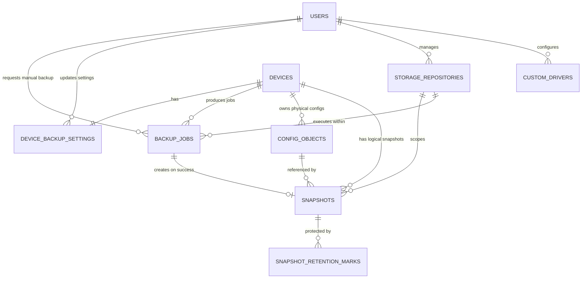

# Network Backup Dashboard — Database Schema & ERD

**Version:** 1.0  
**Status:** Proposed Final Schema for Backend v1  
**Database:** PostgreSQL 16+  
**ORM:** SQLAlchemy 2.x  
**Migration:** Alembic  
**Application Timezone:** Asia/Jakarta  
**Timestamp Storage:** PostgreSQL `TIMESTAMPTZ` (UTC-aware)

---

# 1. Database Design Principles

The database follows these principles:

1. **Zabbix remains the Single Source of Truth** for network-device identity and operational status.
2. PostgreSQL stores a synchronized application representation of Zabbix devices plus backup-specific settings/history.
3. Redis is not authoritative storage; it is used for queue/session/locks only.
4. Backup execution history is never deleted by retention.
5. Logical backup snapshots are separated from physical S3 objects.
6. Multiple logical snapshots may point to one physical S3 object when configuration does not change.
7. Latest Known Good configuration is always protected.
8. Business-state strings use Python `StrEnum` + `VARCHAR`, not PostgreSQL native ENUM, to simplify migrations.
9. User/device/history rows should generally be preserved rather than physically deleted.
10. All state-changing relationships must remain explainable for TA demonstration and debugging.

---

# 2. Complete Database Tables

The database contains ten primary tables:

```text
1. users
2. devices
3. device_backup_settings
4. backup_jobs
5. config_objects
6. snapshots
7. snapshot_retention_marks
8. integration_status
9. storage_repositories
10. custom_drivers
```

Redis holds:

```text
session data
Celery queue data
short-lived cache
per-device distributed lock
```

No `sessions` table is required in PostgreSQL.

---

# 3. ERD — High Level



`integration_status` is intentionally independent because it represents the current status of external integrations rather than a per-device relationship.

---

# 4. ERD — Conceptual View

```text
+----------------+
|     users      |
+----------------+
| id PK          |
| username       |
| password_hash  |
| role           |
| is_active      |
+-------+--------+
        |
        | requested_by / updated_by
        |
        +---------------------------+
        |                           |
        v                           v
+----------------------+     +--------------------------+
|     backup_jobs      |     | device_backup_settings   |
+----------------------+     +--------------------------+
| id UUID PK           |     | device_id PK/FK          |
| device_id FK         |     | driver_key               |
| requested_by FK      |     | schedule_enabled         |
| driver_key           |     | daily_time               |
| state                |     | next_run_at              |
| content_sha256       |     | retention_policy         |
| failure_*            |     | updated_by FK            |
+----------+-----------+     +-------------+------------+
           |                                 ^
           | creates                         |
           v                                 | 1:1
+----------------------+                     |
|      snapshots       |                     |
+----------------------+                     |
| id PK                |                     |
| device_id FK         |                     |
| backup_job_id FK UQ  |                     |
| config_object_id FK  |                     |
| captured_at          |                     |
| change_status        |                     |
| is_retained          |                     |
+----------+-----------+                     |
           |                                 |
           | N:1                             |
           v                                 |
+----------------------+          +----------+----------+
|    config_objects    |          |       devices       |
+----------------------+          +---------------------+
| id PK                |          | id PK               |
| device_id FK         |<---------| zabbix_host_id UQ   |
| content_sha256       |          | hostname            |
| object_sha256        |          | ip_address          |
| s3_key               |          | vendor              |
| storage_status       |          | model               |
+----------------------+          | availability_status |
                                  | source_present      |
                                  +----------+----------+
                                             |
                                             | 1:N
                                             v
                                  +-----------------------+
                                  |      backup_jobs      |
                                  +-----------------------+

snapshots
   |
   | 1:N
   v
+-----------------------------+
| snapshot_retention_marks    |
+-----------------------------+
| snapshot_id PK/FK           |
| mark_type PK                |
| marked_at                   |
+-----------------------------+


+-----------------------------+
| integration_status          |
+-----------------------------+
| name PK                     |
| status                      |
| summary                     |
| details JSONB               |
| last_checked_at             |
+-----------------------------+
```

---

# 5. Table: `users`

## Purpose

Stores application users for login and RBAC.

Roles:

```text
admin
viewer
```

The frontend may show a Delete action, but the recommended database behavior is **soft deactivation** using `is_active=false`, not physical deletion. This preserves historical references such as `backup_jobs.requested_by`.

## Columns

| Column | PostgreSQL Type | Null | Default | Notes |
|---|---|---:|---|---|
| `id` | `BIGSERIAL` | No | auto | Primary key |
| `username` | `VARCHAR(64)` | No | | Unique, stored normalized lower-case |
| `password_hash` | `VARCHAR(255)` | No | | Argon2id hash only |
| `role` | `VARCHAR(16)` | No | | `admin` / `viewer` |
| `is_active` | `BOOLEAN` | No | `TRUE` | Soft-delete/deactivation |
| `last_login_at` | `TIMESTAMPTZ` | Yes | | Last successful login |
| `created_at` | `TIMESTAMPTZ` | No | `now()` | |
| `updated_at` | `TIMESTAMPTZ` | No | `now()` | |

## Constraints

```sql
UNIQUE (username)

CHECK (role IN ('admin', 'viewer'))
```

Application rules:

```text
username normalized to lower-case before save
cannot deactivate own currently logged-in account
cannot deactivate last active Admin
password never stored in plaintext
```

## Recommended Indexes

```sql
CREATE UNIQUE INDEX uq_users_username ON users(username);
CREATE INDEX ix_users_active_role ON users(is_active, role);
```

## Example

```text
id            = 1
username      = admin
password_hash = $argon2id$...
role          = admin
is_active     = true
```

---

# 6. Table: `devices`

## Purpose

Stores the application's local synchronized representation of network devices from Zabbix.

This is **not** an independent inventory database.

Master source:

```text
Zabbix Network Device Host Group
```

Vendor/model source:

```text
Zabbix Host Inventory
```

## Columns

| Column | PostgreSQL Type | Null | Default | Notes |
|---|---|---:|---|---|
| `id` | `BIGSERIAL` | No | auto | Internal application ID |
| `zabbix_host_id` | `VARCHAR(64)` | No | | Zabbix host identifier |
| `hostname` | `VARCHAR(255)` | No | | |
| `ip_address` | `INET` | No | | Management IP |
| `vendor` | `VARCHAR(128)` | Yes | | Host Inventory |
| `model` | `VARCHAR(128)` | Yes | | Host Inventory |
| `host_group` | `VARCHAR(255)` | No | | Expected Network Device group |
| `availability_status` | `VARCHAR(16)` | No | `'unknown'` | Cached Zabbix state |
| `availability_checked_at` | `TIMESTAMPTZ` | Yes | | Latest status refresh |
| `zabbix_last_sync_at` | `TIMESTAMPTZ` | Yes | | Latest inventory sync |
| `source_present` | `BOOLEAN` | No | `TRUE` | Still present in target Zabbix group |
| `created_at` | `TIMESTAMPTZ` | No | `now()` | |
| `updated_at` | `TIMESTAMPTZ` | No | `now()` | |

## Status Values

```text
up
down
unknown
```

## Constraints

```sql
UNIQUE (zabbix_host_id)

CHECK (availability_status IN ('up', 'down', 'unknown'))
```

## Lifecycle

If the host disappears from the Zabbix target group:

```text
DO NOT DELETE device row

source_present = false
```

Historical jobs/snapshots remain intact.

## Recommended Indexes

```sql
CREATE UNIQUE INDEX uq_devices_zabbix_host_id
ON devices(zabbix_host_id);

CREATE INDEX ix_devices_source_present
ON devices(source_present);

CREATE INDEX ix_devices_availability_status
ON devices(availability_status);

CREATE INDEX ix_devices_hostname
ON devices(hostname);
```

---

# 7. Table: `device_backup_settings`

## Purpose

Stores backup-specific configuration that does **not** belong in Zabbix.

There is exactly one settings row per device.

## Relationship

```text
devices 1 ---- 1 device_backup_settings
```

## Columns

| Column | PostgreSQL Type | Null | Default | Notes |
|---|---|---:|---|---|
| `device_id` | `BIGINT` | No | | PK + FK -> devices.id |
| `driver_key` | `VARCHAR(64)` | Yes | | Manual driver assignment |
| `schedule_enabled` | `BOOLEAN` | No | `FALSE` | |
| `daily_time` | `TIME` | Yes | | Asia/Jakarta local time |
| `next_run_at` | `TIMESTAMPTZ` | Yes | | Scheduler state |
| `last_dispatched_at` | `TIMESTAMPTZ` | Yes | | Last scheduler dispatch |
| `retention_policy` | `VARCHAR(32)` | No | `'standard_31'` | |
| `updated_by` | `BIGINT` | Yes | | FK -> users.id |
| `updated_at` | `TIMESTAMPTZ` | No | `now()` | |

## Driver Examples

```text
sangfor-nsf
mikrotik-routeros
ruijie-switch
```

## Retention Values

```text
standard_31
smart_7_4_12_3
```

## Application Validation

```text
schedule_enabled=true => driver_key required
schedule_enabled=true => daily_time required
daily_time minute must align to a 5-minute boundary
two enabled devices may not occupy the same daily_time
```

Examples:

```text
01:00
01:05
01:10
01:15
```

## Database Constraints

```sql
CHECK (
    retention_policy IN (
        'standard_31',
        'smart_7_4_12_3'
    )
)
```

5-minute validation can also be enforced:

```sql
CHECK (
    daily_time IS NULL
    OR (
        EXTRACT(MINUTE FROM daily_time)::INT % 5 = 0
        AND EXTRACT(SECOND FROM daily_time) = 0
    )
)
```

Partial unique index:

```sql
CREATE UNIQUE INDEX uq_enabled_daily_time
ON device_backup_settings(daily_time)
WHERE schedule_enabled = TRUE;
```

## Save Behavior

`Save` persists:

```text
driver_key
schedule_enabled
daily_time
retention_policy
updated_by
```

## Clear Behavior

`Clear` sets:

```text
driver_key = NULL
schedule_enabled = FALSE
daily_time = NULL
next_run_at = NULL
last_dispatched_at = NULL
```

Recommended:

```text
retain retention_policy value
```

because Clear was defined as removing assignment/schedule, not deleting history or retention preference.

---

# 8. Table: `backup_jobs`

## Purpose

This is the most important operational-history table.

One row represents one backup execution attempt at the **job level**, whether triggered manually or by scheduler.

Retention never deletes this table.

## Relationship

```text
devices 1 ---- N backup_jobs
users   1 ---- N backup_jobs (manual requested_by only)
backup_jobs 1 ---- 0..1 snapshots
```

## Columns

| Column | PostgreSQL Type | Null | Notes |
|---|---|---:|---|
| `id` | `UUID` | No | Primary key |
| `device_id` | `BIGINT` | No | FK -> devices.id |
| `trigger_type` | `VARCHAR(16)` | No | manual / scheduled |
| `requested_by` | `BIGINT` | Yes | FK -> users.id; null for scheduler |
| `driver_key` | `VARCHAR(64)` | Yes | Driver actually used for this job |
| `scheduled_for` | `TIMESTAMPTZ` | Yes | Expected scheduled execution |
| `celery_task_id` | `VARCHAR(64)` | Yes | Celery correlation |
| `state` | `VARCHAR(40)` | No | State machine |
| `attempt_count` | `SMALLINT` | No | Starts at 0/1 per implementation |
| `max_attempts` | `SMALLINT` | No | Usually 3 |
| `zabbix_status_at_start` | `VARCHAR(16)` | Yes | up/down/unknown |
| `zabbix_checked_at` | `TIMESTAMPTZ` | Yes | Fresh pre-check time |
| `content_sha256` | `CHAR(64)` | Yes | SHA-256 normalized config |
| `change_status` | `VARCHAR(16)` | Yes | baseline/changed/no_change |
| `raw_size_bytes` | `BIGINT` | Yes | Collected raw size |
| `normalized_size_bytes` | `BIGINT` | Yes | Normalized size |
| `failure_stage` | `VARCHAR(40)` | Yes | e.g. CONNECTING |
| `failure_code` | `VARCHAR(64)` | Yes | sanitized code |
| `failure_message` | `TEXT` | Yes | sanitized message |
| `started_at` | `TIMESTAMPTZ` | Yes | |
| `finished_at` | `TIMESTAMPTZ` | Yes | |
| `duration_ms` | `BIGINT` | Yes | |
| `created_at` | `TIMESTAMPTZ` | No | |

## Why `driver_key` Is Copied Into `backup_jobs`

Even if a device is reassigned later:

```text
today: Mikrotik RouterOS Driver
next month: custom Mikrotik Driver
```

historical jobs still show which implementation was actually used.

Do not rely only on the current `device_backup_settings.driver_key`.

## Trigger Values

```text
manual
scheduled
```

## Job States

```text
QUEUED
PRECHECKING_ZABBIX
CONNECTING
COLLECTING
NORMALIZING
VALIDATING
HASHING
UPLOADING
VERIFYING
RETRYING

SUCCESS_CHANGED
SUCCESS_NO_CHANGE

SKIPPED_DEVICE_DOWN
SKIPPED_STATUS_UNKNOWN

FAILED
```

## Change Status

```text
baseline
changed
no_change
```

The first successful backup is:

```text
baseline
```

because no previous content exists.

UI may show:

```text
—
```

instead of `Baseline`.

## Last Backup Column

The device list obtains:

```text
latest_attempt = newest backup_jobs row
latest_success = newest successful backup_jobs row
```

If latest job failed, tooltip uses:

```text
failure_stage
failure_code
failure_message
attempt_count
latest_success.finished_at
```

## Recommended Indexes

```sql
CREATE INDEX ix_backup_jobs_device_created
ON backup_jobs(device_id, created_at DESC);

CREATE INDEX ix_backup_jobs_state
ON backup_jobs(state);

CREATE INDEX ix_backup_jobs_created
ON backup_jobs(created_at DESC);

CREATE INDEX ix_backup_jobs_scheduled_for
ON backup_jobs(scheduled_for);
```

Optional filtered success index:

```sql
CREATE INDEX ix_backup_jobs_device_success
ON backup_jobs(device_id, finished_at DESC)
WHERE state IN ('SUCCESS_CHANGED', 'SUCCESS_NO_CHANGE');
```

---

# 9. Table: `config_objects`

## Purpose

Represents **physical configuration objects stored in Ceph S3**.

One row = one actual S3 configuration object.

This is deliberately separated from logical backup snapshots.

## Relationship

```text
devices       1 ---- N config_objects
config_objects 1 ---- N snapshots
```

## Columns

| Column | PostgreSQL Type | Null | Notes |
|---|---|---:|---|
| `id` | `BIGSERIAL` | No | Primary key |
| `device_id` | `BIGINT` | No | FK -> devices.id |
| `content_sha256` | `CHAR(64)` | No | Hash normalized content |
| `object_sha256` | `CHAR(64)` | No | Hash raw bytes actually stored |
| `s3_bucket` | `VARCHAR(255)` | No | |
| `s3_key` | `TEXT` | No | |
| `extension` | `VARCHAR(16)` | No | rsc/conf/cfg/etc |
| `size_bytes` | `BIGINT` | No | raw stored bytes |
| `etag` | `VARCHAR(255)` | Yes | informational only |
| `storage_status` | `VARCHAR(16)` | No | available/deleted/error |
| `uploaded_at` | `TIMESTAMPTZ` | Yes | |
| `verified_at` | `TIMESTAMPTZ` | Yes | |
| `deleted_at` | `TIMESTAMPTZ` | Yes | Physical deletion timestamp |
| `created_at` | `TIMESTAMPTZ` | No | |

## Two Hashes

### `content_sha256`

Input:

```text
normalized configuration
```

Used for:

```text
Changed / No Change
content reuse
unique object decision
```

### `object_sha256`

Input:

```text
raw bytes actually uploaded to S3
```

Used for:

```text
stored-file checksum verification
download verification
```

Do not use `content_sha256` as the raw-object integrity check.

## Unique Rule

```sql
UNIQUE(device_id, content_sha256)
```

Therefore a device cannot have two physical objects representing the same normalized configuration.

Recommended S3 key:

```text
network-config/{device_id}/objects/{content_sha256}.{extension}
```

## Additional Constraint

Recommended:

```sql
UNIQUE(s3_bucket, s3_key)
```

## Storage Status

```text
available
deleted
error
```

A database row remains after the S3 file is garbage-collected:

```text
storage_status = deleted
deleted_at = ...
```

This preserves historical metadata.

## Recommended Indexes

```sql
CREATE UNIQUE INDEX uq_config_object_content
ON config_objects(device_id, content_sha256);

CREATE UNIQUE INDEX uq_config_object_s3_key
ON config_objects(s3_bucket, s3_key);

CREATE INDEX ix_config_objects_storage_status
ON config_objects(storage_status);
```

---

# 10. Table: `snapshots`

## Purpose

Represents the **logical backup version/history** presented to the user.

One successful daily job always creates one snapshot.

Even if configuration is unchanged:

```text
new snapshot
same config_object
```

## Relationship

```text
devices       1 ---- N snapshots
backup_jobs   1 ---- 0..1 snapshot
config_objects 1 ---- N snapshots
```

## Columns

| Column | PostgreSQL Type | Null | Notes |
|---|---|---:|---|
| `id` | `BIGSERIAL` | No | Primary key |
| `device_id` | `BIGINT` | No | FK -> devices.id |
| `backup_job_id` | `UUID` | No | FK -> backup_jobs.id, UNIQUE |
| `config_object_id` | `BIGINT` | No | FK -> config_objects.id |
| `captured_at` | `TIMESTAMPTZ` | No | Backup capture time |
| `change_status` | `VARCHAR(16)` | No | baseline/changed/no_change |
| `retention_policy_at_capture` | `VARCHAR(32)` | No | historical policy |
| `display_filename` | `VARCHAR(255)` | No | UI/download filename |
| `is_retained` | `BOOLEAN` | No | current computed result |
| `expired_at` | `TIMESTAMPTZ` | Yes | logical expiration |
| `created_at` | `TIMESTAMPTZ` | No | |

## Why Store `retention_policy_at_capture`

Current device policy may change later:

```text
January: standard_31
February: smart_7_4_12_3
```

Historical snapshot should still record the policy that applied when it was captured.

## Example — No Change

```text
Snapshot 101 -> Object 17
Snapshot 102 -> Object 17
Snapshot 103 -> Object 17
```

Each snapshot has a different:

```text
captured_at
backup_job_id
display_filename
```

but references the same physical file.

## Filename

Recommended example:

```text
mkk-core-switch_20261004_010000.cfg
```

Even if multiple snapshots reference the same object, the download endpoint may send the same S3 bytes with a snapshot-specific `Content-Disposition` filename.

## Recommended Indexes

```sql
CREATE UNIQUE INDEX uq_snapshots_backup_job
ON snapshots(backup_job_id);

CREATE INDEX ix_snapshots_device_captured
ON snapshots(device_id, captured_at DESC);

CREATE INDEX ix_snapshots_config_object
ON snapshots(config_object_id);

CREATE INDEX ix_snapshots_retained
ON snapshots(is_retained);
```

---

# 11. Table: `snapshot_retention_marks`

## Purpose

Explains **why a snapshot is currently protected**.

A snapshot may satisfy several retention tiers at once.

Example:

```text
31 Dec 2026 snapshot
```

may be:

```text
DAILY
WEEKLY
MONTHLY
YEARLY
LATEST_GOOD
```

No duplicate S3 object is needed.

## Relationship

```text
snapshots 1 ---- N snapshot_retention_marks
```

## Columns

| Column | PostgreSQL Type | Null | Notes |
|---|---|---:|---|
| `snapshot_id` | `BIGINT` | No | FK -> snapshots.id |
| `mark_type` | `VARCHAR(32)` | No | retention reason |
| `marked_at` | `TIMESTAMPTZ` | No | |

Composite primary key:

```text
(snapshot_id, mark_type)
```

## Mark Types

```text
STANDARD_WINDOW
DAILY
WEEKLY
MONTHLY
YEARLY
LATEST_GOOD
```

## Retained Rule

```text
snapshot has >= 1 current retention mark
=> is_retained = true

snapshot has 0 retention marks
=> is_retained = false
=> expired_at populated
```

The retention engine may recalculate marks and replace this table's rows.

This table is current retention state, not an audit log of all past retention decisions.

## Recommended Indexes

Composite PK already indexes:

```text
snapshot_id + mark_type
```

Also:

```sql
CREATE INDEX ix_retention_marks_type
ON snapshot_retention_marks(mark_type);
```

---

# 12. Table: `integration_status`

## Purpose

Stores the latest health state of external integrations.

This table is **current status cache**, not historical monitoring.

## Initial Rows

```text
zabbix_sync
ceph_health
```

Potential future:

```text
feishu_webhook
s3_repository
```

only if required later.

## Columns

| Column | PostgreSQL Type | Null | Notes |
|---|---|---:|---|
| `name` | `VARCHAR(64)` | No | Primary key |
| `status` | `VARCHAR(32)` | No | normalized state |
| `summary` | `TEXT` | Yes | short message |
| `details` | `JSONB` | Yes | structured health reason |
| `last_checked_at` | `TIMESTAMPTZ` | Yes | |
| `last_success_at` | `TIMESTAMPTZ` | Yes | |
| `updated_at` | `TIMESTAMPTZ` | No | |

## Ceph Example

```json
{
  "name": "ceph_health",
  "status": "HEALTH_WARN",
  "summary": "1 OSD down; 2 PG degraded",
  "details": {
    "osd_down": 1,
    "pg_degraded": 2
  }
}
```

## Zabbix Example

```json
{
  "name": "zabbix_sync",
  "status": "OK",
  "summary": "27 network devices synchronized",
  "details": {
    "device_count": 27
  }
}
```

---

# 12A. Table: `storage_repositories`

Stores multi-repository S3 / Ceph targets with active status, initialization state, and encrypted credentials.

| Column | Type | Nullable | Default | Description |
|---|---|---|---|---|
| `id` | `UUID` | No | `uuid4()` | Primary key |
| `name` | `VARCHAR(128)` | No | - | Repository display name |
| `endpoint` | `VARCHAR(255)` | No | - | S3 endpoint URL (e.g. `https://10.11.50.50:7443`) |
| `bucket` | `VARCHAR(128)` | No | - | S3 bucket name |
| `access_key` | `VARCHAR(128)` | No | - | S3 Access Key ID |
| `secret_key_encrypted` | `VARCHAR(512)` | No | - | 256-bit AES-256-CBC + HMAC-SHA256 encrypted secret key |
| `secure` | `BOOLEAN` | No | `true` | Enforce SSL/TLS certificate verification |
| `is_active` | `BOOLEAN` | No | `false` | Currently mounted active repository |
| `is_initialized` | `BOOLEAN` | No | `false` | Master password initialized & `repo_manifest.enc` written |
| `master_key_encrypted` | `VARCHAR(512)` | Yes | `NULL` | 256-bit AES-256-CBC encrypted master key |
| `repo_manifest` | `JSONB` | Yes | `NULL` | Cached repository metadata and version info |
| `created_at` | `TIMESTAMPTZ` | No | `now()` | Creation timestamp |
| `updated_at` | `TIMESTAMPTZ` | No | `now()` | Last update timestamp |

### Cryptographic Storage Notes:
* `secret_key_encrypted` and `master_key_encrypted` are protected in the PostgreSQL Database Credential Vault using **AES-256-CBC + HMAC-SHA256** (PBKDF2-HMAC-SHA256 100,000 iterations from `APP_SECRET_KEY`).
* Legacy Fernet 128-bit tokens (`gAAAAA...`) are automatically supported via zero-downtime backward-compatible decryption fallback.

---

# 12B. Table: `custom_drivers`

Stores user-configured parametric CLI backup workers created via Backup Worker Management.

| Column | Type | Nullable | Default | Description |
|---|---|---|---|---|
| `id` | `UUID` | No | `uuid4()` | Primary key |
| `key` | `VARCHAR(64)` | No | - | Unique driver slug identifier (indexed) |
| `label` | `VARCHAR(128)` | No | - | Human-readable driver title |
| `vendor_hint` | `VARCHAR(128)` | No | - | Matching vendor suggestion |
| `model_hint` | `VARCHAR(128)` | No | - | Matching model suggestion |
| `transport` | `VARCHAR(32)` | No | `'ssh'` | Transport protocol (`ssh`, `telnet`) |
| `default_port` | `INTEGER` | No | `22` | Target TCP port |
| `connect_timeout` | `INTEGER` | No | `15` | Connection timeout in seconds |
| `command_timeout` | `INTEGER` | No | `60` | Command execution timeout in seconds |
| `need_enable` | `BOOLEAN` | No | `false` | Privilege escalation required |
| `enable_command` | `VARCHAR(64)` | No | `'enable'` | Command to enter privilege mode |
| `enable_prompt_pattern`| `VARCHAR(64)` | No | `r"[#$]"` | Regex pattern for enable prompt |
| `disable_paging_command`| `VARCHAR(128)`| Yes | `NULL` | Pagination bypass command |
| `paging_mode` | `VARCHAR(32)` | No | `'none'` | Pagination handling mode |
| `backup_command` | `VARCHAR(255)`| No | `'show running-config'` | CLI command to extract config |
| `output_extension` | `VARCHAR(16)` | No | `'txt'` | Download file extension |
| `strip_patterns` | `JSONB` | Yes | `[]` | Regex patterns to strip before hashing |
| `validation_min_length` | `INTEGER` | No | `30` | Minimum character length for valid output |
| `validation_required_keyword`| `VARCHAR(64)`| Yes | `'hostname'`| Keyword required in valid output |
| `is_active` | `BOOLEAN` | No | `true` | Driver availability status |
| `created_at` | `TIMESTAMPTZ` | No | `now()` | Creation timestamp |
| `updated_at` | `TIMESTAMPTZ` | No | `now()` | Last update timestamp |

---

# 13. Relationship Rules

## 13.1 User -> Backup Job

```text
Manual job:
requested_by = user id

Scheduled job:
requested_by = NULL
```

Recommended FK:

```text
ON DELETE SET NULL
```

although normal user deletion should be implemented as soft deactivation.

---

## 13.2 Device -> Backup Settings

Exactly one settings row per device.

Recommended creation behavior:

When Zabbix sync creates a new device, application may immediately create a blank settings row:

```text
driver_key = NULL
schedule_enabled = false
retention_policy = standard_31
```

This simplifies frontend joins.

---

## 13.3 Device -> Job

One device may have unlimited historical jobs.

Never cascade-delete jobs when device leaves Zabbix.

Device itself should not normally be physically deleted.

---

## 13.4 Job -> Snapshot

Only successful jobs create snapshots.

```text
SUCCESS_CHANGED   -> snapshot
SUCCESS_NO_CHANGE -> snapshot

FAILED                  -> no snapshot
SKIPPED_DEVICE_DOWN     -> no snapshot
SKIPPED_STATUS_UNKNOWN  -> no snapshot
```

---

## 13.5 Snapshot -> Config Object

Every successful snapshot references exactly one physical config object.

Changed/baseline:

```text
new config object
new snapshot -> new object
```

No Change:

```text
new snapshot -> existing object
```

---

# 14. Full Example: Three Days No Change

Assume device:

```text
devices.id = 27
hostname   = MKK-Core-Switch
```

## Day 1

Collected normalized config:

```text
SHA = AAAA...
```

No previous config.

Create:

```text
backup_jobs:
J1 SUCCESS_CHANGED / change_status=baseline

config_objects:
O1 content_sha256=AAAA...

snapshots:
S1 -> O1
```

## Day 2

Same normalized hash:

```text
AAAA...
```

Create:

```text
backup_jobs:
J2 SUCCESS_NO_CHANGE

NO new config_object

snapshots:
S2 -> O1
```

## Day 3

Same again:

```text
backup_jobs:
J3 SUCCESS_NO_CHANGE

snapshots:
S3 -> O1
```

Relationship:

```text
J1 -> S1 \
J2 -> S2  ---> O1
J3 -> S3 /
```

Result:

```text
3 successful backup histories
3 logical backup snapshots
1 physical Ceph object
```

---

# 15. Example: Configuration Changes on Day 4

Day 4:

```text
content_sha256 = BBBB...
```

Create:

```text
J4 SUCCESS_CHANGED
O2 content_sha256=BBBB...
S4 -> O2
```

Now:

```text
S1 \
S2  --> O1 (AAAA)
S3 /

S4 ---> O2 (BBBB)
```

---

# 16. Example: No Change for Three Months

Assume configuration last changed on:

```text
01 Jan
```

and stays unchanged through:

```text
01 Apr
```

Daily jobs/snapshots still continue:

```text
Jan 01 snapshot -> Object X
Jan 02 snapshot -> Object X
...
Apr 01 snapshot -> Object X
```

Smart/standard retention may expire many old snapshots.

However:

```text
latest successful snapshot
=> LATEST_GOOD mark
```

and recent retained snapshots still reference Object X.

Therefore:

```text
Object X MUST NOT be garbage-collected.
```

The physical file remains available even if it was first created months earlier.

---

# 17. Latest Known Good Rule

For every device:

```text
SELECT newest successful snapshot
ORDER BY captured_at DESC
LIMIT 1
```

Always ensure:

```text
snapshot_retention_marks:
LATEST_GOOD
```

This protection applies even when:

```text
device schedule disabled
device is offline for months
device removed from target Zabbix group
standard retention window passes
smart tiers rotate
```

---

# 18. Garbage Collection Rule

Never delete S3 object based only on:

```text
uploaded_at age
```

Correct process:

```text
1. Recalculate snapshot retention marks
2. Mark unprotected snapshots expired
3. For each config_object:
      count retained snapshots referencing it
4. If count == 0:
      eligible for S3 deletion
5. Delete from S3
6. Keep DB row
7. storage_status = deleted
8. deleted_at = now()
```

Recommended safety:

Use two phases:

```text
Phase A: determine GC candidates
Phase B: delete object and verify result
```

Do not delete DB metadata first.

---

# 19. Standard 31-Day Retention

Recommended interpretation:

Retain all successful logical snapshots with:

```text
captured_at >= current_time - 31 days
```

plus:

```text
LATEST_GOOD
```

Every retained snapshot receives:

```text
STANDARD_WINDOW
```

The newest successful snapshot additionally receives:

```text
LATEST_GOOD
```

---

# 20. Smart 7/4/12/3 Retention

Use application timezone:

```text
Asia/Jakarta
```

Recommended deterministic selection:

## Daily

Newest successful snapshot for each calendar date across latest 7 days.

## Weekly

Newest successful snapshot in each ISO week across latest 4 weekly buckets.

## Monthly

Newest successful snapshot in each calendar month across latest 12 monthly buckets.

## Yearly

Newest successful snapshot in each calendar year across latest 3 yearly buckets.

## Latest Good

Always newest successful snapshot independent of tiers.

One snapshot may have multiple marks.

---

# 21. Recommended Foreign Key Behavior

## `device_backup_settings.device_id`

```text
FK devices.id
ON DELETE RESTRICT
```

Device should not be physically deleted while history exists.

## `backup_jobs.device_id`

```text
ON DELETE RESTRICT
```

## `backup_jobs.requested_by`

```text
ON DELETE SET NULL
```

## `device_backup_settings.updated_by`

```text
ON DELETE SET NULL
```

## `config_objects.device_id`

```text
ON DELETE RESTRICT
```

## `snapshots.device_id`

```text
ON DELETE RESTRICT
```

## `snapshots.backup_job_id`

```text
ON DELETE RESTRICT
```

## `snapshots.config_object_id`

```text
ON DELETE RESTRICT
```

## `snapshot_retention_marks.snapshot_id`

```text
ON DELETE CASCADE
```

This last cascade is acceptable because retention marks have no independent meaning without a snapshot.

In normal v1 operation snapshots themselves are not hard-deleted.

---

# 22. Transaction Boundaries

Important database writes should be transactional.

## Manual Backup Request

One transaction:

```text
validate permission
validate device/driver
create backup_jobs QUEUED
commit
enqueue Celery task
```

If Celery enqueue fails after commit:

```text
job remains visible
state may be moved to FAILED/QUEUE_ERROR
```

Do not hide it.

## Successful Changed Backup

Recommended order:

```text
upload/verify S3 first
then DB transaction:
  upsert config_object
  create snapshot
  update backup_job success
```

## Successful No-Change Backup

One transaction:

```text
find existing config_object
create snapshot referencing it
update backup_job SUCCESS_NO_CHANGE
```

## Retention

Per-device transaction is preferable to one giant global transaction.

---

# 23. Concurrency / Race Protection

Use Redis per-device lock:

```text
backup-lock:device:{device_id}
```

Purpose:

Prevent:

```text
Scheduled backup
+
Manual Backup Now
```

from running simultaneously for the same device.

Database also protects duplicate physical objects through:

```text
UNIQUE(device_id, content_sha256)
```

If two workers somehow calculate the same new hash, one may win insert; the other should fetch/reuse the existing `config_objects` row.

---

# 24. Schedule Collision Protection

Business rule:

```text
one enabled device per 5-minute daily slot
```

Database partial unique index:

```sql
CREATE UNIQUE INDEX uq_enabled_daily_time
ON device_backup_settings(daily_time)
WHERE schedule_enabled = TRUE;
```

Frontend should only offer:

```text
00, 05, 10, 15, ... 55
```

minute values.

Backend still validates independently.

---

# 25. Dashboard Query Model

The device-list API should not force the frontend to make many calls.

Recommended backend joins/derived fields:

```text
device identity
backup settings
latest backup attempt
latest successful backup
latest snapshot/change state
```

Conceptual response per device:

```json
{
  "id": 27,
  "hostname": "MKK-Core-Switch",
  "status": "up",
  "ip_address": "10.11.0.3",
  "vendor": "Ruijie",
  "model": "S5350",
  "backup_settings": {
    "driver_key": "ruijie-switch",
    "schedule_enabled": true,
    "daily_time": "01:10:00",
    "retention_policy": "smart_7_4_12_3"
  },
  "latest_attempt": {
    "state": "FAILED",
    "finished_at": "2026-10-04T01:10:12+07:00",
    "failure_stage": "CONNECTING",
    "failure_code": "CONNECTION_TIMEOUT",
    "failure_message": "SSH connection timeout",
    "attempt_count": 3
  },
  "latest_success": {
    "state": "SUCCESS_NO_CHANGE",
    "finished_at": "2026-10-03T01:10:04+07:00"
  },
  "change_status": "no_change"
}
```

This supports the Last Backup hover without Activity Audit.

---

# 26. Dashboard Header Queries

## Total Devices

Recommended:

```text
count devices where source_present=true
```

## Backup Success Today

Denominator:

```text
unique devices scheduled today
```

Numerator:

```text
unique scheduled devices having
SUCCESS_CHANGED or SUCCESS_NO_CHANGE
for today's expected schedule
```

`SKIPPED_DEVICE_DOWN`, `SKIPPED_STATUS_UNKNOWN`, and `FAILED` are unsuccessful.

Manual jobs should not inflate this KPI.

---

# 27. Data That Must Never Enter PostgreSQL

Do not store these in application business tables:

```text
network-device plaintext password
Ceph S3 secret key
Zabbix API token
Feishu webhook secret/url if considered sensitive
session cookie value
```

They belong in backend environment/secrets configuration.

Application user password is stored only as:

```text
Argon2id password_hash
```

---

# 28. Migration Order

Recommended Alembic migration sequence:

```text
001_create_users
002_create_devices
003_create_device_backup_settings
004_create_backup_jobs
005_create_config_objects
006_create_snapshots
007_create_snapshot_retention_marks
008_create_integration_status
009_add_indexes_and_constraints
010_seed_bootstrap_users_if_required
```

A single initial migration is technically possible, but multiple logical migrations are easier for agentic development and troubleshooting.

---

# 29. SQLAlchemy Relationship Direction

Recommended model relations:

```text
User.backup_jobs_requested
User.settings_updated

Device.backup_settings
Device.backup_jobs
Device.config_objects
Device.snapshots

BackupJob.device
BackupJob.requested_by_user
BackupJob.snapshot

ConfigObject.device
ConfigObject.snapshots

Snapshot.device
Snapshot.backup_job
Snapshot.config_object
Snapshot.retention_marks

SnapshotRetentionMark.snapshot
```

Use lazy-loading strategy deliberately; API list queries should use eager loading/selects that avoid N+1 queries.

---

# 30. v2 Cryptographic Architecture & Envelope Layout (Delivered)

In v2, rather than altering the `config_objects` database table with per-record cipher columns, zero-trust cryptographic protection is encapsulated directly inside each physical S3 object:

### Physical S3 Configuration Object Layout:
```text
+----------------+----------------+----------------+--------------------------+
| Salt (16B)     | IV (16B)       | HMAC (32B)     | Ciphertext (variable)    |
+----------------+----------------+----------------+--------------------------+
```
- **Compression:** Plaintext config compressed via zlib Deflate (Level 6) with magic marker `NBZ1` prior to encryption (~75% reduction).
- **Key Derivation:** Master Password derived with PBKDF2-HMAC-SHA256 (100,000 iterations, 16-byte random salt) producing separate 32-byte encryption and HMAC keys.
- **Cipher:** AES-256-CBC with PKCS#7 padding.
- **Integrity:** HMAC-SHA256 calculated over `salt + iv + ciphertext` (Encrypt-then-MAC). Constant-time verification (`hmac.compare_digest`) protects against padding oracle attacks.

### Database Credential Vault (PostgreSQL):
- Secrets in `storage_repositories` (`secret_key_encrypted` and `master_key_encrypted`) are stored as URL-safe Base64 envelopes containing PBKDF2-derived AES-256-CBC + HMAC-SHA256 authenticated payloads, replacing legacy 128-bit Fernet tokens with zero-downtime backward compatibility.

---

# 31. Final Schema Summary

```text
users
  -> authentication + RBAC + preferences

devices
  -> Zabbix synchronized asset/status cache

device_backup_settings
  -> driver + daily schedule + retention

backup_jobs
  -> complete operational execution history

config_objects
  -> unique physical configuration objects in Ceph S3

snapshots
  -> logical daily backup versions/history scoped to active repository

snapshot_retention_marks
  -> reasons a logical snapshot is protected (31-day, GFS, Latest Known Good)

integration_status
  -> current Ceph/Zabbix integration health

storage_repositories
  -> S3/Ceph repository management with AES-256 encrypted credential vault

custom_drivers
  -> user-defined parametric CLI backup workers
```

The key architectural separation is:

```text
BACKUP JOB
= what happened operationally

SNAPSHOT
= logical backup version

CONFIG OBJECT
= physical file in Ceph
```

Those three concepts must not be merged into one table.

---

# 32. Database Definition of Done

Database design is complete when the implementation can prove:

1. a Zabbix device can exist without a driver assigned;
2. each device has one backup-settings row;
3. duplicate enabled daily schedule slots are rejected;
4. manual/scheduled jobs persist independently of browser state;
5. each job records the driver used;
6. failures remain in history;
7. only successful jobs create snapshots;
8. unchanged backups create new snapshots but reuse the same config object;
9. changed backup creates a new config object;
10. raw object checksum is separated from normalized change hash;
11. 31-day retention marks the correct snapshots;
12. Smart 7/4/12/3 creates the correct tier marks;
13. Latest Known Good always remains retained;
14. config object is not deleted while any retained snapshot references it;
15. physical S3 deletion does not erase database history;
16. Viewer/Admin user history references remain valid if a user is deactivated;
17. Ceph/Zabbix current health can be stored without mixing it with backup history.
