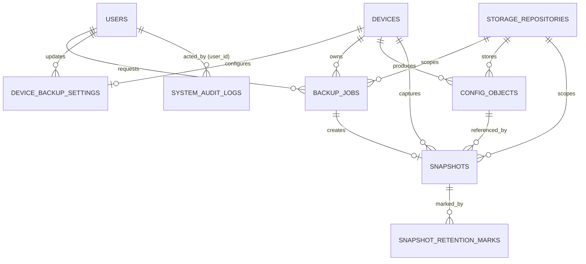

# Arsitektur dan Skema Database NetBackup

## Ringkasan

PostgreSQL menyimpan seluruh metadata persisten NetBackup. Redis dipakai untuk session, broker Celery, result backend, lock, dan heartbeat, tetapi bukan sumber kebenaran untuk riwayat backup.

Skema aktif terdiri dari 11 tabel. Model SQLAlchemy berada di `backend/app/models/` dan riwayat migrasi berada di `migrations/versions/`. Revision Alembic terakhir adalah `015_system_audit_logs`.

## Prinsip desain

- Identitas internal menggunakan `BIGINT` untuk entitas berurutan dan UUID untuk pekerjaan/repository/driver kustom.
- Penghapusan perangkat dibatasi oleh foreign key agar histori tidak hilang tanpa sengaja.
- Penghapusan pengguna pada relasi audit memakai `SET NULL`.
- Snapshot adalah titik pemulihan logis, sedangkan `config_objects` mewakili objek fisik di S3.
- Deduplikasi dibatasi per repository dan perangkat.
- Hanya satu repository boleh aktif.
- Retention memakai dua tahap: menandai snapshot expired, lalu menandai objek `pending_delete` sebelum purge.
- Timestamp operasional memakai timezone. `daily_time` menyimpan jam lokal tanpa timezone.

## ERD



`custom_drivers` dan `integration_status` berdiri sendiri. `device_backup_settings.driver_key` dan `backup_jobs.driver_key` menyimpan logical key driver, bukan foreign key, karena registry menggabungkan implementasi bawaan dan record kustom.

## Ringkasan tabel

| Tabel | Primary key | Fungsi |
|---|---|---|
| `users` | `id` | Akun dan peran aplikasi |
| `devices` | `id` | Inventaris perangkat dari Zabbix |
| `device_backup_settings` | `device_id` | Driver, jadwal, dan retention per perangkat |
| `backup_jobs` | `id` | Riwayat state dan hasil setiap eksekusi |
| `storage_repositories` | `id` | Konfigurasi repository S3 |
| `config_objects` | `id` | Metadata objek fisik S3 |
| `snapshots` | `id` | Titik pemulihan logis |
| `snapshot_retention_marks` | `snapshot_id`, `mark_type` | Tier retention snapshot |
| `custom_drivers` | `id` | Definisi driver parametrik |
| `integration_status` | `name` | Cache status integrasi |
| `system_audit_logs` | `id` | Jejak audit terpusat, WAF threat inspection, dan security monitoring |

## Tabel `users`

| Kolom | Tipe | Null | Keterangan |
|---|---|---|---|
| `id` | BIGINT | Tidak | Primary key |
| `username` | VARCHAR(64) | Tidak | Identitas login unik |
| `email` | VARCHAR(255) | Ya | Email unik untuk alur reset |
| `password_hash` | VARCHAR(255) | Tidak | Nilai internal autentikasi yang tidak boleh muncul pada respons; algoritmanya tidak dibahas |
| `role` | VARCHAR(16) | Tidak | `admin` atau `viewer` |
| `is_active` | BOOLEAN | Tidak | Deaktivasi logis pengguna |
| `last_login_at` | TIMESTAMPTZ | Ya | Login terakhir |
| `created_at` | TIMESTAMPTZ | Tidak | Waktu pembuatan |
| `updated_at` | TIMESTAMPTZ | Tidak | Waktu perubahan |

Constraint dan indeks penting:

- `uq_users_username` untuk username unik.
- `uq_users_email` untuk email unik bila ada.
- `ix_users_active_role` untuk filter status/peran.
- Role dibatasi menjadi `admin` atau `viewer`.

## Tabel `devices`

| Kolom | Tipe | Null | Keterangan |
|---|---|---|---|
| `id` | BIGINT | Tidak | Primary key |
| `zabbix_host_id` | VARCHAR(64) | Tidak | ID unik dari Zabbix |
| `hostname` | VARCHAR(255) | Tidak | Nama perangkat |
| `ip_address` | INET | Tidak | Alamat manajemen |
| `vendor` | VARCHAR(128) | Ya | Vendor hasil inventaris |
| `model` | VARCHAR(128) | Ya | Model hasil inventaris |
| `host_group` | VARCHAR(255) | Tidak | Grup sumber |
| `availability_status` | VARCHAR(16) | Tidak | `up`, `down`, atau `unknown` |
| `availability_checked_at` | TIMESTAMPTZ | Ya | Waktu pemeriksaan status |
| `zabbix_last_sync_at` | TIMESTAMPTZ | Ya | Waktu sinkronisasi terakhir |
| `source_present` | BOOLEAN | Tidak | Apakah perangkat masih ada pada sumber |
| `created_at` | TIMESTAMPTZ | Tidak | Waktu pembuatan |
| `updated_at` | TIMESTAMPTZ | Tidak | Waktu perubahan |

`zabbix_host_id` unik. Indeks tersedia untuk `source_present`, `availability_status`, dan `hostname`.

## Tabel `device_backup_settings`

| Kolom | Tipe | Null | Keterangan |
|---|---|---|---|
| `device_id` | BIGINT | Tidak | PK dan FK ke `devices.id` |
| `driver_key` | VARCHAR(64) | Ya | Key driver registry |
| `schedule_enabled` | BOOLEAN | Tidak | Mengaktifkan jadwal harian |
| `daily_time` | TIME | Ya | Jam lokal pada slot lima menit |
| `next_run_at` | TIMESTAMPTZ | Ya | Eksekusi terjadwal berikutnya |
| `last_dispatched_at` | TIMESTAMPTZ | Ya | Dispatch terakhir |
| `retention_policy` | VARCHAR(32) | Tidak | `standard_31` atau `smart_7_4_12_3` |
| `updated_by` | BIGINT | Ya | FK ke `users.id`, `SET NULL` |
| `updated_at` | TIMESTAMPTZ | Tidak | Waktu perubahan |

Indeks unik parsial `uq_enabled_daily_time` mencegah dua jadwal aktif memakai waktu yang sama. Constraint juga memastikan menit merupakan kelipatan lima dan detik nol.

## Tabel `backup_jobs`

| Kelompok | Kolom |
|---|---|
| Identitas | `id UUID PK`, `device_id`, `repository_id`, `requested_by`, `driver_key` |
| Pemicu | `trigger_type`, `scheduled_for`, `celery_task_id` |
| State | `state`, `attempt_count`, `max_attempts` |
| Pre-check | `zabbix_status_at_start`, `zabbix_checked_at` |
| Hasil konten | `content_sha256`, `change_status`, `raw_size_bytes`, `normalized_size_bytes` |
| Kegagalan | `failure_stage`, `failure_code`, `failure_message` |
| Waktu | `started_at`, `finished_at`, `duration_ms`, `created_at` |

Relasi:

- `device_id -> devices.id` dengan `RESTRICT`.
- `requested_by -> users.id` dengan `SET NULL`.
- `repository_id -> storage_repositories.id` dengan `SET NULL`.
- Maksimal satu snapshot per job melalui indeks unik pada `snapshots.backup_job_id`.

Constraint membatasi `trigger_type`, status Zabbix, dan change status. Indeks mencakup state, waktu pembuatan, jadwal, perangkat, repository, dan pencarian backup sukses terakhir.

## Tabel `storage_repositories`

| Kolom | Tipe | Null | Keterangan |
|---|---|---|---|
| `id` | UUID | Tidak | Primary key |
| `name` | VARCHAR(128) | Tidak | Nama tampilan |
| `endpoint` | VARCHAR(255) | Tidak | Endpoint S3 |
| `bucket` | VARCHAR(128) | Tidak | Bucket repository |
| `access_key` | VARCHAR(128) | Tidak | Identifier akses |
| `secret_key_encrypted` | VARCHAR(512) | Tidak | Secret tersimpan, tidak boleh ditampilkan |
| `secure` | BOOLEAN | Tidak | Pilihan koneksi repository |
| `is_active` | BOOLEAN | Tidak | Repository aktif |
| `is_initialized` | BOOLEAN | Tidak | Manifest sudah diinisialisasi |
| `master_key_encrypted` | VARCHAR(512) | Ya | Credential untuk membuka manifest |
| `repo_manifest` | JSONB | Ya | Metadata version ID, ETag, dan hasil restore drill |
| `created_at` | TIMESTAMPTZ | Tidak | Waktu pembuatan |
| `updated_at` | TIMESTAMPTZ | Tidak | Waktu perubahan |

Indeks unik parsial `uq_storage_repositories_single_active` membatasi satu baris dengan `is_active=true`.

## Tabel `config_objects`

| Kolom | Tipe | Null | Keterangan |
|---|---|---|---|
| `id` | BIGINT | Tidak | Primary key |
| `device_id` | BIGINT | Tidak | FK ke perangkat |
| `repository_id` | UUID | Ya | FK ke repository |
| `content_sha256` | CHAR(64) | Tidak | Hash normalized plaintext |
| `object_sha256` | CHAR(64) | Tidak | Hash raw plaintext |
| `s3_bucket` | VARCHAR(255) | Tidak | Bucket saat objek dibuat |
| `s3_key` | TEXT | Tidak | Key objek |
| `extension` | VARCHAR(16) | Tidak | Ekstensi file hasil driver |
| `size_bytes` | BIGINT | Tidak | Ukuran raw plaintext |
| `etag` | VARCHAR(255) | Ya | ETag hasil PUT |
| `storage_status` | VARCHAR(16) | Tidak | `available`, `pending_delete`, `deleted`, atau `error` |
| `uploaded_at` | TIMESTAMPTZ | Ya | Waktu upload |
| `verified_at` | TIMESTAMPTZ | Ya | Waktu verifikasi terakhir |
| `deleted_at` | TIMESTAMPTZ | Ya | Waktu staging/penghapusan |
| `created_at` | TIMESTAMPTZ | Tidak | Waktu metadata dibuat |

Keunikan:

- `(repository_id, device_id, content_sha256)` untuk deduplikasi konten.
- `(repository_id, s3_bucket, s3_key)` untuk identitas objek.

## Tabel `snapshots`

| Kolom | Tipe | Null | Keterangan |
|---|---|---|---|
| `id` | BIGINT | Tidak | Primary key |
| `device_id` | BIGINT | Tidak | FK ke perangkat |
| `backup_job_id` | UUID | Tidak | FK unik ke job |
| `config_object_id` | BIGINT | Tidak | FK ke objek fisik |
| `repository_id` | UUID | Ya | FK ke repository asal |
| `captured_at` | TIMESTAMPTZ | Tidak | Waktu snapshot |
| `change_status` | VARCHAR(16) | Tidak | `baseline`, `changed`, atau `no_change` |
| `retention_policy_at_capture` | VARCHAR(32) | Tidak | Kebijakan saat snapshot dibuat |
| `display_filename` | VARCHAR(255) | Tidak | Nama file untuk download |
| `is_retained` | BOOLEAN | Tidak | Masih dapat dipakai sebagai titik pemulihan |
| `expired_at` | TIMESTAMPTZ | Ya | Waktu dinyatakan expired |
| `created_at` | TIMESTAMPTZ | Tidak | Waktu record dibuat |

Indeks mendukung histori perangkat berdasarkan waktu, pencarian object, repository, dan filter retained.

## Tabel `snapshot_retention_marks`

Primary key gabungan: `snapshot_id` dan `mark_type`.

Nilai `mark_type`:

- `STANDARD_WINDOW`
- `DAILY`
- `WEEKLY`
- `MONTHLY`
- `YEARLY`
- `LATEST_GOOD`

Foreign key memakai `ON DELETE CASCADE` agar mark hilang ketika snapshot dihapus.

## Tabel `custom_drivers`

| Kelompok | Kolom |
|---|---|
| Identitas | `id`, `key`, `label`, `vendor_hint`, `model_hint`, `is_active` |
| Koneksi | `transport`, `default_port`, `connect_timeout`, `command_timeout` |
| Privilege | `need_enable`, `enable_command`, `enable_prompt_pattern` |
| Pengambilan | `disable_paging_command`, `paging_mode`, `backup_command`, `output_extension` |
| Normalisasi/validasi | `strip_patterns JSONB`, `validation_min_length`, `validation_required_keyword` |
| Audit | `created_at`, `updated_at` |

`key` unik dan diindeks. Detail perilaku berada di [Kontrak Backup Driver](BACKUP-DRIVER-CONTRACT-v1.0.md).

## Tabel `integration_status`

| Kolom | Tipe | Null | Keterangan |
|---|---|---|---|
| `name` | VARCHAR(64) | Tidak | Primary key nama integrasi |
| `status` | VARCHAR(32) | Tidak | Status terakhir |
| `summary` | TEXT | Ya | Ringkasan aman |
| `details` | JSONB | Ya | Detail terstruktur |
| `last_checked_at` | TIMESTAMPTZ | Ya | Pemeriksaan terakhir |
| `last_success_at` | TIMESTAMPTZ | Ya | Keberhasilan terakhir |
| `updated_at` | TIMESTAMPTZ | Tidak | Perubahan record |

## Tabel `system_audit_logs`

Menyimpan jejak audit sistem, pemantauan anomali, WAF threat inspection (*brute-force*, SQLi, XSS, Path Traversal), dan riwayat operasi administratif/storage.

| Kolom | Tipe | Null | Keterangan |
|---|---|---|---|
| `id` | BIGINT | Tidak | Primary key (autoincrement) |
| `created_at` | TIMESTAMPTZ | Tidak | Waktu kejadian dicatat (default UTC/Asia/Jakarta, indexed) |
| `category` | VARCHAR(32) | Tidak | Kategori event: `STORAGE`, `AUTH`, `SECURITY`, `AUDIT`, `BACKUP_JOB`, `SYSTEM` (indexed) |
| `severity` | VARCHAR(16) | Tidak | Tingkat keparahan: `INFO`, `WARNING`, `ERROR`, `CRITICAL` (indexed) |
| `event_type` | VARCHAR(64) | Tidak | Tipe kejadian (misal: `SQLI_ATTEMPT`, `LOGIN_FAILED`, `STORAGE_MOUNTED`, indexed) |
| `source_ip` | VARCHAR(64) | Ya | Alamat IP sumber koneksi (indexed) |
| `user_agent` | VARCHAR(255) | Ya | Browser / HTTP client header |
| `user_id` | BIGINT | Ya | Foreign key `users.id` (ON DELETE SET NULL) |
| `username` | VARCHAR(128) | Ya | Nama user pelaku atau yang diuji |
| `endpoint` | VARCHAR(255) | Ya | Path endpoint atau nama worker |
| `message` | TEXT | Tidak | Ringkasan pesan aktivitas dalam bahasa Inggris |
| `details` | JSONB | Ya | Metadata tambahan, query trace, atau payload event |

**Indeks:**
- `ix_system_audit_logs_created_at` (`created_at`)
- `ix_system_audit_logs_category` (`category`)
- `ix_system_audit_logs_severity` (`severity`)
- `ix_system_audit_logs_event_type` (`event_type`)
- `ix_system_audit_logs_source_ip` (`source_ip`)
- `ix_audit_logs_filter` (`created_at DESC`, `category`, `severity`)

## Urutan migrasi

| Revision | Perubahan utama |
|---|---|
| `001_users` | Tabel pengguna |
| `002_devices` | Tabel perangkat |
| `003_settings` | Pengaturan backup perangkat |
| `004_jobs` | Pekerjaan backup |
| `005_objects` | Objek konfigurasi |
| `006_snapshots` | Snapshot |
| `007_marks` | Retention marks |
| `008_integrations` | Status integrasi |
| `009_indexes` | Indeks dan constraint baseline |
| `010_storage_and_custom_drivers` | Repository, driver kustom, dan relasi repository awal |
| `011_reconcile_schema_drift` | Kolom master key/repository job dan rekonsiliasi indeks |
| `012_multi_repo_unique` | Keunikan per repository dan satu repository aktif |
| `013_config_object_pending_delete` | Status `pending_delete` |
| `014_user_email` | Email pengguna unik |
| `015_system_audit_logs` | Tabel jejak audit `system_audit_logs` dan 6 indeks filter |

## Aturan perubahan skema

1. Jangan mengubah migration yang sudah diterapkan tanpa strategi migrasi eksplisit.
2. Tambahkan revision baru dengan `down_revision` ke head saat ini.
3. Pastikan model dan migration menghasilkan constraint yang sama.
4. Uji upgrade dari database kosong dan dari revision produksi yang benar-benar digunakan.
5. Jalankan `alembic check` terhadap database uji.
6. Perbarui dokumen ini, PRD, dan test terkait pada commit yang sama.
7. Jangan menanam credential atau data lingkungan nyata dalam migration.

## Verifikasi kontrak startup

`backend/app/main.py` mengharapkan 11 tabel berikut:

```text
users
devices
device_backup_settings
backup_jobs
config_objects
snapshots
snapshot_retention_marks
integration_status
custom_drivers
storage_repositories
system_audit_logs
```

Startup non-test juga memeriksa `storage_repositories.master_key_encrypted` dan `backup_jobs.repository_id`. Migrator harus selesai sebelum API, worker, dan beat dimulai.
