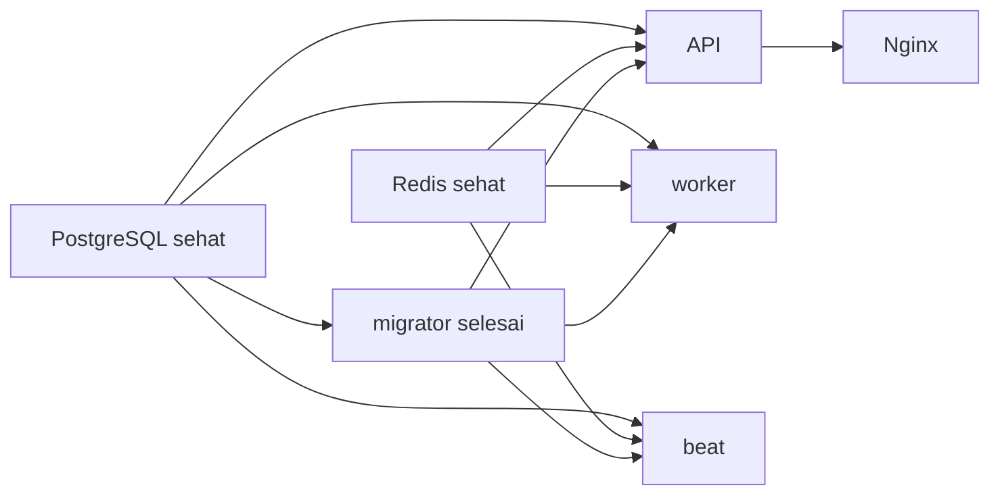

# Dependency dan Runtime

## Sumber kebenaran

- Dependency Python: `backend/requirements.txt`
- Image dan hubungan service: `docker-compose.yml`
- Image aplikasi: `backend/Dockerfile`
- Konfigurasi reverse proxy: `nginx/nginx.conf`
- Variabel konfigurasi: `.env.example` dan `backend/app/config.py`

Dokumen ini menjelaskan fungsi dependency. Versi final yang terpasang ditentukan oleh hasil build karena requirement memakai rentang versi, bukan lock file.

## Runtime

| Komponen | Versi image atau runtime | Peran |
|---|---|---|
| Python | 3.12 slim | API, worker, beat, dan migrator |
| PostgreSQL | 16 Alpine | Metadata persisten |
| Redis | 7 Alpine | Broker, result backend, session, lock, dan heartbeat |
| Nginx | 1.27 Alpine | Frontend statis dan reverse proxy |

## Library Python

| Kelompok | Package | Rentang |
|---|---|---|
| API | `fastapi` | `>=0.115,<1` |
| ASGI | `uvicorn[standard]` | `>=0.30,<1` |
| Validasi | `pydantic` | `>=2.8,<3` |
| Konfigurasi | `pydantic-settings` | `>=2.4,<3` |
| ORM | `SQLAlchemy` | `>=2.0,<3` |
| PostgreSQL driver | `psycopg[binary]` | `>=3.2,<4` |
| Migrasi | `alembic` | `>=1.13,<2` |
| Background task | `celery[redis]` | `>=5.4,<6` |
| Redis client | `redis` | `>=5.0,<7` |
| Driver perangkat | `netmiko` | `>=4.4,<5` |
| S3 client | `boto3` | `>=1.35,<2` |
| HTTP client | `httpx` | `>=0.27,<1` |
| Autentikasi aplikasi | Package yang tercantum pada `backend/requirements.txt` | Mengikuti source |
| Multipart form | `python-multipart` | `>=0.0.9,<1` |
| PDF | `reportlab` | `>=4.2,<6` |
| Spreadsheet | `openpyxl` | `>=3.1.5,<4` |

Backend memakai package kriptografi transitif untuk implementasi payload yang dijelaskan secara kanonis di [Spesifikasi Enkripsi Backup S3](enkripsi-backup-s3.md). Jangan mengganti primitive atau rentang dependency tanpa regression test restore terhadap objek lama.

## Dependency eksternal

| Sistem | Arah | Kegunaan | Perilaku saat gagal |
|---|---|---|---|
| Zabbix API | Keluar | Inventaris dan availability perangkat | Sync/pre-check gagal sesuai task |
| Ceph RGW atau S3-compatible API | Keluar | Manifest dan payload backup | Upload/restore ditolak |
| Ceph Manager API | Keluar | Ringkasan health cluster | Health menjadi unavailable/error |
| Perangkat jaringan | Keluar | Pengambilan konfigurasi oleh driver | Job retry atau gagal sesuai taxonomy driver |
| Feishu webhook | Keluar | Notifikasi hasil terminal | Backup utama tidak diubah |
| SMTP | Keluar | Pengiriman tautan reset | Request tetap memakai respons netral; kegagalan dicatat aman |

Koneksi driver perangkat adalah dependency proses backup; pembahasan keamanan transport tidak termasuk lingkup dokumen kriptografi payload.

## Urutan startup

API, worker, dan beat tidak boleh dimulai sebelum migrator menyelesaikan `alembic upgrade head`. Nginx menunggu healthcheck API.

## Frontend runtime

Frontend tidak memiliki package manager atau bundler. Browser memuat:

- file HTML, CSS, dan JavaScript dari `frontend/`;
- Tailwind CSS dari CDN;
- DM Sans dan Space Mono dari Google Fonts.

Konsekuensinya, lingkungan tanpa akses CDN memerlukan vendoring aset sebelum deployment. Kebijakan CSP juga harus mengizinkan sumber yang benar atau aset dipindahkan ke origin lokal.

## Pembaruan dependency

1. Ubah file sumber dependency, bukan hanya dokumen ini.
2. Build seluruh image dari keadaan bersih.
3. Jalankan migrasi pada database uji.
4. Jalankan unit, integration, dan restore regression test.
5. Periksa perubahan transitive dependency dan advisory keamanan.
6. Perbarui dokumen bila rentang, image, atau perilaku startup berubah.
