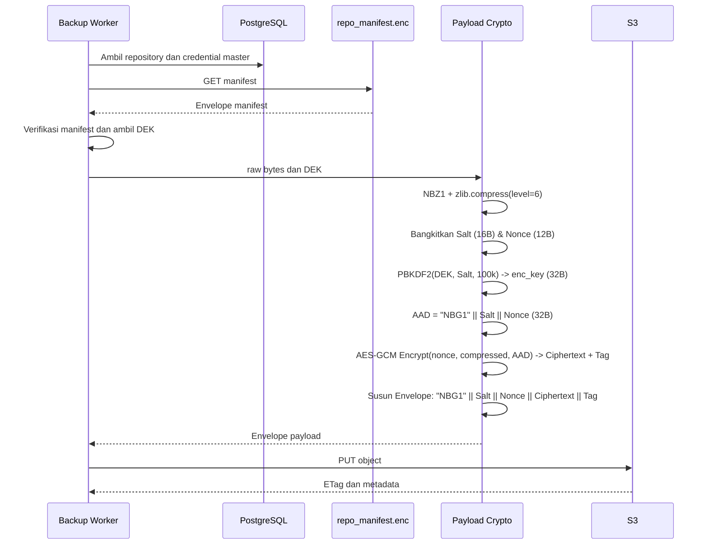
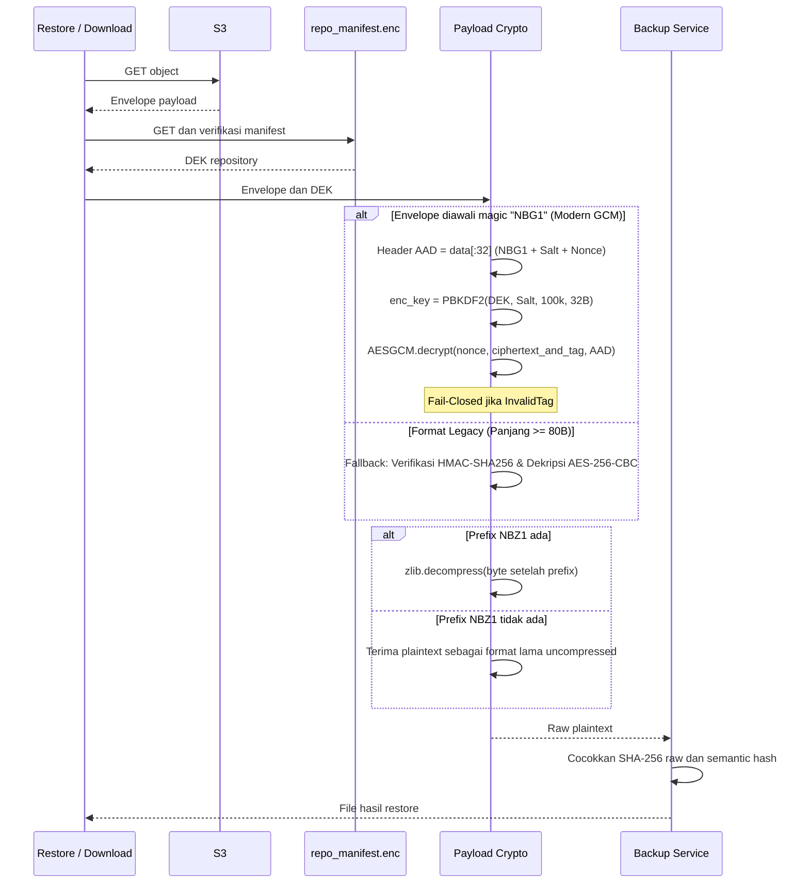

# Spesifikasi Enkripsi Backup S3

## Ringkasan

Sebelum konfigurasi perangkat diunggah ke S3, NetBackup mengompresi plaintext dengan zlib, mengenkripsinya dengan **AES-256-GCM (AEAD)** yang mengikat header amplop sebagai *Additional Authenticated Data* (AAD); saat restore, autentikasi tag GMAC diverifikasi secara matematis sebelum dekompresi dan hasil plaintext diperiksa kembali hash integritasnya.

Dokumen ini adalah sumber kanonis untuk kriptografi payload backup pada alur upload ke S3 dan restore dari S3. Detail perlindungan kredensial aplikasi dan mekanisme autentikasi pengguna tidak dibahas di sini.

## Implementasi sumber

| Komponen | Source code |
|---|---|
| Enkripsi dan dekripsi payload | `backend/app/crypto/payload_crypto.py` |
| Derivasi kunci | `backend/app/crypto/kdf.py` |
| Resolusi DEK dan operasi S3 | `backend/app/services/s3_service.py` |
| Manifest repository | `backend/app/crypto/manifest_crypto.py` |
| Orkestrasi backup dan verifikasi hash | `backend/app/services/backup_execution_service.py` |

## Parameter kriptografi payload

| Parameter | Nilai aktual (Modern v2 - AES-256-GCM) | Keterangan / Justifikasi |
|---|---|---|
| Header Magic Byte | `NBG1` (4 byte) | Identifikasi format amplop AES-256-GCM |
| Kompresi | zlib level 6 | Efisiensi penyimpanan konfigurasi (~70-80%) |
| Penanda kompresi | `NBZ1`, 4 byte di dalam plaintext terenkripsi | Penanda internal jenis dekompresi |
| KDF | PBKDF2-HMAC-SHA256 | RFC 8018 / NIST SP 800-132 |
| Iterasi KDF | 100.000 | Ketahanan brute-force GPU/ASIC |
| Input KDF normal | DEK repository sebagai string UTF-8 berisi 64 karakter heksadesimal | Material kunci repositori |
| Salt | 16 byte acak CSPRNG (`os.urandom(16)`) | Perlindungan rainbow table per objek |
| Panjang hasil KDF | 32 byte (256-bit) | Diturunkan via `derive_key_aes256_gcm` |
| Cipher & Mode | **AES-256-GCM** (Galois/Counter Mode) | NIST SP 800-38D (AEAD) |
| Nonce (IV) | 12 byte acak CSPRNG (`os.urandom(12)`) | Rekomendasi standar 96-bit NIST GCM |
| Padding | Tidak ada (*No Padding*) | GCM adalah mode counter/stream; kebal padding oracle |
| Tag Autentikasi | 16 byte (128-bit) GMAC tag | Dihasilkan dan divalidasi langsung oleh AEAD engine |
| AAD (Additional Authenticated Data) | 32 byte: `NBG1` (4B) \|\| Salt (16B) \|\| Nonce (12B) | Mencegah modifikasi / substitusi header envelope |
| Gerbang Integritas | Fail-Closed (`IntegrityVerificationError`) | Tag salah langsung menghentikan proses sebelum dekripsi |

PBKDF2 menerima string DEK yang dihasilkan oleh `secrets.token_hex(32)`, bukan 32 byte hasil decode heksadesimal. Perbedaan ini penting untuk kompatibilitas restore.

## Material kunci repository

Payload baru memakai DEK persisten milik repository. Service memperoleh credential master repository dari record database, mengambil `repo_manifest.enc` dari S3, memverifikasi manifest, lalu membaca DEK. Perlindungan credential database merupakan dependensi aplikasi dan berada di luar pembahasan kriptografi payload ini.

DEK dibuat sekali ketika repository diinisialisasi. Rotasi password membuat ulang pembungkus manifest dengan password baru tetapi mempertahankan DEK yang sama, sehingga payload lama tetap dapat dipulihkan.

Manifest lama yang sudah berhasil diverifikasi tetapi belum memiliki field DEK memakai password master sebagai material kunci payload. Kegagalan mengambil atau memverifikasi manifest menghentikan operasi dan tidak boleh diam-diam memakai password master.

## Alur upload



Transformasi byte:

```text
compressed = b"NBZ1" || zlib.compress(raw, level=6)
salt = os.urandom(16)
nonce = os.urandom(12)
enc_key = PBKDF2-HMAC-SHA256(DEK_UTF8, salt, 100000, dklen=32)
aad = b"NBG1" || salt || nonce
ciphertext_and_tag = AESGCM(enc_key).encrypt(nonce, compressed, aad)
envelope = b"NBG1" || salt || nonce || ciphertext_and_tag
```

## Format envelope payload

### Format Modern (v2 - AES-256-GCM AEAD)

| Offset | Panjang | Isi | Peran Kriptografi |
|---:|---:|---|---|
| 0 | 4 byte | Magic marker `b"NBG1"` | Identifikasi amplop format AES-256-GCM v2 |
| 4 | 16 byte | Salt PBKDF2 (`os.urandom(16)`) | Parameter KDF per payload |
| 20 | 12 byte | Nonce AES-GCM (`os.urandom(12)`) | Initialization vector 96-bit standar NIST |
| 32 | Variabel (N byte) | Ciphertext AES-GCM | Stream ciphertext data terkompresi (tanpa padding) |
| 32 + N | 16 byte | GMAC Authentication Tag | Tag integritas Galois 128-bit yang dihasilkan AEAD |

Header luar berukuran **32 byte** (`NBG1` + Salt + Nonce) dan diikat langsung sebagai **Additional Authenticated Data (AAD)** ke dalam perhitungan GMAC. Modifikasi pada 1 bit pun dari Salt atau Nonce akan menyebabkan tag mismatch dan penolakan langsung.

### Format Kompatibilitas Legacy (v1 - AES-256-CBC + HMAC-SHA256)

Untuk file snapshot lama yang dienkripsi sebelum v2, sistem menyediakan fallback otomatis:

| Offset | Panjang | Isi |
|---:|---:|---|
| 0 | 16 byte | Salt PBKDF2 |
| 16 | 16 byte | IV AES-CBC |
| 32 | 32 byte | HMAC-SHA256 (Encrypt-then-MAC) |
| 64 | Kelipatan 16 byte | Ciphertext ber-padding PKCS#7 |

Panjang minimum envelope valid legacy adalah 80 byte.

## Alur restore



Urutan verifikasi integritas sebelum pemulihan data bersifat wajib:
- Pada **AES-256-GCM**, cipher primitives secara internal memverifikasi tag GMAC 16-byte terhadap ciphertext dan header AAD sebelum mengeluarkan byte plaintext apa pun. Apabila terjadi bit-flipping atau manipulasi data, exception `InvalidTag` langsung dilempar dan dipetakan ke `IntegrityVerificationError`.
- Jika hasil dekripsi diawali `NBZ1`, dekompresi zlib dijalankan. Kegagalan dekompresi menghasilkan `DecryptionError`.
- Sesudah restore, pipeline backup membandingkan SHA-256 plaintext mentah dengan `object_sha256` dan hash konten normal dengan `content_sha256` sebelum menganggap objek dapat digunakan kembali.

## Kompatibilitas data lama

Urutan penanganan pada `payload_crypto.decrypt_payload_aes256` adalah:

1. **Deteksi Format Berdasarkan Magic Header:**
   - Jika payload diawali `b"NBG1"`, proses dekripsi modern **AES-256-GCM** dijalankan dengan validasi AAD.
   - Jika tidak diawali `b"NBG1"` dan panjangnya $\ge$ 80 byte, sistem beralih ke jalur fallback **AES-256-CBC + HMAC-SHA256**.
2. **Fallback Kredensial pada `S3Service.get_config_object`:**
   - Dekripsi pertama memakai DEK dari manifest repositori yang sudah diverifikasi.
   - Jika gagal dan DEK berbeda dari password master, dicoba memakai password master langsung untuk payload dari era sebelum manifes DEK.
   - Jika tetap gagal, plaintext hanya dikembalikan bila objek teridentifikasi positif sebagai objek plaintext legacy melalui metadata dan checksum database.
   - Selain kondisi tersebut, restore gagal tertutup (*fail-closed*) dan tidak mengembalikan byte mentah.

## Error dan respons operasional

| Kondisi | Error internal | Dampak |
|---|---|---|
| Material kunci kosong atau proses enkripsi gagal | `EncryptionError` | Upload dibatalkan |
| Envelope kurang dari ukuran minimum atau zlib rusak | `DecryptionError` | Restore ditolak |
| Tag GCM tidak cocok, AAD termanipulasi, atau HMAC legacy salah | `IntegrityVerificationError` | Ditolak sebelum dekompresi (*Fail-Closed*) |
| Manifest, koneksi, PUT, atau GET S3 gagal | `S3ServiceError` | Job gagal pada tahap terkait |
| Hash plaintext hasil restore berbeda | Kode kegagalan verifikasi pada backup service | Objek tidak dipakai sebagai hasil sukses |

API memetakan error domain menjadi envelope error umum yang dijelaskan di [Kontrak REST API](../02-architecture/API-CONTRACT-v1.0.md). Pesan kepada klien tidak boleh memuat DEK, password, credential S3, plaintext konfigurasi, atau isi envelope.

## Keuntungan Desain AES-256-GCM

1. **Penyatuan Enkripsi & Integritas (True AEAD):**
   Tidak memerlukan dua proses terpisah (AES encrypt lalu HMAC hash). AEAD memproses kerahasiaan dan integritas sekaligus dalam satu lintasan matematis (*single pass*).
2. **Eliminasi Risiko Padding Oracle:**
   AES-GCM menggunakan operasi *counter mode*, menghasilkan ciphertext yang ukurannya persis sama dengan ukuran input tanpa memerlukan padding blok PKCS#7.
3. **Integritas Header via AAD:**
   Header envelope (`NBG1`, salt, dan nonce) diikatkan langsung ke dalam perhitungan tag autentikasi melalui Additional Authenticated Data (AAD), mencegah serangan substitusi IV atau modifikasi header envelope.
4. **Efisiensi & Performa Hardware:**
   Operasi GMAC memanfaatkan perkalian Galois Field ($GF(2^{128})$) yang telah memiliki instruksi native hardware (Intel AES-NI & CLMUL, ARMv8 Cryptography Extensions), menawarkan throughput yang jauh lebih tinggi dan hemat latensi.
5. **Transisi Mulus (Backward Compatibility):**
   Mendukung format modern `NBG1` untuk semua upload baru, sekaligus mempertahankan jalur fallback terverifikasi untuk membaca snapshot legacy.

## Bukti pengujian di repository

- `tests/unit/test_crypto_standalone.py` (Memverifikasi roundtrip GCM, AAD tampering, dan fallback CBC legacy)
- `tests/unit/test_storage_repository.py` (Memverifikasi isolasi storage dan rotasi password)
- `tests/unit/test_review_hardening_items.py` (Memverifikasi konsistensi DEK envelope)
