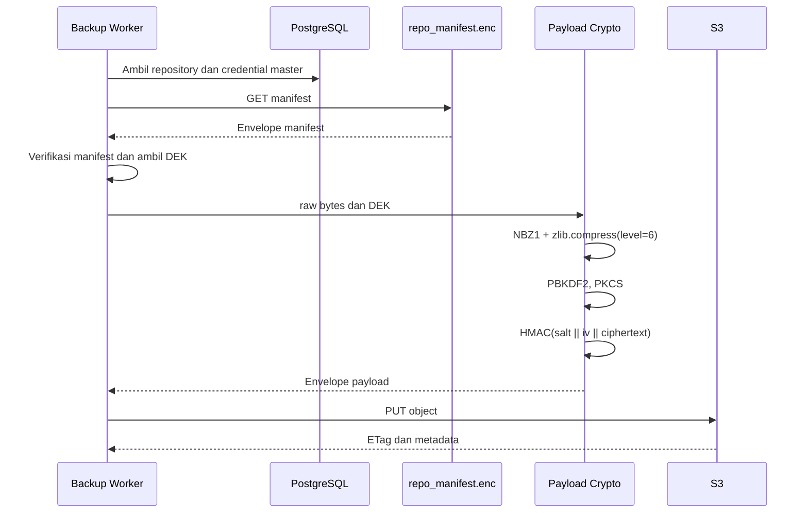
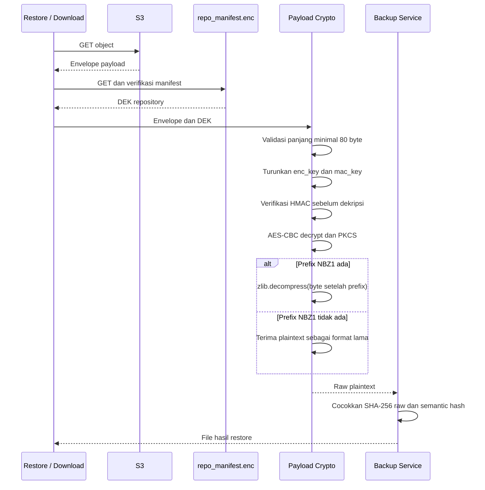

# Spesifikasi Enkripsi Backup S3

## Ringkasan

Sebelum konfigurasi perangkat diunggah ke S3, NetBackup mengompresi plaintext, mengenkripsinya, lalu menambahkan autentikasi pesan; saat restore, integritas diverifikasi sebelum dekripsi dan hasil plaintext diperiksa kembali.

Dokumen ini adalah sumber kanonis untuk kriptografi payload backup pada alur upload ke S3 dan restore dari S3. Detail perlindungan kredensial aplikasi dan mekanisme autentikasi pengguna tidak dibahas di sini.

## Implementasi sumber

| Komponen | Source code |
|---|---|
| Enkripsi dan dekripsi payload | `backend/app/crypto/payload_crypto.py` |
| Derivasi kunci | `backend/app/crypto/kdf.py` |
| Resolusi DEK dan operasi S3 | `backend/app/services/s3_service.py` |
| Manifest repository | `backend/app/crypto/manifest_crypto.py` |
| Orkestrasi backup dan verifikasi hash | `backend/app/services/backup_execution_service.py` |

## Parameter kriptografi payload

| Parameter | Nilai aktual |
|---|---|
| Kompresi | zlib level 6 |
| Penanda kompresi | `NBZ1`, empat byte di dalam plaintext terenkripsi |
| KDF | PBKDF2-HMAC-SHA256 |
| Iterasi KDF | 100.000 |
| Input KDF normal | DEK repository sebagai string UTF-8 berisi 64 karakter heksadesimal |
| Salt | 16 byte acak per payload |
| Panjang hasil KDF | 64 byte |
| Kunci enkripsi | Byte 0 sampai 31 hasil KDF |
| Kunci autentikasi | Byte 32 sampai 63 hasil KDF |
| Cipher | AES-256-CBC |
| IV | 16 byte acak per payload |
| Padding | PKCS#7 dengan ukuran blok 128 bit |
| Autentikasi | HMAC-SHA256, Encrypt-then-MAC |
| Perbandingan MAC | `hmac.compare_digest` |

PBKDF2 menerima string DEK yang dihasilkan oleh `secrets.token_hex(32)`, bukan 32 byte hasil decode heksadesimal. Perbedaan ini penting untuk kompatibilitas restore.

## Material kunci repository

Payload baru memakai DEK persisten milik repository. Service memperoleh credential master repository dari record database, mengambil `repo_manifest.enc` dari S3, memverifikasi manifest, lalu membaca DEK. Perlindungan credential database merupakan dependensi aplikasi dan berada di luar pembahasan kriptografi payload ini.

DEK dibuat sekali ketika repository diinisialisasi. Rotasi password membuat ulang pembungkus manifest dengan password baru tetapi mempertahankan DEK yang sama, sehingga payload lama tetap dapat dipulihkan.

Manifest lama yang sudah berhasil diverifikasi tetapi belum memiliki field DEK memakai password master sebagai material kunci payload. Kegagalan mengambil atau memverifikasi manifest menghentikan operasi dan tidak boleh diam-diam memakai password master.

## Alur upload



Transformasi byte:

```text
compressed = b"NBZ1" || zlib.compress(raw, level=6)
key_material = PBKDF2-HMAC-SHA256(DEK_UTF8, salt, 100000, dklen=64)
enc_key = key_material[0:32]
mac_key = key_material[32:64]
padded = PKCS7-128(compressed)
ciphertext = AES-256-CBC-ENCRYPT(enc_key, iv, padded)
mac = HMAC-SHA256(mac_key, salt || iv || ciphertext)
envelope = salt || iv || mac || ciphertext
```

## Format envelope payload

| Offset | Panjang | Isi |
|---:|---:|---|
| 0 | 16 byte | Salt PBKDF2 |
| 16 | 16 byte | IV AES-CBC |
| 32 | 32 byte | HMAC-SHA256 |
| 64 | Kelipatan 16 byte, minimal 16 byte | Ciphertext ber-padding |

Header luar berukuran 64 byte dan tidak memiliki magic byte atau nomor versi. Panjang envelope valid paling kecil adalah 80 byte.

`NBZ1` tidak berada pada header luar. Penanda itu baru terlihat setelah HMAC valid, ciphertext didekripsi, dan padding dilepas.

## Alur restore



Urutan verifikasi HMAC sebelum dekripsi bersifat wajib. Perubahan satu bit pada salt, IV, MAC, atau ciphertext harus ditolak sebelum operasi AES.

Jika hasil dekripsi diawali `NBZ1`, kegagalan zlib menghasilkan `DecryptionError`. Jika penanda tidak ada, implementasi saat ini mengembalikan hasil dekripsi sebagai payload lama yang tidak terkompresi. Karena itu, `NBZ1` adalah penanda format kompresi, bukan pemeriksaan integritas utama.

Sesudah restore, pipeline backup membandingkan SHA-256 plaintext mentah dengan `object_sha256` dan hash konten normal dengan `content_sha256` sebelum menganggap objek dapat digunakan kembali.

## Kompatibilitas data lama

Urutan fallback pada `S3Service.get_config_object` adalah:

1. Dekripsi memakai DEK dari manifest yang sudah diverifikasi.
2. Jika gagal dan DEK berbeda dari password master, coba password master untuk payload dari masa sebelum envelope DEK.
3. Jika dekripsi tetap gagal, plaintext hanya dikembalikan bila objek teridentifikasi positif sebagai objek plaintext legacy melalui metadata dan checksum database.
4. Selain kondisi tersebut, restore gagal tertutup dan tidak mengembalikan byte mentah.

## Error dan respons operasional

| Kondisi | Error internal | Dampak |
|---|---|---|
| Material kunci kosong atau proses enkripsi gagal | `EncryptionError` | Upload dibatalkan |
| Envelope kurang dari 80 byte, padding rusak, atau zlib rusak | `DecryptionError` | Restore ditolak |
| Kunci salah atau envelope berubah | `IntegrityVerificationError` | Ditolak sebelum dekripsi |
| Manifest, koneksi, PUT, atau GET S3 gagal | `S3ServiceError` | Job gagal pada tahap terkait |
| Hash plaintext hasil restore berbeda | Kode kegagalan verifikasi pada backup service | Objek tidak dipakai sebagai hasil sukses |

API memetakan error domain menjadi envelope error umum yang dijelaskan di [Kontrak REST API](api-contract.md). Pesan kepada klien tidak boleh memuat DEK, password, credential S3, plaintext konfigurasi, atau isi envelope.

## Keterbatasan dan konsekuensi desain

- Envelope payload belum memiliki magic byte dan versi pada header luar.
- KDF memproses representasi teks heksadesimal DEK, sehingga perubahan ke byte mentah memerlukan versi format dan migrasi yang eksplisit.
- AES-CBC aman pada implementasi ini hanya sebagai komposisi Encrypt-then-MAC yang selalu memverifikasi HMAC lebih dahulu.
- Dukungan fallback legacy memperluas jalur restore dan wajib dipertahankan dalam regression test selama data lama masih didukung.
- Kehilangan password master dan material pembukanya tidak memiliki alur pemulihan otomatis.
- Efektivitas kompresi bergantung pada isi file dan tidak boleh dinyatakan sebagai persentase tetap.

## Bukti pengujian di repository

- `tests/unit/test_crypto_standalone.py`
- `tests/unit/test_storage_repository.py`
- `tests/unit/test_review_hardening_items.py`

Skenario penerimaan lengkap berada di [Test Script](../04-testing/test-script.md). Dokumen ini menjelaskan kontrak implementasi, bukan hasil eksekusi test.
