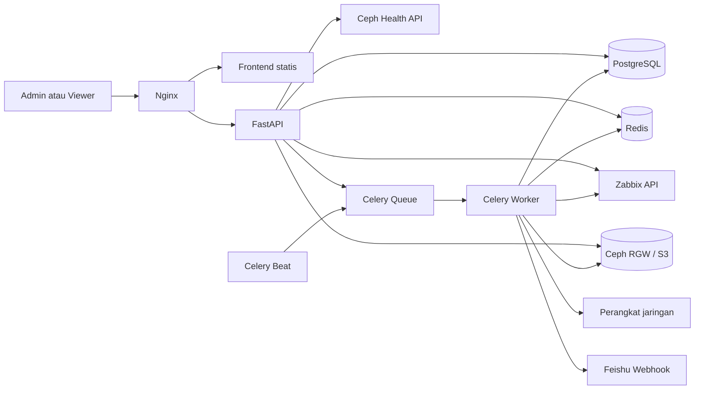
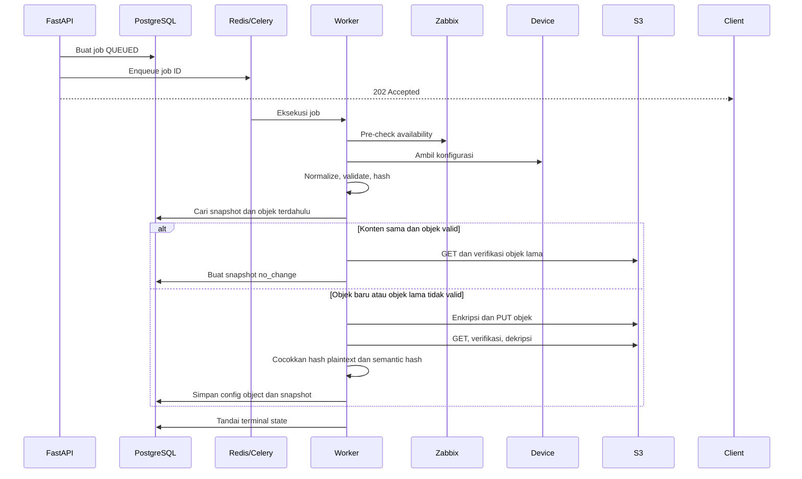

# Technical Design Document NetBackup

## Tujuan

Dokumen ini menjelaskan arsitektur aktual NetBackup berdasarkan source code. Detail database, API, driver, UI, dan format file backup berada pada dokumen khusus yang ditautkan dari bagian terkait.

## Keputusan arsitektur

| Keputusan | Implementasi | Alasan |
|---|---|---|
| Bentuk aplikasi | Modular monolith | Domain tetap terpisah tanpa menambah koordinasi antarservice. |
| API | FastAPI | Route, validasi request, dan OpenAPI berasal dari source yang sama. |
| Data persisten | PostgreSQL dan SQLAlchemy | Relasi pekerjaan, snapshot, repository, dan retention membutuhkan transaksi relasional. |
| Antrean dan koordinasi | Redis dan Celery | Backup berjalan di luar request HTTP dan dapat memakai lock/heartbeat. |
| Penyimpanan file | Ceph RGW atau S3-compatible storage | File backup disimpan sebagai object, metadata tetap di PostgreSQL. |
| Frontend | HTML, CSS, dan JavaScript tanpa build Node | Nginx dapat menyajikan aset statis secara langsung. |
| Deployment | Docker Compose | Menyatukan dependency dan urutan startup pada lingkungan proyek. |
| Migrasi | Alembic melalui service `migrator` | API, worker, dan beat menunggu schema terbaru sebelum mulai. |

## Konteks sistem



## Container

| Service | Tanggung jawab | Dependency startup |
|---|---|---|
| `postgres` | Metadata persisten | Tidak ada |
| `redis` | Broker, result backend, session, lock, dan heartbeat | Tidak ada |
| `migrator` | Menjalankan `alembic upgrade head` lalu berhenti | PostgreSQL sehat |
| `api` | REST API dan health endpoint | PostgreSQL, Redis, migrator selesai |
| `worker` | Menjalankan backup dan task background | PostgreSQL, Redis, migrator selesai |
| `beat` | Menjadwalkan dispatch, sync, health, dan retention | PostgreSQL, Redis, migrator selesai |
| `nginx` | Menyajikan frontend dan proxy API | API sehat |

Port publik default berasal dari `NGINX_PORT` dengan fallback `8080`. URL pengguna yang didokumentasikan adalah `https://netbackup.makuku.co.id`.

## Struktur backend

| Direktori | Tanggung jawab |
|---|---|
| `backend/app/api/` | Route HTTP dan serialisasi respons |
| `backend/app/schemas/` | Validasi request/response berbasis Pydantic |
| `backend/app/services/` | Aturan use case dan orkestrasi |
| `backend/app/repositories/` | Query database untuk aggregate utama |
| `backend/app/models/` | Model SQLAlchemy |
| `backend/app/tasks/` | Entry point task Celery |
| `backend/app/drivers/` | Pengambilan, normalisasi, dan validasi konfigurasi perangkat |
| `backend/app/integrations/` | Klien Zabbix, Ceph health, dan Feishu |
| `backend/app/crypto/` | Kriptografi payload dan material repository |
| `backend/app/core/` | Session, error, state machine, lock, dan logging keamanan |

Daftar package, image, dan hubungan runtime berada di [Dependency dan Runtime](dependencies.md).

## Alur request web

1. Nginx menyajikan frontend atau meneruskan `/api/` ke FastAPI.
2. Middleware FastAPI memakai atau membuat `X-Request-ID`.
3. Dependency endpoint memeriksa context pengguna dan kewenangan yang diperlukan.
4. Route memvalidasi request melalui Pydantic dan memanggil service/repository.
5. `AppError` diubah menjadi envelope error konsisten.
6. Respons sukses memakai objek `data`, kecuali respons file dan status 204.

Kontrak endpoint lengkap berada di [Kontrak REST API](api-contract.md).

## Akses pengguna

Aplikasi mengenal peran `admin` dan `viewer`. Admin memiliki endpoint perubahan, sedangkan viewer memakai endpoint baca. Session disimpan di Redis.

## Integrasi Zabbix

- Task periodik `network_backup.sync_zabbix_devices` berjalan sesuai `ZABBIX_SYNC_INTERVAL_SECONDS`.
- `zabbix_host_id` menjadi identitas unik perangkat.
- Perangkat yang tidak lagi ditemukan tidak langsung dihapus. Model memakai `source_present=false`.
- Availability dinormalisasi menjadi `up`, `down`, atau `unknown`.
- Worker melakukan pre-check baru sebelum pengambilan konfigurasi.

## Registry dan driver

Registry menggabungkan driver bawaan dan driver kustom aktif. Driver tidak menulis database atau S3. Driver hanya menerima context koneksi, mengambil konfigurasi, menormalisasi hasil, memvalidasi hasil, dan mengembalikan objek collected configuration.

Kontrak terperinci berada di [Kontrak Backup Driver](backup-driver-contract.md).

## Pipeline backup



Pipeline menggunakan lock per perangkat. Job juga memiliki lease/heartbeat. Scheduler menandai pekerjaan aktif yang lebih tua dari satu jam sebagai gagal jika lease sudah tidak ada.

## State machine

Alur normal:

```text
QUEUED
  -> PRECHECKING_ZABBIX
  -> CONNECTING
  -> COLLECTING
  -> NORMALIZING
  -> VALIDATING
  -> HASHING
  -> UPLOADING
  -> VERIFYING
  -> SUCCESS_CHANGED
```

Cabang lain:

- `HASHING -> SUCCESS_NO_CHANGE` jika objek lama sudah dipulihkan dan diverifikasi.
- Tahap aktif dapat menuju `RETRYING` lalu kembali ke `PRECHECKING_ZABBIX`.
- Pre-check dapat berakhir pada `SKIPPED_DEVICE_DOWN` atau `SKIPPED_STATUS_UNKNOWN`.
- Tahap aktif dapat berakhir pada `FAILED`.
- Terminal state tidak boleh berpindah ke state lain.

## Hash dan deduplikasi

Sistem menghitung dua hash plaintext:

- `object_sha256`: hash byte mentah yang dikembalikan driver.
- `content_sha256`: hash konfigurasi yang sudah dinormalisasi.

Kunci objek menggunakan pola:

```text
network-config/<device_id>/objects/<content_sha256>.<extension>
```

Jika objek lama hilang atau gagal dipulihkan, worker membuat key pengganti dengan timestamp. `ConfigObject` unik per kombinasi repository, perangkat, dan content hash. Metadata ukuran pada database menyimpan ukuran plaintext, sedangkan hasil `put_config_object` menghitung ukuran envelope untuk respons internal upload.

## Penyimpanan dan enkripsi S3

Repository aktif memasok endpoint, bucket, dan kredensial ke `S3Service`. Payload baru selalu melewati alur enkripsi sebelum `put_object`. Restore mengambil object, menyelesaikan material kunci repository, memverifikasi integritas, mendekripsi, dan memeriksa hash plaintext.

Detail algoritma dan format hanya berada di [Spesifikasi Enkripsi Backup S3](enkripsi-backup-s3.md).

## Snapshot

Snapshot adalah titik pemulihan logis. Satu snapshot menghubungkan satu backup job dengan satu config object, satu perangkat, dan repository asal. Beberapa snapshot `no_change` dapat menunjuk objek fisik yang sama.

Download diizinkan hanya jika:

- pengguna adalah admin;
- snapshot masih retained;
- config object berstatus `available`;
- repository snapshot sedang aktif;
- restore dan checksum lolos.

## Scheduler

Celery Beat menjadwalkan:

| Task | Jadwal sumber |
|---|---|
| Dispatch backup jatuh tempo | `SCHEDULE_DISPATCH_INTERVAL_SECONDS` |
| Sinkronisasi Zabbix | `ZABBIX_SYNC_INTERVAL_SECONDS` |
| Refresh Ceph health | `CEPH_HEALTH_INTERVAL_SECONDS` |
| Evaluasi retention | Setiap hari pada `RETENTION_RUN_HOUR` |
| Purge objek `pending_delete` | Setiap 3600 detik |

Jadwal perangkat disimpan sebagai jam lokal pada slot lima menit. `next_run_at` disimpan sebagai timestamp ber-timezone.

## Retention

Retention dievaluasi per pasangan perangkat dan repository.

- `standard_31`: mempertahankan snapshot dalam jendela 31 hari.
- `smart_7_4_12_3`: memilih tier harian, mingguan, bulanan, dan tahunan sesuai implementasi.
- Snapshot terbaru selalu mendapat proteksi `LATEST_GOOD`.
- Objek tanpa snapshot retained masuk `pending_delete` terlebih dahulu.
- Purge melakukan row lock dan memeriksa ulang referensi sebelum menghapus dari S3.

## Notifikasi dan laporan

Notification service dipanggil untuk hasil terminal tertentu. Kegagalan notifikasi tidak mengganti hasil backup utama. Report service menghasilkan XLSX atau PDF berdasarkan filter endpoint.

## Konfigurasi

Semua nama variabel aktif berada di `.env.example`. Nilai credential harus berasal dari environment lokal dan tidak boleh disimpan dalam dokumentasi. Daftar dan prosedur penggunaan berada di [README](../../README.md) serta [Runbook](../05-operations/runbook.md).

## Database

PostgreSQL adalah penyimpanan persisten. Redis tidak menggantikan metadata database. Detail tabel, relasi, indeks, constraint, dan migrasi berada di [Arsitektur Database](database-schema.md).

Saat startup non-test, aplikasi memeriksa tabel yang diwajibkan serta kolom `storage_repositories.master_key_encrypted` dan `backup_jobs.repository_id`. Pemeriksaan ini melengkapi, bukan menggantikan, Alembic.

## Penanganan error

Error aplikasi memakai bentuk:

```json
{
  "error": {
    "code": "ERROR_CODE",
    "message": "Pesan aman untuk klien",
    "details": null,
    "request_id": "<REQUEST_ID>"
  }
}
```

Pesan log tidak boleh memuat password, token, secret key, atau isi konfigurasi perangkat.

## Keterbatasan yang diketahui

- OpenAPI dihasilkan dari route, tetapi belum mendeklarasikan seluruh respons domain 4xx/5xx pada schema.
- Alias rotasi password repository tersedia pada dua path.
- Health endpoint dasar hanya menunjukkan proses API hidup, bukan readiness seluruh dependency.
- Restore produk adalah download file, bukan push konfigurasi ke perangkat.
- Spesifikasi target SLA, RPO, RTO, dan kapasitas masih menunggu keputusan pemilik proyek.
