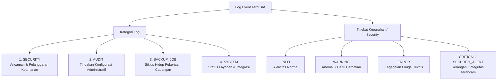
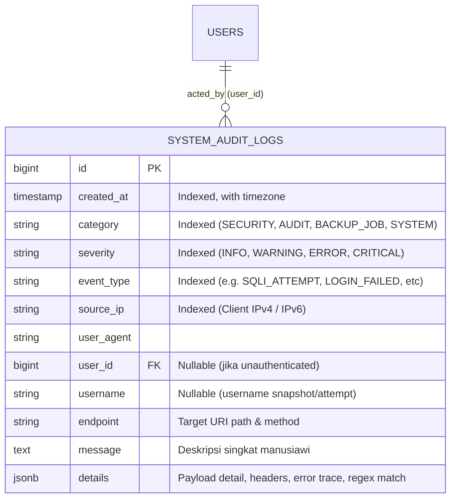
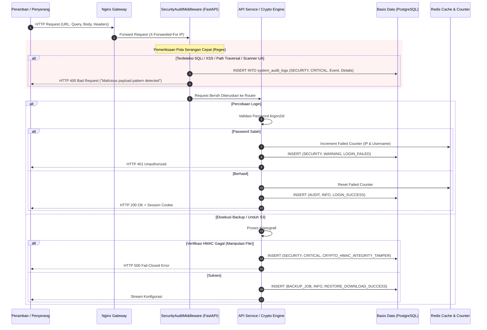

# MASTER PLAN: SISTEM PEMANTAUAN LOG TERPADU, DETEKSI ANCAMAN KEAMANAN, DAN PELAPORAN AUDIT
## NetBackup — Centralized Network Configuration Backup & Enterprise Observability

**Versi Dokumen:** 1.0  
**Tanggal:** 18 Oktober 2026  
**Status:** Draf Perencanaan untuk Review Pengguna (Ready for Review)  
**Tujuan Dokumen:** Rencana induk teknis implementasi fitur pemantauan log terpusat, pengklasifikasian aktivitas sistem, deteksi ancaman keamanan (*brute-force*, injeksi, DDoS/flood, perusakan integritas kriptografi S3), serta ekspor laporan berkala multi-format (Excel & PDF) untuk kebutuhan operasional dan pembuktian empiris Tugas Akhir (TA).

---

## 1. RINGKASAN EKSEKUTIF & LATAR BELAKANG

### 1.1 Latar Belakang & Nilai Tambah untuk Tugas Akhir (TA)
Pada sistem pencadangan konfigurasi jaringan perusahaan (*Enterprise Network Backup*), file konfigurasi memuat aset rahasia tingkat tinggi (*enable secret*, kredensial SNMP, *preshared key* VPN, topologi internal). Perlindungan data tidak hanya bertumpu pada algoritma enkripsi at-rest S3 (AES-256-CBC + HMAC-SHA256), melainkan juga pada **visibilitas penuh terhadap seluruh aktivitas operasional dan upaya serangan siber (*Security Observability & Audit Trail*)**.

Penambahan fitur ini memberikan nilai akademis dan praktis yang sangat tinggi untuk naskah skripsi/TA:
1. **Bab 3 (Metodologi & Desain Sistem):** Memperluas arsitektur sistem dari sekadar otomasi backup menjadi platform dengan sistem *Audit Trail*, *Intrusion Detection Lightweight Engine*, dan *Role-Based Access Control Audit*.
2. **Bab 4 & 5 (Pengujian & Pembahasan):** Menyediakan skenario pengujian penetrasi terukur (*Penetration Testing Simulation*) untuk menguji ketangguhan sistem saat diserang (SQLi, brute-force, tamper S3) dan membuktikan bahwa sistem mampu mendeteksi serta mencatatnya secara deterministik.
3. **Lampiran Naskah TA:** Menghasilkan dokumen laporan audit resmi bertanda air institusi (.pdf) dan rekapitulasi data (.xlsx) sebagai bukti fisik pengujian lapangan.

### 1.2 Tujuan Utama Proyek
- Menangkap dan mengklasifikasikan seluruh log aktivitas aplikasi (keamanan, audit administratif, pekerjaan backup, kesehatan sistem).
- Mendeteksi upaya peretasan (*suspicious & malicious activities*) secara otomatis dan real-time tanpa menambah latensi request normal.
- Menyediakan dashboard pemantauan interaktif di web NetBackup dengan indikator KPI dan tabel data berfilter.
- Menyediakan fitur ekspor data log ke format Microsoft Excel (`.xlsx`) dan dokumen cetak PDF (`.pdf`) lengkap dengan filter periode waktu (Hari Ini, 24 Jam, 7 Hari, 30 Hari, dan Rentang Tanggal Kustom).

---

## 2. SPESIFIKASI KEBUTUHAN SISTEM (REQUIREMENTS)

### 2.1 Taksonomi & Klasifikasi Log

Seluruh kejadian log dikelompokkan ke dalam **4 Kategori Fungsional** dan **4 Tingkat Keparahan (*Severity Level*)**:

#### Rincian Kategori:
1. **`SECURITY` (Keamanan & Ancaman):**
   - Percobaan login gagal berulang (*Brute-force / Credential Stuffing*).
   - Percobaan injeksi kode pada URL query parameter atau JSON body (SQL Injection, XSS, Path Traversal).
   - Akses tidak sah / Pelanggaran RBAC (Pengguna Viewer mencoba akses endpoint Admin &rarr; HTTP 403).
   - Pelanggaran Proteksi CSRF (Token hilang atau token manipulasi).
   - **Perusakan Integritas Kriptografi S3 (*Cryptographic Tampering*):** Kegagalan autentikasi HMAC-SHA256 pada saat download snapshot (menandakan berkas di S3 dimanipulasi atau bit-flipping attack).
   - Lonjakan request tidak wajar dari satu IP (*Request Flood / DoS Suspected*).
2. **`AUDIT` (Jejak Audit Administratif):**
   - Pembuatan, pembaruan, dan penonaktifan akun pengguna.
   - Inisialisasi repositori S3, pembukaan kunci (*unlock*), dan rotasi Master Password S3.
   - Pembuatan dan perubahan parameter driver kustom.
   - Pengubahan jadwal harian dan kebijakan retensi perangkat.
3. **`BACKUP_JOB` (Siklus Hidup Eksekusi Backup):**
   - Permintaan backup manual dan eksekusi scheduler Celery Beat.
   - Transisi status: `CONNECTING`, `EXTRACTING`, `HASHING`, `UPLOADING`.
   - Hasil eksekusi: `SUCCESS_CHANGED`, `SUCCESS_NO_CHANGE` (deduplikasi), `FAILED`.
   - Perangkat dilewati karena offline (`SKIPPED_DEVICE_DOWN`).
4. **`SYSTEM` (Kesehatan Infrastruktur):**
   - Sinkronisasi periodik Zabbix API (host baru, status offline).
   - Pemeriksaan kesehatan kluster Ceph S3 (`/healthz`, `/api/v1/health/ceph`).
   - Eksekusi pembersihan siklus retensi snapshot.

---

### 2.2 Aturan Deteksi Ancaman Keamanan (Threat Detection Rules)

Sistem akan dilengkapi mesin inspeksi ringan (*Lightweight Security Inspector*) yang bekerja secara asinkron/cepat di middleware FastAPI:

| ID Aturan | Jenis Ancaman | Pola / Pemicu Deteksi | Tindakan Sistem | Kategori & Severity |
| :--- | :--- | :--- | :--- | :--- |
| **SEC-01** | **SQL Injection (SQLi)** | Pola regex pada parameter query/body: `' OR '1'='1`, `UNION SELECT`, `SLEEP\(`, `DROP TABLE`, `INFORMATION_SCHEMA`, `--`. | Blokir request (HTTP 400), tangkap IP, path, dan payload cuplikan. | `SECURITY` / `CRITICAL` |
| **SEC-02** | **Cross-Site Scripting (XSS)** | Tag berbahaya: `<script>`, `javascript:`, `onload=`, `onerror=`, `eval\(`, `<iframe`. | Blokir request (HTTP 400), rekam jejak payload. | `SECURITY` / `CRITICAL` |
| **SEC-03** | **Path Traversal / LFI** | Karakter traversal: `../`, `..%2f`, `..\\`, `/etc/passwd`, `/etc/shadow`, `boot.ini`. | Blokir request (HTTP 403), catat IP penyerang. | `SECURITY` / `CRITICAL` |
| **SEC-04** | **Brute-Force Login** | Kegagalan login ≥ 5 kali berturut-turut dari IP atau username yang sama dalam rentang 2 menit (dihitung via sliding window Redis). | Catat peringatan brute-force, beri delay progresif. | `SECURITY` / `CRITICAL` |
| **SEC-05** | **Request Flood / DoS** | Trafik request dari IP tunggal melebihi ambang batas wajar (> 120 req/menit) di luar endpoint polling status. | Catat event peringatan lonjakan trafik. | `SECURITY` / `WARNING` |
| **SEC-06** | **CSRF Violation** | Permintaan state-changing (POST, PUT, DELETE) tanpa header `X-CSRF-Token` atau token tidak valid. | Tolak request (HTTP 403), catat insiden CSRF. | `SECURITY` / `WARNING` |
| **SEC-07** | **RBAC Bypass Attempt** | Akun dengan role `viewer` mencoba mengakses endpoint administratif. | Tolak request (HTTP 403), catat username & IP. | `SECURITY` / `WARNING` |
| **SEC-08** | **S3 Crypto Tampering** | Verifikasi HMAC gagal saat proses download konfigurasi dari S3 (`IntegrityVerificationError`). | Batalkan proses seketika (*Fail-Closed*), catat alarm integritas data. | `SECURITY` / `CRITICAL` |
| **SEC-09** | **Scanner User-Agent** | User-Agent yang cocok dengan alat audit otomatis (`sqlmap`, `nikto`, `acunetix`, `dirbuster`, `nmap`). | Blokir/catat upaya reconnaissance pemindaian. | `SECURITY` / `WARNING` |

---

### 2.3 Spesifikasi Fitur Ekspor Data (Excel & PDF)

Sesuai permintaan, sistem menyediakan fitur ekspor log terpadu dengan opsi filter periode waktu:

#### 1. Pengaturan Periode Waktu (Period Filtering)
- **Preset Cepat:**
  - *Hari Ini (Today):* 00:00:00 WIB s/d waktu saat ini.
  - *24 Jam Terakhir (Last 24 Hours).*
  - *7 Hari Terakhir (Last 7 Days).*
  - *30 Hari Terakhir (Last 30 Days).*
- **Rentang Tanggal Kustom (Custom Range):**
  - Form interaktif pemilih tanggal mulai (`start_date`) dan tanggal selesai (`end_date`) berbasis waktu lokal Jakarta (`Asia/Jakarta`, UTC+7).
- **Filter Multi-Kriteria:**
  - Kategori: `Semua`, `Security`, `Audit`, `Backup Job`, `System`.
  - Severity: `Semua`, `Critical Only`, `Warning & Critical`, `Error Only`.
  - Pencarian Teks Bebas: Alamat IP, Username, atau kata kunci deskripsi.

#### 2. Format Laporan Microsoft Excel (`.xlsx`)
- Dibuat menggunakan pustaka `openpyxl`.
- **Sheet 1: "Audit Log Records"**
  - Kolom: No, Stempel Waktu (WIB), Kategori, Severity, Event Type, IP Sumber, Aktor / Username, Resource Target, Pesan Ringkas, Detail Insiden.
  - Pewarnaan sel dinamis berbasis severity (Merah muda untuk CRITICAL, Kuning untuk WARNING, Abu-abu untuk INFO).
  - Dilengkapi Auto-Filter Excel pada baris header dan lebar kolom adaptif.
- **Sheet 2: "Executive Summary & Statistics"**
  - Tabel ringkasan total event, jumlah insiden per kategori, distribusi severity, dan daftar 5 IP sumber paling sering memicu insiden keamanan.

#### 3. Format Laporan Resmi PDF (`.pdf`)
- Dibuat menggunakan pustaka `reportlab` berstandar publikasi profesional.
- **Kop Dokumen Resmi:** Identitas PT Lucky Mom Indonesia, judul laporan audit, stempel waktu cetak, dan parameter filter yang digunakan.
- **Kartu Indikator KPI (Executive KPI Cards):**
  - Total Log Tercatat.
  - Jumlah Insiden Keamanan (Security Alerts).
  - Percobaan Login Gagal.
  - Eksekusi Backup Gagal.
- **Tabel Rekapitulasi Riwayat Insiden:**
  - Desain strip selang-seling, badge severity berwarna, dan pembungkusan teks rapi (*word wrap*).
- **Tanda Tangan & Pengesahan:**
  - Blok tanda tangan resmi untuk Administrator Sistem dan Head of IT / Dosen Penguji.

---

## 3. DESAIN ARSITEKTUR & STRUKTUR BASIS DATA

### 3.1 Skema Tabel Basis Data Baru: `system_audit_logs`

Akan dibuatkan migrasi Alembic baru: **`015_system_audit_logs.py`** untuk mencatat seluruh log terstruktur di PostgreSQL 16:

#### Spesifikasi Kolom:
- `id` (BigInteger, Primary Key, Autoincrement).
- `created_at` (DateTime with Timezone, Non-Null, Default: UTC/Asia Jakarta, Index `ix_audit_logs_created_at`).
- `category` (String(32), Non-Null, Index `ix_audit_logs_category`).
- `severity` (String(16), Non-Null, Index `ix_audit_logs_severity`).
- `event_type` (String(64), Non-Null, Index `ix_audit_logs_event_type`).
- `source_ip` (String(64), Nullable, Index `ix_audit_logs_source_ip`).
- `user_agent` (String(255), Nullable).
- `user_id` (BigInteger, Foreign Key `users.id` ON DELETE SET NULL, Nullable).
- `username` (String(128), Nullable).
- `endpoint` (String(255), Nullable).
- `message` (Text, Non-Null).
- `details` (JSONB, Nullable, Default: `{}`).
- **Indeks Komposit Kinerja Tinggi:**  
  `CREATE INDEX ix_audit_logs_filter ON system_audit_logs (created_at DESC, category, severity);`

---

### 3.2 Diagram Alur Deteksi & Pencatatan Log

---

## 4. KONTRAK REST API MONITORING & LOGGING

Seluruh endpoint berada di bawah domain `/api/v1/logs`:

| Metode | Rute Endpoint | Peran Akses | Deskripsi & Parameter |
| :--- | :--- | :--- | :--- |
| `GET` | `/api/v1/logs` | Admin / Viewer | Mengambil daftar log terpaginasi. Parameter: `page`, `page_size`, `category`, `severity`, `event_type`, `search`, `start_date`, `end_date`. |
| `GET` | `/api/v1/logs/stats` | Admin / Viewer | Mengambil metrik agregat untuk kartu KPI: total event per periode, total insiden keamanan, jumlah login gagal, distribusi severity. |
| `GET` | `/api/v1/logs/{id}` | Admin / Viewer | Mengambil rincian detail 1 entri log beserta objek JSON `details` lengkap. |
| `GET` | `/api/v1/logs/export` | Admin / Viewer | **Mengekspor data log.** Parameter: `format=xlsx` atau `format=pdf`, `start_date`, `end_date`, `category`, `severity`, `search`. Mengembalikan aliran biner file unduhan. |

---

## 5. DESAIN ANTARMUKA PENGGUNA (FRONTEND UI/UX)

Antarmuka dibangun secara terpadu pada dashboard web NetBackup (`frontend/index.html` dan `frontend/js/app.js`):

1. **Tab Navigasi Baru:** Menambahkan menu **"Audit & Security Logs"** pada bilah navigasi utama.
2. **Bilah Filter Periode & Kriteria (Filter Toolbar):**
   - Dropdown Pilihan Periode Cepat (*Today*, *Last 24h*, *Last 7d*, *Last 30d*, *Custom Range*).
   - Input Date Picker untuk Rentang Tanggal Mulai dan Tanggal Selesai.
   - Dropdown Filter Kategori (`All`, `Security`, `Audit`, `Backup Job`, `System`).
   - Dropdown Filter Severity (`All`, `Critical`, `Warning`, `Error`, `Info`).
   - Kotak Pencarian Teks Bebas.
   - Tombol Aksi: **"Export to Excel"** dan **"Export to PDF"**.
3. **Kartu Ringkasan KPI (Top Metric Cards):**
   - *Total Log Events* (dalam periode terpilih).
   - *Security Threats Detected* (badge merah mencolok jika > 0).
   - *Failed Authentication Attempts*.
   - *Crypto & System Errors*.
4. **Tabel Data Interaktif (Responsive Data Table):**
   - Stempel Waktu (WIB).
   - Badge Severity berwarna kontras tinggi (*Critical: Red, Warning: Amber, Error: Rose, Info: Emerald*).
   - Kategori & Event Type.
   - IP Sumber & Aktor / Username.
   - Pesan Ringkas.
   - Tombol Tindakan: **"View Details"** (Membuka modal pop-up dengan tampilan JSON rapi untuk inspeksi forensik payload/header).

---

## 6. RENCANA PENGUJIAN & SKENARIO SIMULASI TUGAS AKHIR (TA)

Untuk membuktikan keandalan sistem pada naskah skripsi dan sidang TA, disiapkan **5 skenario pengujian penetrasi terukur**:

| ID Uji | Target Pengujian | Langkah Prosedur Pengujian | Hasil yang Diharapkan (Expected Result) |
| :--- | :--- | :--- | :--- |
| **TS-LOG-01** | **Deteksi SQL Injection** | Mengirimkan request ke `/api/v1/devices?search=' UNION SELECT 1,2,3--` | Sistem memblokir request dengan HTTP 400, dan mencatat event `SECURITY / CRITICAL / SQLI_ATTEMPT` lengkap dengan IP klien dan cuplikan pola injection. |
| **TS-LOG-02** | **Deteksi Path Traversal** | Mengirimkan request dengan parameter `/api/v1/devices?search=../../../../etc/passwd` | Sistem memblokir request dan mencatat event `SECURITY / CRITICAL / PATH_TRAVERSAL_ATTEMPT`. |
| **TS-LOG-03** | **Deteksi Brute-Force Login** | Menjalankan script penyerang yang melakukan 6 kali percobaan login salah berturut-turut dalam 30 detik. | Pada percobaan ke-5 dan ke-6, sistem mencatat event `SECURITY / CRITICAL / BRUTE_FORCE_SUSPECTED` dan memberikan delay progresif. |
| **TS-LOG-04** | **Deteksi Manipulasi Kriptografi S3** | Melakukan manipulasi 1 byte pada ciphertext S3 (simulasi *Bit-Flipping* / perusakan data) lalu mencoba mengunduh snapshot. | Verifikasi HMAC gagal, proses dibatalkan seketika (*Fail-Closed*), dan sistem mencatat alarm `SECURITY / CRITICAL / CRYPTO_HMAC_INTEGRITY_TAMPER`. |
| **TS-LOG-05** | **Uji Ekspor Laporan Excel & PDF** | Memilih filter rentang tanggal "7 Hari Terakhir", memfilter kategori "SECURITY", lalu mengklik tombol Export Excel dan Export PDF. | Mengunduh file `.xlsx` dan `.pdf` bertanda air yang memuat data akurat sesuai rentang tanggal yang dipilih. |

---

## 7. RENCANA IMPLEMENTASI BERTAHAP (ROADMAP)

Pengerjaan akan dieksekusi secara aman dan bertahap melalui 6 tahapan kerja:

- [ ] **Fase 1: Basis Data & Skema Model**
  - Membuat model SQLAlchemy `SystemAuditLog` di `backend/app/models/audit_log.py`.
  - Membuat migrasi Alembic `015_system_audit_logs.py` dan mengeksekusi `alembic upgrade head`.
- [ ] **Fase 2: Backend Core & Mesin Deteksi Ancaman**
  - Mengembangkan service `AuditLogService` (`create_log`, `query_logs`, `get_stats`).
  - Mengembangkan `SecurityAuditMiddleware` di FastAPI untuk deteksi regex serangan injeksi, traversal, dan scanner.
  - Memasang trigger logging pada titik kritis sistem (login failure di `auth.py`, tamper HMAC di `payload_crypto.py` / `s3_service.py`, job failure di worker).
- [ ] **Fase 3: REST API & Mesin Ekspor Multi-Format**
  - Membangun router API `/api/v1/logs` dengan pagination dan filter parameter.
  - Membangun service ekspor Excel via `openpyxl` (styling warna, autofilter, summary sheet).
  - Membangun service ekspor PDF via `reportlab` (tanda air, kop resmi PT Lucky Mom Indonesia, tabel insiden).
- [ ] **Fase 4: Frontend UI & Visualisasi Dashboard**
  - Menambahkan tab "Audit & Security Logs" di antarmuka web.
  - Membangun toolbar pemilihan periode (Today, 24h, 7d, 30d, Custom Range).
  - Menampilkan kartu KPI statistik dan tabel data responsif dengan modal inspeksi JSON.
- [ ] **Fase 5: Pengujian Otomatis & Skenario Penetrasi TA**
  - Menulis suite automated unit tests di `tests/unit/test_audit_logs.py`.
  - Menjalankan uji simulasi serangan (SQLi, brute-force, tamper S3) dan memverifikasi keluaran laporan.
- [ ] **Fase 6: Dokumentasi Sistem & Pemutakhiran Dokumen Master**
  - Memperbarui `docs/DOKUMENTASI-LENGKAP-SISTEM-NETBACKUP.md` untuk mencatat tabel ke-11, spesifikasi API logs, dan skenario pengujian baru.

---

## 8. KRITERIA PENERIMAAN (ACCEPTANCE CRITERIA)

1. Sistem berhasil mencatat seluruh event penting dengan klasifikasi yang tepat (Category & Severity).
2. Upaya serangan injeksi (SQLi, XSS, Path Traversal) berhasil ditolak dan tercatat sebagai insiden `CRITICAL`.
3. Kegagalan verifikasi HMAC pada file S3 tercatat sebagai alarm integritas data.
4. Pengguna dapat memfilter log berdasarkan rentang tanggal/periode kustom secara akurat.
5. Ekspor laporan Excel (`.xlsx`) dan PDF (`.pdf`) dapat diunduh langsung, tidak korup, dan berformat resmi.
6. Seluruh pengujian otomatis Pytest berjalan 100% lulus tanpa merusak fitur utama aplikasi yang sudah ada.

---
*Silakan ditinjau rancangan master plan di atas. Jika Anda menyetujui atau memiliki catatan penyesuaian, kita dapat langsung memulai eksekusi dari Fase 1.*
